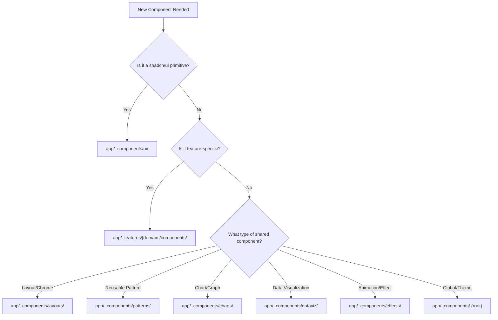

# 🧱 Component Architecture & Organization

**Context:** You are implementing UI components in a multi-tenant SaaS application.
**Goal:** Ensure consistent component placement and architecture patterns.

---

## 🎨 Design System Quick Reference

**Before building ANY component, read these docs:**

| Priority | Doc | Purpose |
|----------|-----|---------|
| 1 | `docs/guides/agent-component-guide.md` | **START HERE** - Decision trees, anti-patterns |
| 2 | `docs/guides/component-decision-matrix.md` | WHEN to use each component |
| 3 | `docs/guides/component-cookbook.md` | HOW to use with real examples |
| 4 | `docs/guides/page-templates.md` | Full page skeletons |
| 5 | `docs/guides/integration-patterns.md` | Server Actions, Suspense, forms |
| 6 | `brand-identity/product/ux-standards.md` | Linear Standard philosophy |

### Quick Rules

- **Headers:** Use `PageGreetingHeader` for list pages, `PageHeader` for detail/forms
- **Loading:** Use `Skeleton` (not `Spinner`) matching final layout
- **Empty states:** Always use `EmptyState` component
- **Colors:** Semantic only (`bg-primary`, not `bg-blue-500`)
- **Forms:** Server Actions + React Hook Form + Zod

---

## 1. 🗂️ Component Location Decision Tree

**Use this decision flow EVERY TIME you create a new component:**



---

## 2. 📂 Directory Responsibilities

### `app/_components/ui/` (shadcn/ui primitives)
**Purpose:** Base UI primitives from shadcn/ui
**Import Pattern:** `import { Button } from "@/app/_components/ui/button"`
**Examples:**
- `button.tsx`, `input.tsx`, `dialog.tsx`, `sheet.tsx`
- Form controls: `checkbox.tsx`, `radio-group.tsx`, `switch.tsx`
- Overlays: `tooltip.tsx`, `popover.tsx`, `modal.tsx`

**Rules:**
- ✅ Only shadcn/ui components
- ✅ No business logic
- ✅ Minimal customization
- ❌ Never add Salt-specific features here

### `app/_components/layouts/` (Application chrome)
**Purpose:** Layout containers and navigation chrome
**Import Pattern:** `import { DashboardLayout } from "@/app/_components/layouts"`
**Examples:**
- `DashboardLayout.tsx`, `BridgeLayout.tsx`, `PublicLayout.tsx`
- `Sidebar.tsx`, `TopNav.tsx`, `Footer.tsx`
- `PageHeader.tsx`, `Breadcrumbs.tsx`

### `app/_components/patterns/` (Reusable patterns)
**Purpose:** Business-agnostic reusable patterns
**Import Pattern:** `import { StatCard } from "@/app/_components/patterns"`
**Examples:**
- `StatCard.tsx`, `DataTable.tsx`, `EmptyState.tsx`
- `LoadingSpinner.tsx`, `ErrorBoundary.tsx`
- `SearchInput.tsx`, `FilterBar.tsx`

### `app/_components/charts/` (Chart components)
**Purpose:** Chart and graph components
**Import Pattern:** `import { BarChart } from "@/app/_components/charts"`
**Examples:**
- Recharts wrappers: `BarChart.tsx`, `LineChart.tsx`, `PieChart.tsx`
- Chart utilities and configurations

### `app/_components/dataviz/` (Data visualization)
**Purpose:** Complex data visualization components
**Import Pattern:** `import { DataGrid } from "@/app/_components/dataviz"`
**Examples:**
- `DataGrid.tsx`, `MetricsPanel.tsx`, `Dashboard.tsx`
- Advanced visualization components

### `app/_components/effects/` (Animations & effects)
**Purpose:** Animation and visual effect components
**Import Pattern:** `import { FadeIn } from "@/app/_components/effects"`
**Examples:**
- `FadeIn.tsx`, `SlideIn.tsx`, `Sparkles.tsx`
- Framer Motion wrappers

### `app/_components/` (Root - Global components)
**Purpose:** Global, theme, and provider components
**Examples:**
- `theme-provider.tsx`, `theme-toggle.tsx`
- `LayoutClient.tsx` (global layout wrapper)

### `app/_features/[domain]/components/` (Feature-specific)
**Purpose:** Components that belong to a specific business domain
**Import Pattern:** `import { ClientCard } from "@/app/_features/relationships/components"`
**Domains:**
- `auth/components/` - Login, signup, password reset
- `billing/components/` - Stripe checkout, billing history
- `clients/components/` - Client management UI
- `projects/components/` - Project management UI
- `studio/components/` - Studio settings and management
- `portal/components/` - Client portal (Bridge) specific UI
- `marketing/components/` - Landing page, pricing, testimonials

---

## 3. 🔗 Import Conventions

### Package vs. Local Imports
```typescript
// Use @repo/* for utility packages
import { cn } from "@repo/utils"
import { Button } from "@repo/ui"

// Use @/app/_components/* for local components
import { DashboardLayout } from "@/app/_components/layouts"
import { ClientCard } from "@/app/_features/relationships/components"

// Use @/app/_lib/* for infrastructure
import { createClient } from "@/app/_lib/supabase/server"
import { getTenantContext } from "@/app/_lib/tenancy"
```

### Re-export Patterns
```typescript
// app/_components/patterns/index.ts
export { StatCard } from "./StatCard"
export { DataTable } from "./DataTable"
export { EmptyState } from "./EmptyState"

// Usage
import { StatCard, DataTable } from "@/app/_components/patterns"
```

---

## 4. 🏗️ Component Architecture Standards

### Naming Conventions
```typescript
// ✅ PascalCase for component files
DashboardLayout.tsx
ClientCard.tsx
ProjectMemberList.tsx

// ✅ Use descriptive, domain-specific names
// NOT: Card.tsx (too generic)
// YES: ClientCard.tsx, ProjectCard.tsx

// ✅ Suffix with component type for clarity
ProjectCreateForm.tsx    // Form component
ClientListTable.tsx      // Table component
BillingSettingsPanel.tsx // Settings panel
```

### File Structure Pattern
```typescript
// For simple components
app/_features/clients/components/
├── ClientCard.tsx
└── ClientCard.test.tsx

// For complex components with sub-components
app/_features/projects/components/
├── ProjectTable/
│   ├── index.tsx          // Main component + exports
│   ├── ProjectTable.tsx   // Main table component
│   ├── ProjectRow.tsx     // Sub-component
│   ├── ProjectActions.tsx // Sub-component
│   └── ProjectTable.test.tsx
```

### Component Template
```typescript
import { cn } from "@repo/utils"
import { Button } from "@/app/_components/ui/button"

interface ComponentNameProps {
  // Props with JSDoc comments
  /** Brief description of the prop */
  variant?: "default" | "destructive"
  children: React.ReactNode
  className?: string
}

export function ComponentName({
  variant = "default",
  children,
  className
}: ComponentNameProps) {
  return (
    <div className={cn("base-styles", className)}>
      {children}
    </div>
  )
}
```

---

## 5. 🚨 Common Anti-Patterns (Avoid These)

### ❌ Wrong Component Placement
```typescript
// DON'T put feature-specific components in shared locations
app/_components/patterns/ClientCard.tsx  // ❌ Client-specific

// DO put them in feature directories
app/_features/clients/components/ClientCard.tsx  // ✅
```

### ❌ Overgeneralizing Components
```typescript
// DON'T create overly generic components that try to do everything
function GenericCard({ type, data, actions, ... }) // ❌ Too generic

// DO create specific components with clear purpose
function ClientCard({ client, onEdit, onDelete })  // ✅ Clear purpose
function ProjectCard({ project, onView, onArchive }) // ✅ Clear purpose
```

### ❌ Mixing Concerns
```typescript
// DON'T mix business logic with UI components
function ClientCard({ client }) {
  const [isDeleting, setIsDeleting] = useState(false)

  // ❌ Business logic in UI component
  const deleteClient = async () => {
    await supabase.from('clients').delete().eq('id', client.id)
  }

  return <div>...</div>
}

// DO separate business logic from UI
function ClientCard({ client, onDelete }) { // ✅ Pure UI component
  return <div>...</div>
}
```

---

## 6. 🧪 Testing Patterns

### Co-location Rule
```typescript
// ✅ Tests live next to components
app/_features/clients/components/
├── ClientCard.tsx
├── ClientCard.test.tsx      // Unit test
└── ClientList.tsx

e2e/tests/
└── clients.spec.ts          // E2E test (isolated)
```

### Test Naming
```typescript
// ClientCard.test.tsx
describe("ClientCard", () => {
  it("displays client name and email", () => {
    // Test implementation...
  })

  it("calls onEdit when edit button is clicked", () => {
    // Test implementation...
  })
})
```

---

## 7. 💡 Decision Examples

### Example 1: Creating a "Studio Settings Panel"
**Question:** Where does a studio settings configuration panel go?
**Answer:** `app/_features/studio/components/StudioSettingsPanel.tsx`
**Reasoning:** Studio-specific business logic, not reusable across domains

### Example 2: Creating a "Data Export Button"
**Question:** Where does a reusable data export button go?
**Answer:** `app/_components/patterns/DataExportButton.tsx`
**Reasoning:** Reusable pattern that could be used across multiple features

### Example 3: Creating a "Custom Date Picker"
**Question:** Where does a custom date picker with Salt branding go?
**Answer:** `app/_components/ui/date-picker.tsx`
**Reasoning:** It's a UI primitive enhancement, extends shadcn functionality

### Example 4: Creating a "Revenue Chart"
**Question:** Where does a specific revenue visualization go?
**Answer:** `app/_components/charts/RevenueChart.tsx`
**Reasoning:** Chart component with potential for reuse across different revenue contexts

---

## Why This Organization Maximizes Velocity

1. **Eliminates Decision Fatigue:** Clear decision tree prevents "where does this go?" delays
2. **Promotes Reusability:** Shared patterns are easy to find and reuse
3. **Enables Refactoring:** Clear boundaries make it safe to refactor within domains
4. **Supports Testing:** Co-location makes tests easy to find and maintain
5. **Scales with Team:** New developers can quickly understand the system