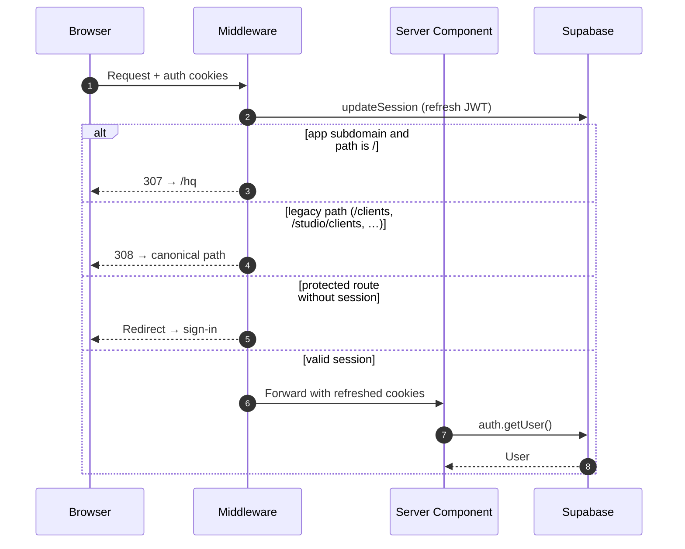

# Authentication & Authorization Architecture

> Read this file before modifying `middleware.ts`, login flows, or session logic.

---

## Current model (2026)

Salt uses **Supabase Auth** with **HTTP-only cookies** validated on every request.

| Surface | Host | Auth | Default entry |
|---------|------|------|---------------|
| **Salt app** | `app.usesalt.io` / `localhost:3000` | Supabase session | `/hq` |
| **Marketing** | `usesalt.io` | None | `/` |

**Legacy (compat only):** `bridge.*` and `table.*` subdomains redirect to `/roundtables`. `/studio`, `/dashboard`, `/clients`, `/relationships`, and `/work` paths redirect via `middleware.ts` — see [legacy-naming.md](./legacy-naming.md).

---

## Request flow



---

## Implementation map

| Concept | Location |
|---------|----------|
| Session refresh | `app/_lib/supabase/middleware.ts` |
| Edge middleware | `middleware.ts` |
| Server client | `app/_lib/supabase/server.ts` |
| Browser client | `app/_lib/supabase/client.ts` |
| Legacy redirects | `app/_features/shell/routes.ts` |
| Dev login (local) | `app/(sandbox)/dev-login/` |

---

## Hard constraints

1. **No localStorage for sessions** — cookies only.
2. **Middleware is Edge-safe** — no Node-only APIs in `middleware.ts`.
3. **Server-side verification** — use `supabase.auth.getUser()` in Server Components and Server Actions; client hooks are UI-only.
4. **Port 3000** — local auth redirects and E2E expect `localhost:3000`.

---

## Common tasks

### Get user in a Server Component

```typescript
import { createServerClient } from '@/app/_lib/supabase/server'

export async function MyPage() {
  const supabase = await createServerClient()
  const { data: { user } } = await supabase.auth.getUser()
  if (!user) redirect('/sign-in')
  // ...
}
```

### Protected routes

Route groups under `(hq)/` and `(studio)/` assume an authenticated studio user. Marketing routes under `(public)/` do not.

---

## Legacy auth notes

Historical docs described a separate **Bridge client portal** with token auth on `bridge.usesalt.io`. That product surface is retired; Roundtables is the canonical shared workspace. Archived portal code lives in `archive/client-portal-legacy-20260521/`.

Do not reintroduce Bridge/Table as parallel auth domains without an explicit product decision.
