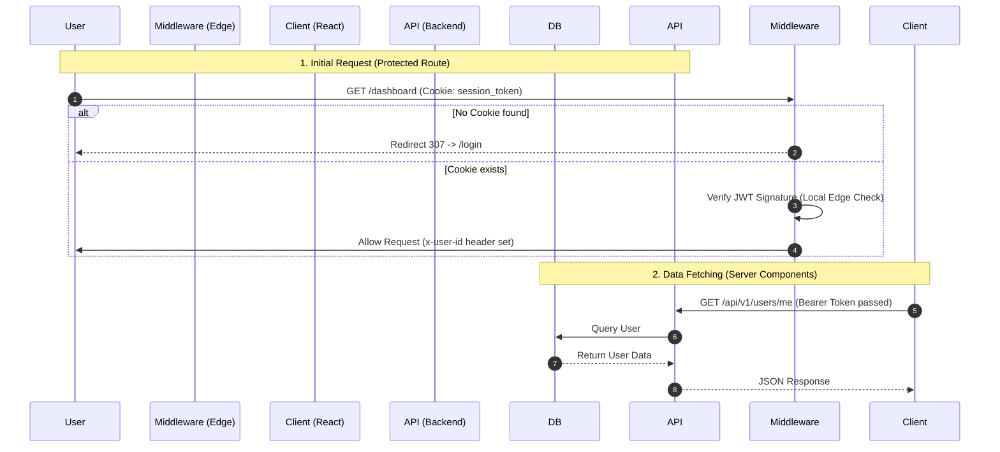
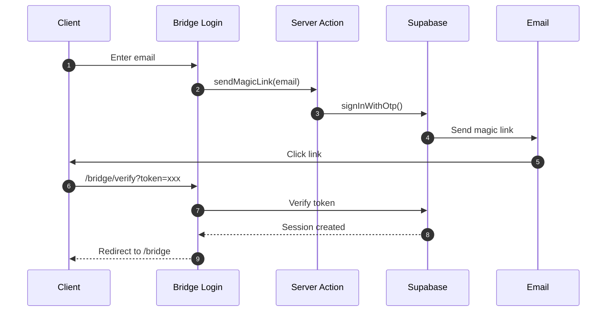

# 🔐 Authentication & Authorization Architecture

> **AI Instruction:** Read this ENTIRE file before modifying `middleware.ts`, login forms, or session logic. The authentication flow is strict and fragile. Do not guess.

---

## 1. System Overview

We use a **Stateless, Cookie-based Session** system.

- **Protocol:** HTTP-Only Secure Cookies (Not `localStorage`).
- **Validation:** Edge Middleware (`apps/frontend/src/middleware.ts`).
- **Source of Truth:** Server-side Supabase auth is the only authority on session validity. Server Components verify via `supabase.auth.getUser()`.

---

## 2. The Critical Path (Mermaid Diagram)

Use this diagram to understand the sequence of events during a user request.



---

## 3. 🚨 Hard Constraints (The "Kill List")

Violating these rules breaks the build or creates security holes.

1. **NO LocalStorage:** Never store session tokens in `localStorage` or `sessionStorage`. We rely strictly on `httpOnly` cookies.

2. **Edge Runtime Limits:** `middleware.ts` runs on the Edge. You CANNOT use:
   - Native Node.js modules (`fs`, `crypto`, `path`).
   - Heavy libraries (bcrypt, etc).
   - **Solution:** If you need complex logic, use Server Actions or API routes from Middleware.

3. **Strict Typing:** Do not manually type `User` or `Session` in components.
   - ❌ WRONG: `interface User { id: string... }`
   - ✅ RIGHT: `import type { User } from "@repo/shared-types";`

4. **No "Client-Side" Protection:** Never rely on `useAuth()` hook for security. It is UI-only (e.g., hiding a button). Real protection happens in Middleware and Server-side auth checks.

---

## 4. Implementation Map (Source of Truth)

If you need to edit Auth, go to these specific files. Do not hallucinate new paths.

| Concept | File Location | Responsibility |
|---------|---------------|----------------|
| Session Schema | `packages/shared-types/src/auth/session.schema.ts` | Zod definition of User/Session. |
| Edge Protection | `apps/frontend/src/middleware.ts` | Route guarding & redirects. |
| Login Page | `apps/frontend/src/app/(auth)/login/page.tsx` | UI for credentials entry. |
| Auth Hooks | `apps/frontend/src/hooks/use-auth.ts` | React Query wrapper for user state. |
| Auth Verify | `libs/supabase/server.ts` | Server-side auth verification via Supabase. |

---

## 5. Common Workflows

### How to get the Current User (RSC - Server Components)

Do not use hooks. Parse the headers injected by middleware.

```typescript
import { headers } from "next/headers";

export async function getUser() {
  const headerList = headers();
  const userId = headerList.get("x-user-id");
  if (!userId) return null;
  // Fetch full user details if needed...
}
```

### How to get the Current User (Client Components)

Use the shared hook which wraps TanStack Query.

```typescript
"use client";
import { useAuth } from "@/hooks/use-auth";

export function UserMenu() {
  const { user, isLoading } = useAuth();
  if (isLoading) return <Skeleton />;
  return <div>{user.email}</div>;
}
```

---

## 6. Bridge (Client Portal) Authentication

The Bridge client portal uses a **separate authentication flow** from the main Studio app.

### Key Differences

| Aspect | Studio (`/studio`) | Bridge (`/bridge`) |
|--------|-------------------|-------------------|
| **Auth Type** | Session-based (Supabase Auth) | Magic link tokens |
| **Route Group** | `(studio)` | `(client_portal)` |
| **User Type** | `studioMember` | `clientUser` |
| **Login Path** | `/signin` | `/bridge/login` |

### Bridge Auth Flow



### Implementation Files

| Concept | File Location |
|---------|---------------|
| Bridge Login Page | `app/(client_portal)/bridge/login/page.tsx` |
| Magic Link Action | `app/(client_portal)/bridge/login/actions.ts` |
| Token Verification | `app/(client_portal)/bridge/verify/page.tsx` |
| Client Picker | `app/(client_portal)/bridge/select/page.tsx` |
| Bridge Layout | `app/(client_portal)/bridge/layout.tsx` |

### Tenant Resolution

Bridge routes resolve tenant context via:
1. **Studio slug** in URL: `/bridge/[studioSlug]`
2. **Client membership** lookup in database
3. **Actor type** set to `clientUser` in middleware