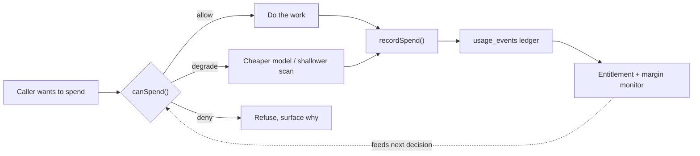

# Billing & Metering Architecture

> **Meter at the primitive, not at the feature.**
>
> Read this file before changing anything that spends vendor money, records usage, resolves entitlement, or touches tiers. This is the engineering source of truth. Business rationale lives in [pricing proposal](../reference/pricing-proposal-tiered-plays.md); customer-facing copy lives in [pricing tiers](../../brand-identity/product/pricing-tiers.md).

---

## Scope: two unrelated things are called "billing"

| Term | Means | Lives in |
|------|-------|----------|
| **Salt SaaS billing** | What *our customers* pay *us*. Subscriptions, tiers, the play meter, vendor COGS. | `app/_lib/usage/`, `app/_lib/stripe/`, **this document** |
| **Client billing** | Invoices *our customers* send *their* clients. A Memory record type. | `app/_features/billing/`, `billing_records` table |

They share a word and nothing else. `app/_features/billing/` is mostly the second kind. Do not put metering logic there.

---

## The core principle

Salt has two separate meters, and conflating them is the mistake that makes billing systems unfixable.

| | **Billing meter** | **Cost meter** |
|---|---|---|
| Counts | Plays with external effect | Every unit of vendor spend |
| Unit | 1 play | micro-USD |
| Audience | The customer's invoice | The margin monitor, internally |
| Drives | Revenue, bundles, overage | Alerts, degradation, the circuit breaker |
| Answer to | "What do I owe?" | "Is this workspace profitable?" |

A workspace can sit at 5% of its play bundle and still be the most expensive account we have, because Ask Salt chat and capture intelligence burn tokens without producing a single billable play. **A system that only counts plays cannot see that user.** That is the gap this architecture closes.

Both meters write to the same append-only ledger (`usage_events`), distinguished by `event_type`. One ledger, two views.

---

## Where money actually leaves

This is the complete inventory. Salt incurs variable vendor cost in exactly **seven** places. Everything else in the codebase is downstream of one of these.

| # | Exit point | Cost driver | Gated today? |
|---|-----------|-------------|--------------|
| 1 | `executeComposioAction` — `app/_lib/composio/actions.ts` | Composio action (~$0.002) | **Yes** — classification, trust ladder, approval, in-memory rate cap |
| 2 | `composio.tools.execute` — `app/_lib/composio/webhook-enrichment.ts` | Composio action | **No** — bypasses the single gate |
| 3 | `sendLlm` — `app/_lib/ai/gpt.ts` | LLM tokens (15 callers) | **No** — API-key check only |
| 4 | `streamText` — `app/api/ask-salt/chat/route.ts` | LLM tokens, up to 12 agent steps | **Partial** — step cap only, no budget |
| 5 | `streamText` — `app/_lib/composio/agent.ts` | LLM tokens | Step cap only |
| 6 | `openai.audio.speech.create` — `app/api/briefing/audio/route.ts` | TTS characters | Length cap only |
| 7 | `fetch(/embeddings)` — `app/_lib/ai/embeddings.ts` | Embedding tokens | **No** |

**Seven is the number that matters.** Instrument these and every current and future feature is covered automatically. Chase features instead and you will keep discovering holes, because features multiply and primitives do not.

### Why feature-level metering fails

The first pass at play metering hooked `executePlayRun`. That turned out to be one of *ten* places that mark a play `ran`, and the audit found that Ask Salt's standalone sends — real external emails, real COGS — were metering as free. Every one of those ten sites is a place a future contributor can forget.

The codebase already learned this lesson once, for safety rather than cost. From [`app/_lib/memory-tools/CLAUDE.md`](../../app/_lib/memory-tools/CLAUDE.md):

> **Protection lives in the tools, not the callers.**

Metering follows the same rule. Cost accounting lives at the spend primitive, not in the feature that happens to call it.

---

## The contract every spend surface follows

Two calls wrap every unit of vendor spend. There are no exceptions and no "this one is cheap" carve-outs — cheap things called in loops are how bills happen.



```typescript
// 1. Ask before spending. Never assume.
const decision = await canSpend({ workspaceId, kind: "llm_tokens", estimateMicros });
if (decision.outcome === "deny") return refuse(decision.reason);

const model = decision.outcome === "degrade" ? CHEAP_MODEL : NORMAL_MODEL;

// 2. Do the work.
const result = await doTheThing(model);

// 3. Record what it actually cost. Idempotent, never throws.
await recordSpend({ workspaceId, kind: "llm_tokens", actualMicros, idempotencyKey });
```

**Why both halves are required.** `canSpend` alone drifts from reality because estimates are wrong. `recordSpend` alone is what we have today: perfect hindsight and no brakes. The loop only closes when the recording feeds the next decision.

### Degrade before you deny

Denial is the last resort, not the first. A paying customer hitting a hard wall is a support ticket and a cancellation; a customer silently served by a cheaper model is neither. The ladder:

| Step | Behaviour | Customer sees |
|------|-----------|---------------|
| **Allow** | Normal path | Nothing |
| **Degrade** | Cheaper model class, shallower capture scan, smaller context | Nothing, or slightly plainer output |
| **Queue** | Defer non-urgent work to the next period | Slower background processing |
| **Deny** | Refuse and explain | A clear message naming the limit and the upgrade |

Only user-initiated, clearly-attributable actions should ever reach **deny**. Background work degrades or queues — never fail a cron in a way that makes Salt look broken.

#### Thresholds (decided 2026-08-05)

The trigger is **month-to-date COGS as a fraction of that workspace's subscription revenue**, evaluated per workspace. Not absolute dollars: a Max customer costing $30 is healthy, a Starter customer costing $30 is not.

| MTD COGS ÷ revenue | Action |
|---|---|
| < 30% | **Allow.** Normal path. Roughly a 70% gross margin, the SaaS floor worth defending. |
| 30–100% | **Degrade**, in this order: cheaper model class → shallower capture scans → queue non-urgent background work. |
| ≥ 100% | **Deny** newly-initiated billable work. The workspace now costs more than it pays. |

Degradation order is least-visible first, so margin is defended before experience is. Swapping model class is usually invisible; queueing is noticeable; denial is a support ticket.

Two guardrails on deny:

- **Never deny work already promised.** An approved play must complete. Refuse at admission, not mid-execution.
- **Overage opt-in outranks the deny threshold.** A customer who has explicitly accepted overage billing is paying for the excess, so revenue rises with COGS and the ratio is recomputed against the higher figure — they are not the runaway case this protects against.

Both numbers are policy, not physics. They belong in one named constant each, tunable without touching the ladder logic, and should be revisited once shadow metering produces real per-workspace COGS distributions.

---

## Data model

### `usage_events` — the ledger

Append-only. A trigger rejects `UPDATE` and `DELETE` **even from `service_role`**, so an application bug can only ever add rows. Corrections are reversal rows that point at what they cancel via `reverses_event_id`.

| Column | Purpose |
|--------|---------|
| `workspace_id` | Tenant. Always filter on it — service-role writes bypass RLS. |
| `event_type` | Which meter. `play_executed` bills; cost-only types do not. |
| `billable` | Whether this reaches an invoice. Derived, never hand-set. |
| `external_effect` | Whether a tool touched the outside world. The billable boundary. |
| `cost_estimate_micros` | COGS in micro-USD. **Not cents** — a Composio action is $0.002 and rounds to zero. |
| `cost_breakdown` | Itemized `{ai, composio, overhead, aiCalls, tools}` for G10 attribution. |
| `idempotency_key` | Uniqueness. Plays use `play_<runId>`. Retries land once. |
| `play_run_id` | Links to `play_runs` when applicable. |
| `reverses_event_id` / `reversal_reason` | Credits and corrections. |

### `workspace_subscriptions` — entitlement

Service-role writes only. `authenticated` gets **no** write grant.

**Entitlement is deliberately not on the `workspaces` table.** `workspaces` grants `UPDATE` to `authenticated`, and the owner policy has no `WITH CHECK`, so Postgres reuses `USING` as the check across every column. A tier column there would let any owner `PATCH /rest/v1/workspaces` themselves to Max with nothing but their session token.

Two more numbers are deliberately **not stored**:

- **`plays_included`** derives from `tier` and `pricing_version` via `app/_lib/usage/tiers.ts`. A number never persisted per-workspace cannot be tampered with. `plays_included_override` is service-role-only and exists for one-off deals, not for routine grandfathering.
- **`plays_used`** aggregates from the ledger on read. A mutable counter is both a tamper target and a drift source; deriving it makes Stripe reconciliation a two-way comparison instead of a three-way merge.

### `tool_classifications.external_effect`

The billable boundary. See [Tools Reference](./tools.md).

---

## Changing pricing

Pricing **will** change. The proposal holds the 25/100/300 bundles only until 60–90 days of shadow metering, then resets them to each segment's observed percentile and grandfathers the launch cohort. The system is built so that is a routine change rather than a migration.

### Why the catalog is versioned

A single mutable catalog cannot express "this customer was sold something different." Editing a bundle size in place re-prices every workspace on that tier at once:

- Raise it and you hand out capacity you never sold.
- Lower it and you quietly take capacity from someone paying for it.

Neither is recoverable afterwards, because nothing recorded the original promise. So `app/_lib/usage/pricing-versions.ts` holds a **frozen snapshot per version**, and `workspace_subscriptions.pricing_version` records which one each workspace bought. Entitlement resolves through that column, so **grandfathering is the default** — it happens by construction, not by a backfill someone has to remember.

`plays_included_override` still exists, but it is now the exception (enterprise and one-off deals), not the grandfathering mechanism. Overrides cover one number; a version covers price, bundle, and every limit together.

### The procedure

1. **Add a version** in `pricing-versions.ts`. Give it a dated id and a `note` explaining why it exists — someone will read it while debugging a customer's bill.
2. **Never edit or delete a shipped version.** Live rows point at it. A deleted version cannot be reconstructed, and `getPricingVersion()` will log an error and fall back to current, silently re-pricing whoever was on it. A test asserts shipped versions stay.
3. **Create the new Stripe prices** and add their ids to the env (`app/_lib/stripe/saas-price-ids.ts`). Stripe prices are immutable too — changing an amount always means a new price object. Keep the old ids configured so `resolveTierFromPriceId` still resolves existing subscriptions.
4. **Bump `CURRENT_PRICING_VERSION`.** New signups get it; every existing workspace keeps the version stamped on its row.
5. **Decide explicitly whether to migrate cohorts.** Doing nothing grandfathers everyone, which is the safe default. Migrating is one auditable statement:

```sql
update workspace_subscriptions
   set pricing_version = '2027-01'
 where pricing_version = '2026-08'
   and created_at > '2026-11-01';
```

6. **Update the customer-facing copy** in `brand-identity/product/pricing-tiers.md` and the published-numbers assertions in `tiers.test.ts`.

### Rules for callers

Anything resolving a **real workspace** must pass its version:

```ts
getTierCapacity(tier, subscription.pricing_version)
```

Omitting it prices that workspace at today's catalog — the exact bug versioning prevents. The default-to-current behaviour is for signup and marketing surfaces, where "current" is genuinely what is meant. `getWorkspaceEntitlement()` already threads it and returns `pricingVersion` so a support engineer can see which catalog produced a bill.

Sync **preserves** the stored version on upsert (`getStoredPricingVersions`). Without that, any replayed Stripe webhook would move a grandfathered workspace onto current pricing.

### What is not yet versioned

`app/_lib/usage/play-cost.ts` COGS constants are estimates of what vendors charge Salt, not what Salt charges customers. They should track reality and are correctly unversioned. If they ever feed an invoice, they must be versioned too.

---

## What is a billable play

A play is billable when **at least one tool it executed carries `external_effect: true`**. Billability is *derived*, never judged by the feature that ran the play.

| Situation | Billable |
|-----------|----------|
| Play sends an email, books a meeting, issues an invoice | **Yes** |
| Play only reads, classifies, or writes to Memory | No |
| Ask Salt sends one email with no surrounding play | **Yes** — a standalone external action is one play |
| Keeper applies a profile field | No |
| Play fails before any external effect | No |
| Play succeeds, user thumbs-down within 72h | Reversed (G4) |

The invariant: **every write of `state: 'ran'` has a matching ledger row.** Idempotency makes double-metering harmless, so when in doubt, meter.

---

## Current state — read this before you assume anything works

Honest status as of 2026-08-05. Most of the pricing system **observes**; almost none of it **enforces**.

| Capability | Built | Enforced |
|------------|:-----:|:--------:|
| Usage ledger, append-only, idempotent | Yes | n/a |
| Play metering across all 10 completion paths | Yes | n/a |
| `external_effect` billability | Yes | n/a |
| Per-play itemized COGS | Yes | n/a |
| Tier catalog and Stripe subscription sync | Yes | n/a |
| `getWorkspaceEntitlement()` / `playsRemaining` | Yes | **No caller anywhere** |
| `playsIncluded` bundle limit | Catalog only | **No** |
| `askSaltDailyLimit` | Catalog only | **No** |
| `captureBudgetMicros` | Catalog only | **No** |
| `storageQuotaBytes` | Catalog only | **No** |
| `MAX_TOOL_CALLS_PER_PLAY` | Constant only | **No** |
| LLM token spend per workspace | **Not recorded at all** | **No** |
| Legacy `ai_credits` | Table + UI | **No** — `deduct_ai_credits` is never called |
| Composio per-workspace rate cap | Yes | **Partial** — in-memory per instance, so serverless multiplies it |

**Consequence, stated plainly:** today a single workspace on the $29 Starter tier can run unlimited plays, hold unlimited Ask Salt conversations, and trigger unbounded capture scans. Nothing refuses, nothing degrades, and no overage is charged. The ledger will describe it accurately after the fact.

### Highest-risk unbounded paths

1. **Ask Salt chat** — no rate limit, no message cap, no token budget. Each message can fan out to 12 agent steps, each able to call Composio.
2. **Sync & Scan** — `run-intelligence-scan.ts` hardcodes `scanAll: true`, so one click classifies *every* capture in the lookback window with one LLM call each.
3. **Play approval** — no entitlement check before `executePlayRun`.
4. **Capture crons** — bounded per run (50 workspaces × 100 emails) but repeat every 30 minutes and scale with tenant count.
5. **Webhook enrichment** — bypasses the Composio gate entirely; volume is driven by the user's inbox.

---

## Playbooks: why they need no billing work

**Playbooks are roughly 10–30% complete.** The YAML v2 executor is never invoked in production, schedule triggers have no dispatcher, and signal-dispatched runs create queue cards that approve to a log-only path. (`resumePausedPlaybook` used to mark work as executed without executing it — fixed 2026-08-05; it now runs the approved tool through the gate and meters with the real slug.) See the [pricing implementation plan](../../.cursor/plans/2026-08-05-pricing-implementation.md).

Design billing **as if playbooks already work**, and do it by not thinking about playbooks at all.

A playbook cannot spend money on its own. To do anything billable it must call `executeComposioAction` or an LLM primitive — exits 1, 3, and 4 above. Meter those and playbooks are covered on the day they ship, with no playbook-specific billing code.

This is the practical payoff of the primitive-level rule. The alternative — a `meterPlaybookStep()` hook — would be a fourth feature-level integration to keep in sync, and the Ask Salt hole is the evidence for what happens next.

**Rule: never add billing logic to playbook YAML, the playbook executor, or a playbook definition.** Billability is a property of the tool, not of the workflow that called it.

---

## Hard constraints

Non-negotiable. Violations are billing correctness bugs, not style issues.

1. **Never spend without `canSpend` + `recordSpend`.** Adding an eighth exit point means wiring both. There is no "too small to meter".
2. **Never meter at the feature layer.** No `meterPlaybookStep`, no `meterAskSaltMessage`. Meter the primitive.
3. **Never store a tier, bundle size, or usage counter on `workspaces`.** It is directly writable by workspace owners through PostgREST.
4. **Never grant `authenticated` write on `usage_events` or `workspace_subscriptions`.** The bulk policy loop in `20260625193000` generates `workspace_members_manage_*` for workspace-scoped tables — both tables are deliberate exceptions.
5. **Never `UPDATE` or `DELETE` a usage event.** Write a reversal row.
6. **Always pass an idempotency key.** Retries, webhook replays, and backfills must land exactly once.
7. **Metering must never break execution.** Wrap it, log failures, let the work succeed. An unmetered play beats a failed customer action; the ledger can be backfilled.
8. **Costs in micro-USD, prices in cents.** Never mix. Never use floats for money.
9. **Service-role writes must filter `workspace_id` explicitly.** RLS is bypassed; the tenant boundary is yours to enforce.
10. **Billability derives from `external_effect`.** Never hand-set `billable`.
11. **Never edit or delete a shipped pricing version.** Add a new one. Editing in place re-prices every existing customer on that tier, silently and irreversibly.
12. **Resolve capacity through the workspace's `pricing_version`.** `getTierCapacity(tier)` without a version means "today's catalog" and is only correct on signup and marketing paths.

---

## Adding a new spend surface

Checklist for any change that calls a paid vendor API:

- [ ] Route through an existing primitive if one fits. Prefer this to a new exit point.
- [ ] If it must be new, add it to the exit-point table above.
- [ ] Call `canSpend` before, honouring `degrade` — not just `deny`.
- [ ] Call `recordSpend` after, with a stable idempotency key and real cost.
- [ ] Pick or add an `event_type`. Set `billable` only via `external_effect`.
- [ ] Ask: can one user trigger this in a loop? If yes, it needs its own rate bound, DB-backed rather than in-memory.
- [ ] Ask: does a cron run this per workspace? If yes, it needs a fleet-wide ceiling.
- [ ] Add a unit test that fails if the metering is removed.

---

## Code map

| Path | Role |
|------|------|
| `app/_lib/usage/ledger.ts` | `recordUsageEvent`, `reverseUsageEvent`, `countBillablePlays` |
| `app/_lib/usage/tiers.ts` | `TIER_CATALOG` — capacities and prices. Server-side truth. |
| `app/_lib/usage/entitlements.ts` | `getWorkspaceEntitlement` — currently has no callers |
| `app/_lib/usage/play-cost.ts` | COGS estimation in micro-USD, floor-breach thresholds |
| `app/_lib/usage/record-play-usage.ts` | Play metering entry; derives billability |
| `app/_features/plays/services/meter-play.ts` | `meterInternalPlay` for non-executor completions |
| `app/_lib/composio/external-effect.ts` | Resolves `external_effect` for a tool slug |
| `app/_lib/stripe/subscription-sync.ts` | Stripe → `workspace_subscriptions` |
| `app/api/webhook/stripe/route.ts` | Subscription lifecycle webhooks |

---

## Related

- [Tools Reference](./tools.md) — tool contracts and `external_effect`
- [Primitives Overview](./primitives.md) — Signals, Tools, Playbooks
- [Pricing proposal](../reference/pricing-proposal-tiered-plays.md) — business rationale, guardrails G1–G11
- [Cost analysis](../reference/cost-analysis.md) — unit economics
- [Scaling cost risks](../reference/scaling-cost-risks.md) — vendor scaling traps
- [Stripe integration](../guides/stripe-integration.md) — checkout and webhook mechanics
- [Pricing tiers](../../brand-identity/product/pricing-tiers.md) — customer-facing copy
