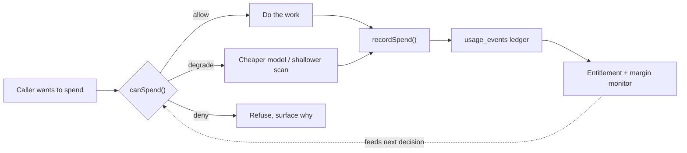

# Billing & Metering Architecture

> **Meter at the primitive, not at the feature.**
>
> Read this file before changing anything that spends vendor money, records usage, resolves entitlement, or touches tiers. This is the engineering source of truth. Business rationale lives in [pricing proposal](../reference/pricing-proposal-tiered-plays.md); customer-facing copy lives in [pricing tiers](../../brand-identity/product/pricing-tiers.md).

---

## Scope: two unrelated things are called "billing"

| Term | Means | Lives in |
|------|-------|----------|
| **Salt SaaS billing** | What *our customers* pay *us*. Subscriptions, tiers, the play meter, vendor COGS. | `app/_lib/usage/`, `app/_lib/stripe/`, **this document** |
| **Client billing** | Invoices *our customers* send *their* clients. A Memory record type. | `app/_features/billing/`, `billing_records` table |

They share a word and nothing else. `app/_features/billing/` is mostly the second kind. Do not put metering logic there.

---

## The core principle

Salt has two separate meters, and conflating them is the mistake that makes billing systems unfixable.

| | **Billing meter** | **Cost meter** |
|---|---|---|
| Counts | Plays with external effect | Every unit of vendor spend |
| Unit | 1 play | micro-USD |
| Audience | The customer's invoice | The margin monitor, internally |
| Drives | Revenue, bundles, overage | Alerts, degradation, the circuit breaker |
| Answer to | "What do I owe?" | "Is this workspace profitable?" |

A workspace can sit at 5% of its play bundle and still be the most expensive account we have, because Ask Salt chat and capture intelligence burn tokens without producing a single billable play. **A system that only counts plays cannot see that user.** That is the gap this architecture closes.

Both meters write to the same append-only ledger (`usage_events`), distinguished by `event_type`. One ledger, two views.

---

## Where money actually leaves

This is the complete inventory. Salt incurs variable vendor cost in exactly **seven** places. Everything else in the codebase is downstream of one of these.

| # | Exit point | Cost driver | Gated today? |
|---|-----------|-------------|--------------|
| 1 | `executeComposioAction` — `app/_lib/composio/actions.ts` | Composio action (~$0.002) | **Yes** — classification, trust ladder, approval, rate cap, `canSpend` |
| 2 | `composio.tools.execute` — `app/_lib/composio/webhook-enrichment.ts` | Composio action | **No** — bypasses the single gate |
| 3 | `sendLlm` — `app/_lib/ai/gpt.ts` | LLM tokens (14 call sites) | **Yes** — `canSpend`, degrades to the cheap model class |
| 4 | `streamText` — `app/api/ask-salt/chat/route.ts` | LLM tokens, up to 12 agent steps | **Yes** — fair use + `canSpend`, degrades to 5 steps |
| 5 | `streamText` — `app/_lib/composio/agent.ts` | LLM tokens | Step cap only |
| 6 | `openai.audio.speech.create` — `app/api/briefing/audio/route.ts` | TTS characters | **Yes** — length cap + `canSpend` |
| 7 | `fetch(/embeddings)` — `app/_lib/ai/embeddings.ts` | Embedding tokens | **No** — see below |

Exit 7 is deliberately left ungated. `EmbeddingFn` is `(text: string) => Promise<number[]>`, threaded through the semantic matcher with no workspace anywhere in the chain, and its dominant use is the canonical field index — schema field names, identical for every tenant, computed once per process, which is platform spend rather than a workspace's. At `text-embedding-3-small` rates ($0.02 per million tokens) it is also the cheapest exit by two orders of magnitude. Threading a workspace through the matcher to gate it would be the largest refactor on this list for the smallest saving. Revisit if per-record embedding volume grows; the per-record path already degrades without a `spend` context via `FourTierMatchContext`.

**Seven is the number that matters.** Instrument these and every current and future feature is covered automatically. Chase features instead and you will keep discovering holes, because features multiply and primitives do not.

### Why feature-level metering fails

The first pass at play metering hooked `executePlayRun`. That turned out to be one of *ten* places that mark a play `ran`, and the audit found that Ask Salt's standalone sends — real external emails, real COGS — were metering as free. Every one of those ten sites is a place a future contributor can forget.

The codebase already learned this lesson once, for safety rather than cost. From [`app/_lib/memory-tools/CLAUDE.md`](../../app/_lib/memory-tools/CLAUDE.md):

> **Protection lives in the tools, not the callers.**

Metering follows the same rule. Cost accounting lives at the spend primitive, not in the feature that happens to call it.

---

## The contract every spend surface follows

Two calls wrap every unit of vendor spend. There are no exceptions and no "this one is cheap" carve-outs — cheap things called in loops are how bills happen.



```typescript
// 1. Ask before spending. Never assume.
const decision = await canSpend({ workspaceId, kind: "llm_tokens", estimateMicros });
if (decision.outcome === "deny") return refuse(decision.reason);

const model = decision.outcome === "degrade" ? CHEAP_MODEL : NORMAL_MODEL;

// 2. Do the work.
const result = await doTheThing(model);

// 3. Record what it actually cost. Idempotent, never throws.
await recordSpend({ workspaceId, kind: "llm_tokens", actualMicros, idempotencyKey });
```

**Why both halves are required.** `canSpend` alone drifts from reality because estimates are wrong. `recordSpend` alone is what we have today: perfect hindsight and no brakes. The loop only closes when the recording feeds the next decision.

### Degrade before you deny

Denial is the last resort, not the first. A paying customer hitting a hard wall is a support ticket and a cancellation; a customer silently served by a cheaper model is neither. The ladder:

| Step | Behaviour | Customer sees |
|------|-----------|---------------|
| **Allow** | Normal path | Nothing |
| **Degrade** | Cheaper model class, shallower capture scan, smaller context | Nothing, or slightly plainer output |
| **Queue** | Defer non-urgent work to the next period | Slower background processing |
| **Deny** | Refuse and explain | A clear message naming the limit and the upgrade |

Only user-initiated, clearly-attributable actions should ever reach **deny**. Background work degrades or queues — never fail a cron in a way that makes Salt look broken.

#### Thresholds (decided 2026-08-05)

The trigger is **month-to-date COGS as a fraction of that workspace's subscription revenue**, evaluated per workspace. Not absolute dollars: a Max customer costing $30 is healthy, a Starter customer costing $30 is not.

| MTD COGS ÷ revenue | Action |
|---|---|
| < 30% | **Allow.** Normal path. Roughly a 70% gross margin, the SaaS floor worth defending. |
| 30–100% | **Degrade**, in this order: cheaper model class → shallower capture scans → queue non-urgent background work. |
| ≥ 100% | **Deny** newly-initiated billable work. The workspace now costs more than it pays. |

Degradation order is least-visible first, so margin is defended before experience is. Swapping model class is usually invisible; queueing is noticeable; denial is a support ticket.

Two guardrails on deny:

- **Never deny work already promised.** An approved play must complete. Refuse at admission, not mid-execution.
- **Overage opt-in outranks the deny threshold.** A customer who has explicitly accepted overage billing is paying for the excess, so revenue rises with COGS and the ratio is recomputed against the higher figure — they are not the runaway case this protects against.

Both numbers are policy, not physics. They belong in one named constant each, tunable without touching the ladder logic, and should be revisited once shadow metering produces real per-workspace COGS distributions.

---

## Data model

### `usage_events` — the ledger

Append-only. A trigger rejects `UPDATE` and `DELETE` **even from `service_role`**, so an application bug can only ever add rows. Corrections are reversal rows that point at what they cancel via `reverses_event_id`.

| Column | Purpose |
|--------|---------|
| `workspace_id` | Tenant. Always filter on it — service-role writes bypass RLS. |
| `event_type` | Which meter. `play_executed` bills; cost-only types do not. |
| `billable` | Whether this reaches an invoice. Derived, never hand-set. |
| `external_effect` | Whether a tool touched the outside world. The billable boundary. |
| `cost_estimate_micros` | COGS in micro-USD. **Not cents** — a Composio action is $0.002 and rounds to zero. |
| `cost_breakdown` | Itemized `{ai, composio, overhead, aiCalls, tools}` for G10 attribution. |
| `idempotency_key` | Uniqueness. Plays use `play_<runId>`. Retries land once. |
| `play_run_id` | Links to `play_runs` when applicable. |
| `reverses_event_id` / `reversal_reason` | Credits and corrections. |

### `workspace_subscriptions` — entitlement

Service-role writes only. `authenticated` gets **no** write grant.

**Entitlement is deliberately not on the `workspaces` table.** `workspaces` grants `UPDATE` to `authenticated`, and the owner policy has no `WITH CHECK`, so Postgres reuses `USING` as the check across every column. A tier column there would let any owner `PATCH /rest/v1/workspaces` themselves to Max with nothing but their session token.

Two more numbers are deliberately **not stored**:

- **`plays_included`** derives from `tier` and `pricing_version` via `app/_lib/usage/tiers.ts`. A number never persisted per-workspace cannot be tampered with. `plays_included_override` is service-role-only and exists for one-off deals, not for routine grandfathering.
- **`plays_used`** aggregates from the ledger on read. A mutable counter is both a tamper target and a drift source; deriving it makes Stripe reconciliation a two-way comparison instead of a three-way merge.

### `tool_classifications.external_effect`

The billable boundary. See [Tools Reference](./tools.md).

---

## Changing pricing

Pricing **will** change. The proposal holds the 25/100/300 bundles only until 60–90 days of shadow metering, then resets them to each segment's observed percentile and grandfathers the launch cohort. The system is built so that is a routine change rather than a migration.

### Why the catalog is versioned

A single mutable catalog cannot express "this customer was sold something different." Editing a bundle size in place re-prices every workspace on that tier at once:

- Raise it and you hand out capacity you never sold.
- Lower it and you quietly take capacity from someone paying for it.

Neither is recoverable afterwards, because nothing recorded the original promise. So `app/_lib/usage/pricing-versions.ts` holds a **frozen snapshot per version**, and `workspace_subscriptions.pricing_version` records which one each workspace bought. Entitlement resolves through that column, so **grandfathering is the default** — it happens by construction, not by a backfill someone has to remember.

`plays_included_override` still exists, but it is now the exception (enterprise and one-off deals), not the grandfathering mechanism. Overrides cover one number; a version covers price, bundle, and every limit together.

### Stripe setup

Products and prices are created by `scripts/stripe-bootstrap-prices.py`, which is idempotent — it looks prices up by `lookup_key` before creating, so re-running returns existing ids.

```bash
# test mode (uses the test-mode key from 1Password)
op run --env-file=.env.1password -- python3 scripts/stripe-bootstrap-prices.py

# live mode — required before the first real customer
op run --env-file=.env.1password -- python3 scripts/stripe-bootstrap-prices.py --live
```

Lookup keys carry the pricing version (`pro_monthly_2026-08`), so a future version's prices sit alongside the old ones rather than replacing them. Stripe prices are immutable — changing an amount always creates a new price object — which is the same constraint the versioned catalog has, and the reason the two stay in step.

The ids then need to land in three places:

| Where | Values | Notes |
|---|---|---|
| 1Password, `stripe` item | `pricing` section = test ids, `pricing-live` = live ids | Vault `salt-software-development`. Local dev reads the `pricing` section via `.env.1password`. |
| Vercel Preview (`staging` branch) | **test-mode** ids | Pairs with the test-mode `STRIPE_SECRET_KEY` already scoped to that branch. |
| Vercel Production | **live-mode** ids | Pairs with the live key. |

Test and live ids must be **separate Vercel records**. A single record targeting both environments cannot hold both values, and a test price id is rejected outright by a live key. The original six were one record spanning Preview and Production, so they could never have been correct.

Verify with:

```bash
op run --env-file=.env.1password -- pnpm exec vitest run saas-price-wiring
```

That test checks both directions — checkout resolution *and* the reverse `price id -> tier` lookup the upgrade webhook depends on. It skips silently when `STRIPE_PRICE_*` is absent, so plain `pnpm test` stays green.

#### Two Vercel CLI traps

Create these through the REST API with `"type": "encrypted"`, not `vercel env add`:

1. **The CLI creates variables as `type: sensitive`**, which is write-only. Neither `vercel env pull` nor even `GET /v10/projects/{id}/env?decrypt=true` will return the value, so a typo is undetectable — you cannot audit what you deployed. `encrypted` is the right type here: price ids are not secrets (they are visible client-side at checkout), and being able to read them back is what makes the wiring verifiable.
2. **`vercel env add NAME preview --value X --yes` loops on its own hint**, re-printing `git_branch_required` forever. The branch must be positional: `vercel env add NAME preview staging --yes`.

Reading back with `decrypt=true` after writing is the only reliable confirmation:

```bash
vercel env pull /tmp/p.env --environment=production --yes && rg '^STRIPE_PRICE' /tmp/p.env; rm -f /tmp/p.env
```

Delete that file immediately — it contains every production secret, including the live Stripe key.

### The procedure

1. **Add a version** in `pricing-versions.ts`. Give it a dated id and a `note` explaining why it exists — someone will read it while debugging a customer's bill.
2. **Never edit or delete a shipped version.** Live rows point at it. A deleted version cannot be reconstructed, and `getPricingVersion()` will log an error and fall back to current, silently re-pricing whoever was on it. A test asserts shipped versions stay.
3. **Create the new Stripe prices** and add their ids to the env (`app/_lib/stripe/saas-price-ids.ts`). Stripe prices are immutable too — changing an amount always means a new price object. Keep the old ids configured so `resolveTierFromPriceId` still resolves existing subscriptions.
4. **Bump `CURRENT_PRICING_VERSION`.** New signups get it; every existing workspace keeps the version stamped on its row.
5. **Decide explicitly whether to migrate cohorts.** Doing nothing grandfathers everyone, which is the safe default. Migrating is one auditable statement:

```sql
update workspace_subscriptions
   set pricing_version = '2027-01'
 where pricing_version = '2026-08'
   and created_at > '2026-11-01';
```

6. **Update the customer-facing copy** in `brand-identity/product/pricing-tiers.md` and the published-numbers assertions in `tiers.test.ts`.

### Rules for callers

Anything resolving a **real workspace** must pass its version:

```ts
getTierCapacity(tier, subscription.pricing_version)
```

Omitting it prices that workspace at today's catalog — the exact bug versioning prevents. The default-to-current behaviour is for signup and marketing surfaces, where "current" is genuinely what is meant. `getWorkspaceEntitlement()` already threads it and returns `pricingVersion` so a support engineer can see which catalog produced a bill.

Sync **preserves** the stored version on upsert (`getStoredPricingVersions`). Without that, any replayed Stripe webhook would move a grandfathered workspace onto current pricing.

### What is not yet versioned

`app/_lib/usage/play-cost.ts` COGS constants are estimates of what vendors charge Salt, not what Salt charges customers. They should track reality and are correctly unversioned. If they ever feed an invoice, they must be versioned too.

---

## What is a billable play

A play is billable when **at least one tool it executed carries `external_effect: true`**. Billability is *derived*, never judged by the feature that ran the play.

| Situation | Billable |
|-----------|----------|
| Play sends an email, books a meeting, issues an invoice | **Yes** |
| Play only reads, classifies, or writes to Memory | No |
| Ask Salt sends one email with no surrounding play | **Yes** — a standalone external action is one play |
| Keeper applies a profile field | No |
| Play fails before any external effect | No |
| Play succeeds, user thumbs-down within 72h | Reversed (G4) |

The invariant: **every write of `state: 'ran'` has a matching ledger row.** Idempotency makes double-metering harmless, so when in doubt, meter.

---

## Current state — read this before you assume anything works

Honest status as of 2026-08-06. Vendor spend is gated on a per-workspace budget, and the **play bundle** is gated at admission.

| Capability | Built | Enforced |
|------------|:-----:|:--------:|
| Usage ledger, append-only, idempotent | Yes | n/a |
| Play metering across all 10 completion paths | Yes | n/a |
| `external_effect` billability | Yes | n/a |
| Per-play itemized COGS | Yes | n/a |
| Tier catalog and Stripe subscription sync | Yes | n/a |
| `getWorkspaceEntitlement()` / `playsRemaining` | Yes | **Yes** — read by `canSpend` and play admission |
| `canSpend()` COGS-to-revenue circuit breaker | Yes | **Yes** — exits 1, 3, 4, 6 |
| `playsIncluded` bundle limit | Yes | **Yes** — `checkPlayAdmission` gates `executePlayRun` |
| `askSaltDailyLimit` | Yes | **Yes** — ledger-backed |
| `captureBudgetMicros` | Yes | **Yes** — via the manual scan cap |
| `storageQuotaBytes` | Catalog only | **No** |
| `MAX_TOOL_CALLS_PER_PLAY` | Constant only | **No** |
| LLM token spend — Ask Salt | Yes | Fair use + budget |
| LLM token spend — `sendLlm` (14 call sites) | Yes | **Yes** |
| Embedding spend | No | **No** — deliberate, see exit 7 |
| Legacy `ai_credits` | Table + UI | **No** — `deduct_ai_credits` is never called |
| Composio per-workspace rate cap | Yes | **Partial** — in-memory per instance, so serverless multiplies it |

**Consequence, stated plainly:** a workspace on the $29 Starter tier can no longer burn unbounded vendor money — cost is capped at roughly what it pays — and can no longer run unlimited *plays* either: `checkPlayAdmission` refuses a billable play at admission once the bundle is exhausted, unless overage is enabled. Both the margin leak and the revenue leak are closed for the executor path. Ask Salt standalone actions (the second metering point, `createPlayRecord`) are still ungated — they bill correctly but nothing refuses them at zero remaining; that belongs to the overage UI phase.

### Play-bundle admission (shipped 2026-08-06)

The revenue-side gate, and the inverse twin of `canSpend`: cost admission asks "can we afford to serve this workspace", bundle admission asks "has this workspace used what it bought".

| Piece | Where |
|-------|-------|
| Admission check | [`app/_lib/usage/play-admission.ts`](../../app/_lib/usage/play-admission.ts) |
| Gate placement | `executePlayRun` — after consent, before any step executes |
| Production binding | `app/_features/plays/services/run-play-deps.ts` |

Four properties:

1. **Only plays that could bill are gated.** The candidate is built from the compiled definition: concrete act-step slugs (Salt-internal `memory_*` slugs excluded) plus a flag for external capability act steps, whose concrete tool resolves at runtime. A play with no acting steps, or whose act tools are all internal (mailbox housekeeping), is allowed without an entitlement read — it can never consume the bundle.
2. **Blocked, not failed.** A refused run finalizes to `state: "blocked"` with an upgrade/overage message and stays re-approvable. It is deliberately *not* `failed`: nothing about the playbook is wrong, and the learning loop must not receive failure evidence for a billing decision. `"blocked"` is now a first-class `PlayRunState` (`blocked → approved | dismissed`), which also repaired re-approval for toolkit- and pacing-blocked runs — previously the executor wrote a state no claim filter accepted.
3. **Overage opt-in is the escape hatch.** `overageEnabled` workspaces pass the gate with an exhausted bundle; the play meters as billable and accrues overage against the G5 cap, which `resolveRevenueMicros` already counts as revenue for the cost gate.
4. **Fails open.** An entitlement-read error allows the play, matching `canSpend` and constraint 7. The execution is still metered on the way out, so a waved-through play leaves a ledger row for the G1 reconciliation sweep.

### The ledger was unwritable for a day (fixed 2026-08-06)

Worth reading before writing another billing migration, because everything looked healthy while it was broken.

`usage_events` and `workspace_subscriptions` granted `service_role` nothing — not even SELECT — from the moment they shipped on 2026-08-05. `service_role` is the only writer of both, so every `recordUsageEvent` returned `permission denied for table usage_events` (SQLSTATE 42501). Play metering, Ask Salt fair use, and LLM cost tracking all wrote into a void.

Three things conspired to hide it:

1. **The ledger is deliberately non-fatal.** Metering must never break the feature it observes, so each failure logged and the request carried on. That is still the right design; it just means silence is not evidence.
2. **Unit tests mock the database.** 2242 of them passed against a ledger that could not accept a row. No amount of unit testing could have caught this.
3. **The creating migration said so in a comment.** It read "service_role bypasses RLS entirely and is the only writer" — true, and irrelevant. `service_role` has BYPASSRLS, so no *policy* can stop it, but a missing GRANT stops it before any policy is consulted. Bypassing RLS is not the same as holding table privileges.

The trigger was writing an explicit grant block naming only `authenticated` and `anon`. Taking manual control of privileges on a table opts it out of inherited defaults, and the block omitted the one role that mattered. **When a migration writes its own GRANT/REVOKE block, it must name every role that touches the table, `service_role` included.**

Fixed by `20260806130000_billing_service_role_grants.sql`. `usage_events` gets SELECT + INSERT only — UPDATE and DELETE stay withheld even from the sole writer, so an application bug cannot attempt to rewrite billing history that the immutability trigger would reject anyway.

Verify with `scripts/verify-billing-ledger-writable.mjs`, which probes with a deliberately invalid workspace id so the foreign key rejects every row: a permission error means grants are wrong, a foreign-key error means the write path is healthy. Run it after any migration touching grants on billing tables.

### Ask Salt admission (shipped 2026-08-06)

The first real enforcement in the system, and the template for the rest.

| Piece | Where |
|-------|-------|
| Token → micro-USD pricing | [`app/_lib/usage/llm-cost.ts`](../../app/_lib/usage/llm-cost.ts) |
| Admission + recording | [`app/_lib/usage/ask-salt-usage.ts`](../../app/_lib/usage/ask-salt-usage.ts) |
| Wiring | [`app/api/ask-salt/chat/route.ts`](../../app/api/ask-salt/chat/route.ts) |

Four decisions worth not relitigating:

1. **The limit reads from the ledger, not from `app/_lib/rate-limit`.** That module keeps buckets in module memory, which on serverless is one bucket per warm instance and a fresh allowance on every cold start — fine for burst protection, useless as a spend ceiling. The ledger is shared and durable.
2. **The window is rolling 24h, not a calendar day**, so a midnight reset cannot be used to burst. `resetAt` is the oldest counted query plus 24h, so the 429 can state when the *first* slot opens rather than implying a full day's wait.
3. **The ceiling is `askSaltDailyLimit × connectedSeatsIncluded`**, pooled at the workspace exactly as plays are. Seat identity is not tracked until G6, and pooling is the reading that cannot wrongly block a solo operator.
4. **Events are recorded `billable: false`.** Ask Salt is included at every tier and must never consume a play bundle. It carries COGS into the margin report and counts against fair use, and neither of those is the invoice.

The metering callback lives on `streamText`, **not** on `createUIMessageStream`. Only the former carries token usage, and its `totalUsage` aggregates every step of the turn — which matters because `stopWhen: stepCountIs(12)` means one user message can be twelve model round-trips. It is awaited rather than fired and forgotten, because a floating promise can be cut off when the serverless instance freezes after the response, dropping the record for precisely the most expensive turns.

Unknown models price at the **most expensive** known rate, not an average. Under-pricing an unrecognised model hides real spend, which is the failure this subsystem exists to prevent; over-pricing is visible and self-corrects. There is a test pinning this direction.

### `sendLlm` metering (shipped 2026-08-06)

`sendLlm` now takes an `LlmSpendContext` in place of the old `userId` and records token spend itself, so every one of its 14 call sites is metered and any new one is metered on the day it is written. Recording lives *inside* the primitive for the same reason play metering does: hooking the feature layer is what produced nine missed paths and a year of Ask Salt sends billing as free.

```ts
sendLlm(messages, workspaceSpend(workspace.id, userId), { routingKey: "insights" })
sendLlm(messages, platformSpend("catalog-sync-cron", "shared tool catalog"), { … })
```

Events are `llm_call`, always `billable: false` — token spend is the cost *underneath* an outcome, never the outcome itself. Customers are billed per play. This is the highest-cardinality type in the ledger (one row per model call), which is why the `billable = true` partial index deliberately excludes it and why `idx_usage_events_type_period` exists for the complementary read.

Two guarantees worth keeping:

- **Metering has its own `try`/`catch` inside `sendLlm`.** Without it, a throw would be caught by the function's outer handler and turn a perfectly good answer into `null`. The ledger observes the call; it does not get a vote in whether the call succeeded. There is a test pinning this.
- **The fallback retry meters separately, and the failed attempt does not meter at all.** The retry is a second real request that costs real money; the failure carries no `usage` block, so any figure for it would be invented.

**Why the workspace is threaded explicitly.** The two cheaper-looking options are both wrong here, and the reasons are specific enough to be worth recording so they are not revisited:

| Option | Why it fails |
|--------|--------------|
| Look the workspace up from `userId` | `workspace_members` is one-to-many. Every resolver today takes the earliest membership (`.order("created_at").limit(1)`), with a comment in `app/_lib/tenancy/context.ts` conceding this holds only "until workspace switching is fully wired." Spend would bill to whichever workspace the user joined first, and get *more* wrong once switching ships. Several call sites also pass synthetic actors — `"play-executor"`, `"catalog-sync-cron"` — where no user row exists at all. |
| `AsyncLocalStorage` request context | Six of the 14 sites run with no request: two crons, a post-OAuth background job, the play executor, a platform-admin action, and a background narrative recompute. Several are fire-and-forget (`void captureVoiceCorrection(...)`, `void runFirstScanForWorkspace(...)`), the exact context-loss case Next.js warns about. Decisively, `capture-intelligence-cron.ts` loops over **multiple workspaces in one invocation** — a request-scoped store holds one value and cannot express that. |

So `LlmSpendContext` is a union, and "this spend has no workspace" is a stated case (`platformSpend(actor, reason)`) rather than an omission. There is no default: forgetting is a build error, not a plausible wrong bill. Platform spend — tool classification, admin catalog work — is not charged to any tenant, because billing one workspace for shared infrastructure would be worse than billing nobody.

Changing the signature turned the migration into a compiler worklist, which is the argument for doing it this way: `tsc` named all 14 sites, and propagating the type through three helpers that took `userId` (`extractFieldsWithLlm`, `extractLineItemsFromDocument`, `generateRecordNarrative`) surfaced their callers too. Nothing had to be found by grep.

Two live bugs were fixed along the way, both previously invisible: `first-scan.ts` passed a `workspaceId` into the `userId` argument (sending a workspace id to the provider as a user identifier), and `run-play-deps.ts` passed the literal `"play-executor"` for every workspace on the platform.

`FourTierMatchContext.spend` is optional, and its absence is what disables the LLM tier — an unattributable caller degrades to the cheaper tiers rather than spending anonymously.

### `canSpend()` (shipped 2026-08-06)

The circuit breaker described above, now real. [`app/_lib/usage/can-spend.ts`](../../app/_lib/usage/can-spend.ts) decides; [`app/_lib/usage/cogs.ts`](../../app/_lib/usage/cogs.ts) supplies the number it decides on.

**The ladder is origin-aware, and that is the part worth understanding.** `resolveOutcome(ratio, origin)` is a pure function over three origins:

| Origin | Below 30% | 30–100% | At or above 100% |
|---|---|---|---|
| `user` | allow | degrade | **deny** |
| `background` | allow | degrade | **queue** |
| `committed` | allow | degrade | **degrade** |

`committed` is how the guardrail "never deny work already promised" is encoded rather than merely documented. An approved play that has started must finish: refusing halfway leaves side effects applied, no output, and nothing to explain. Admission is the place to say no. `backgroundSpend()` and `committedSpend()` exist so a call site declares which it is at the point of call.

**Each exit point owns its own lever.** `canSpend` returns `degrade` and deliberately does not say what to give up, because the caller knows and this module does not:

| Exit | Lever under `degrade` |
|---|---|
| `sendLlm` | Swap to `LLM_FALLBACK_MODEL` (gpt-4o-mini) |
| Ask Salt | Drop `stepCountIs(12)` to 5 |
| Manual capture scan | Fewer captures per run (already tier-derived) |

Ask Salt degrades on *steps* rather than model class because it already routes to the cheapest model Salt uses. Steps are the real cost driver there: twelve round-trips each able to call tools is what makes one message expensive, so capping them is also the first half of bounding tool fan-out within a turn.

**The revenue basis is not just the subscription price.** `resolveRevenueMicros` divides annual plans down to a monthly equivalent, and adds opted-in overage — a customer who accepted overage billing is paying for the excess, so measuring them against the base subscription would throttle the one cohort fully covering its costs. The G5 cap applies, or the denominator would grow without limit. Enterprise returns `null` (no catalog price, negotiated per deal); null means "no basis" and resolves to allow, because treating its $0 as revenue would make every ratio infinite and deny the account on its first request.

**Everything fails open, loudly.** A ledger read failure, an entitlement error, or an outright throw all return `allow`. Hard constraint 7 already says metering must never break execution, and admission is the same bargain: an unmetered call beats a broken customer action. The spend still lands in the ledger on the way out, so the gap is visible afterwards.

#### The cost read, and why in-memory is right here and wrong elsewhere

`getWorkspaceCogs` sits in front of every paid call, so it caches. That looks like a direct contradiction of the Ask Salt argument that in-memory state is useless on serverless — it is not, and the distinction is worth keeping straight:

- **A counter in memory *is* the limit.** Duplicating it across instances multiplies the allowance, and a cold start hands out a fresh one. Useless as a ceiling.
- **A cache holds a copy of a number the database owns.** Duplicating it changes nothing; it only means an instance may read a value up to `CACHE_TTL_MS` old. Bounded staleness, not an unbounded allowance.

A plain TTL cache would still fail where it matters most, because one Ask Salt turn is twelve model calls and a burst fits inside 60 seconds. So the snapshot is treated as a floor: `recordUsageEvent` calls `noteLocalSpend`, and the effective figure is snapshot plus everything this instance has recorded since. The gate tightens in real time locally and converges globally on the next refetch. It can only ever *over*-count briefly, which errs toward degrading early — the safe direction for a cost control.

The aggregate itself is a `STABLE` SQL function (`workspace_cogs_micros`) rather than a PostgREST select-and-sum, because `llm_call` is the highest-cardinality row type in the ledger and summing in Node would ship thousands of rows to produce one integer. It is `SECURITY INVOKER` with EXECUTE granted to `service_role` alone: the only caller already bypasses RLS, so `SECURITY DEFINER` would add privilege escalation for no benefit.

#### One thing the type system cannot check

`createAdminClient()` is constructed without a `Database` generic, so `supabase.rpc("anything", { whatever })` compiles regardless of whether the function exists or the parameter names match. This is the same blind spot that let `usage_events` ship without a `service_role` grant. `scripts/verify-cogs-aggregate.mjs` probes the real database; run it after any change to the function signature.

### Highest-risk unbounded paths

1. ~~**Ask Salt chat**~~ — bounded as of 2026-08-06 by fair use, budget admission, and a step cap that tightens to 5 under pressure. Tool fan-out within a healthy turn is still 12 steps × N tools; each Composio call now passes `canSpend`, so the cost is bounded by the workspace budget even though the step count is not bounded per turn.
2. ~~**Sync & Scan**~~ — bounded as of 2026-08-06. `scanAll: true` used to mean *unbounded*: the paginating branch of `fetchCapturesInLookback` was a `while (true)` that ignored `maxEmails` entirely, so `maxEmails` applied only to the branch that flag skipped. One click classified every capture in the lookback window — a seven-day default — at one model call each, making the cost of a click a function of the user's inbox size rather than of anything Salt chose. Both branches now honour the ceiling, and `syncAndScanCaptures` derives it from the tier via `resolveScanCaptureCap` (`app/_lib/usage/capture-scan-cap.ts`). The loop is extracted as `collectCapturePages` specifically so a test fails if it ever becomes unbounded again. This is a per-scan ceiling, not a budget check; `canSpend()` supersedes it and this becomes the backstop underneath.
3. ~~**Play approval**~~ — gated as of 2026-08-06: `checkPlayAdmission` refuses a billable play at admission when the bundle is exhausted and overage is off (see "Play-bundle admission" above). Ask Salt standalone actions remain ungated.
4. **Capture crons** — bounded per run (50 workspaces × 100 emails) but repeat every 30 minutes and scale with tenant count.
5. **Webhook enrichment** — bypasses the Composio gate entirely; volume is driven by the user's inbox.

---

## Playbooks: why they need no billing work

**Playbooks are roughly 10–30% complete.** The YAML v2 executor is never invoked in production, schedule triggers have no dispatcher, and signal-dispatched runs create queue cards that approve to a log-only path. (`resumePausedPlaybook` used to mark work as executed without executing it — fixed 2026-08-05; it now runs the approved tool through the gate and meters with the real slug.) See the [pricing implementation plan](../../.cursor/plans/2026-08-05-pricing-implementation.md).

Design billing **as if playbooks already work**, and do it by not thinking about playbooks at all.

A playbook cannot spend money on its own. To do anything billable it must call `executeComposioAction` or an LLM primitive — exits 1, 3, and 4 above. Meter those and playbooks are covered on the day they ship, with no playbook-specific billing code.

This is the practical payoff of the primitive-level rule. The alternative — a `meterPlaybookStep()` hook — would be a fourth feature-level integration to keep in sync, and the Ask Salt hole is the evidence for what happens next.

**Rule: never add billing logic to playbook YAML, the playbook executor, or a playbook definition.** Billability is a property of the tool, not of the workflow that called it.

---

## Hard constraints

Non-negotiable. Violations are billing correctness bugs, not style issues.

1. **Never spend without `canSpend` + `recordSpend`.** Adding an eighth exit point means wiring both. There is no "too small to meter".
2. **Never meter at the feature layer.** No `meterPlaybookStep`, no `meterAskSaltMessage`. Meter the primitive.
3. **Never store a tier, bundle size, or usage counter on `workspaces`.** It is directly writable by workspace owners through PostgREST.
4. **Never grant `authenticated` write on `usage_events` or `workspace_subscriptions`.** The bulk policy loop in `20260625193000` generates `workspace_members_manage_*` for workspace-scoped tables — both tables are deliberate exceptions.
5. **Never `UPDATE` or `DELETE` a usage event.** Write a reversal row.
6. **Always pass an idempotency key.** Retries, webhook replays, and backfills must land exactly once.
7. **Metering must never break execution.** Wrap it, log failures, let the work succeed. An unmetered play beats a failed customer action; the ledger can be backfilled.
8. **Costs in micro-USD, prices in cents.** Never mix. Never use floats for money.
9. **Service-role writes must filter `workspace_id` explicitly.** RLS is bypassed; the tenant boundary is yours to enforce.
10. **Billability derives from `external_effect`.** Never hand-set `billable`.
11. **Never edit or delete a shipped pricing version.** Add a new one. Editing in place re-prices every existing customer on that tier, silently and irreversibly.
12. **Resolve capacity through the workspace's `pricing_version`.** `getTierCapacity(tier)` without a version means "today's catalog" and is only correct on signup and marketing paths.

---

## Adding a new spend surface

Checklist for any change that calls a paid vendor API:

- [ ] Route through an existing primitive if one fits. Prefer this to a new exit point.
- [ ] If it must be new, add it to the exit-point table above.
- [ ] Call `canSpend` before, honouring `degrade` — not just `deny`.
- [ ] Call `recordSpend` after, with a stable idempotency key and real cost.
- [ ] Pick or add an `event_type`. Set `billable` only via `external_effect`.
- [ ] Ask: can one user trigger this in a loop? If yes, it needs its own rate bound, DB-backed rather than in-memory.
- [ ] Ask: does a cron run this per workspace? If yes, it needs a fleet-wide ceiling.
- [ ] Add a unit test that fails if the metering is removed.

---

## Code map

| Path | Role |
|------|------|
| `app/_lib/usage/can-spend.ts` | `canSpend` — the circuit breaker. Ladder, revenue basis, origins. |
| `app/_lib/usage/cogs.ts` | MTD COGS read, cached with local-delta accounting |
| `app/_lib/usage/ledger.ts` | `recordUsageEvent`, `reverseUsageEvent`, `countBillablePlays` |
| `app/_lib/usage/tiers.ts` | `TIER_CATALOG` — capacities and prices. Server-side truth. |
| `app/_lib/usage/entitlements.ts` | `getWorkspaceEntitlement` — called by Ask Salt admission and play admission |
| `app/_lib/usage/play-admission.ts` | `checkPlayAdmission` — the bundle gate in front of `executePlayRun` |
| `app/_lib/usage/play-cost.ts` | COGS estimation in micro-USD, floor-breach thresholds |
| `app/_lib/usage/llm-cost.ts` | Token → micro-USD by model. Unknown models price expensive. |
| `app/_lib/usage/ask-salt-usage.ts` | `checkAskSaltAllowance`, `recordAskSaltUsage` |
| `app/_lib/usage/record-play-usage.ts` | Play metering entry; derives billability |
| `app/_features/plays/services/meter-play.ts` | `meterInternalPlay` for non-executor completions |
| `app/_lib/composio/external-effect.ts` | Resolves `external_effect` for a tool slug |
| `app/_lib/stripe/subscription-sync.ts` | Stripe → `workspace_subscriptions` |
| `app/api/webhook/stripe/route.ts` | Subscription lifecycle webhooks |

---

## Related

- [Tools Reference](./tools.md) — tool contracts and `external_effect`
- [Primitives Overview](./primitives.md) — Signals, Tools, Playbooks
- [Pricing proposal](../reference/pricing-proposal-tiered-plays.md) — business rationale, guardrails G1–G11
- [Cost analysis](../reference/cost-analysis.md) — unit economics
- [Scaling cost risks](../reference/scaling-cost-risks.md) — vendor scaling traps
- [Stripe integration](../guides/stripe-integration.md) — checkout and webhook mechanics
- [Pricing tiers](../../brand-identity/product/pricing-tiers.md) — customer-facing copy
