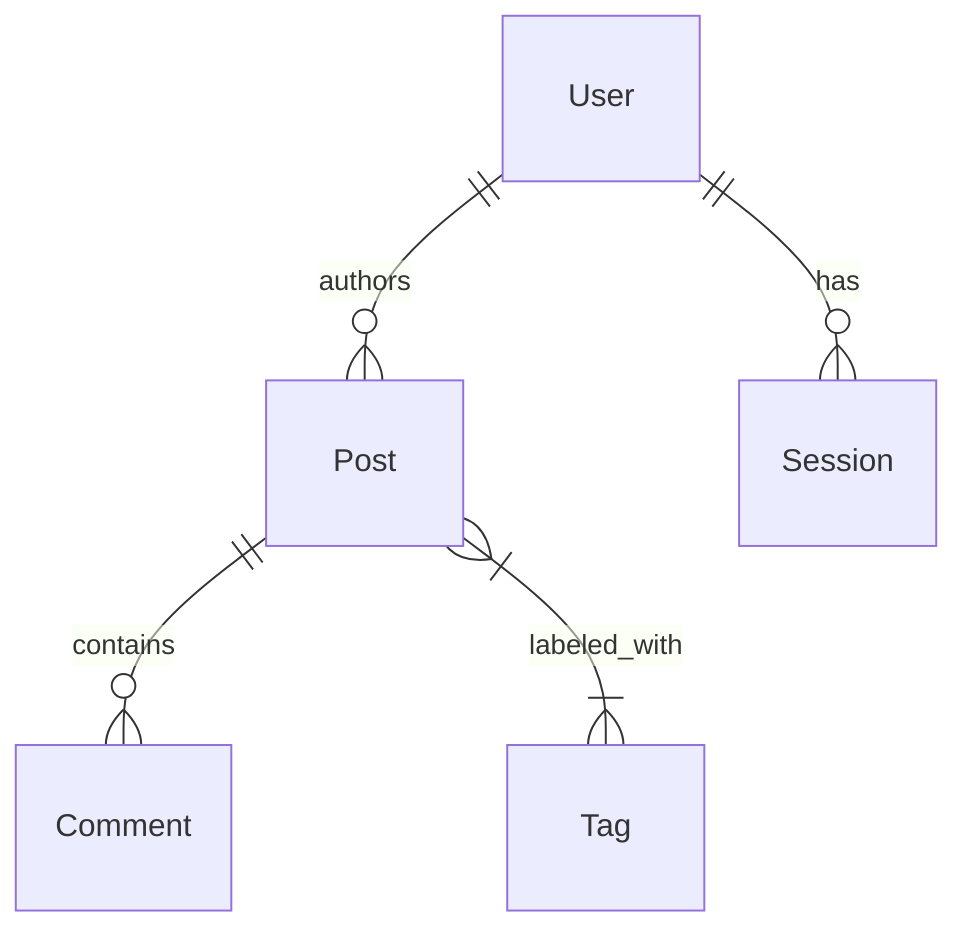

# 🗄️ Database Architecture

> **AI Instruction:** Use this schema for all backend logic. **Do not guess table names.**

---

## 1. Core Principles

| Aspect | Implementation |
|--------|----------------|
| **ORM** | Prisma (or Drizzle) |
| **Database** | PostgreSQL |
| **Pattern** | Use standard foreign keys. No polymorphic relations (AI struggles with them). |
| **Naming** | `snake_case` for DB columns, `camelCase` for API responses |

---

## 2. Entity Relationship Diagram (Mermaid)

Visualizing the high-level relationships prevents "join hallucinations".


---

## 3. Schema Definitions (The "Semantic Layer")

> **Rule:** Do not just list columns. Explain **why** they exist.

### `users`

| Column | Type | Description |
|--------|------|-------------|
| `id` | `uuid` | Primary Key. |
| `role` | `enum` | **CRITICAL:** Values are `ADMIN`, `USER`, `GUEST`. Default is `USER`. |
| `status` | `varchar` | State machine: `PENDING` → `ACTIVE` → `BANNED`. |

### `posts`

| Column | Type | Description |
|--------|------|-------------|
| `author_id` | `uuid` | FK to `users.id`. Must exist. |
| `published` | `boolean` | If false, only visible to author and admin. |
| `content` | `jsonb` | Structure: `{ blocks: [], version: 1 }`. Do not query raw text. |

---

## 4. Critical Constraints & Triggers

Rules that exist in the DB but not always in the Types.

1. **Unique Emails:** `users.email` is unique and case-insensitive.
2. **Cascade Delete:** Deleting a `User` cascades to `Sessions` but NOT `Posts` (posts are orphaned or re-assigned).
3. **Audit Logs:** Every write to `sensitive_tables` triggers a row in `audit_logs` (handled by DB trigger).

---

## 5. System Tables

### `agent_audit_log`

Immutable audit trail for AI agent database operations. **System-level table, not tenant-scoped.**

| Column | Type | Description |
|--------|------|-------------|
| `id` | `uuid` | Primary Key. |
| `agent_id` | `text` | Agent identifier: `database-keeper`, `ralph`, etc. |
| `operation_type` | `enum` | Values: `schema_read`, `data_read`, `rls_audit`, `explain_analyze`, `migration_draft`, `migration_validate`, `session_start`, `session_end`. |
| `operation_tier` | `integer` | Permission tier: `1` (read-only), `2` (migration authoring). |
| `target_tables` | `text[]` | Tables affected/analyzed. |
| `sql_query` | `text` | Query executed (for read operations). |
| `result_status` | `enum` | Values: `success`, `error`, `denied`, `pending_review`. |
| `created_at` | `timestamptz` | When operation occurred. |

**RLS:** Service role only. No tenant scoping - this is system-level logging.

**Constraints:**
- Immutable: No UPDATE or DELETE policies exist.
- All agent operations must be logged before execution.

---

## Why This Format Works for Velocity

1. **The Enum List:** By explicitly listing enum values (`ADMIN`, `USER`), you prevent the AI from guessing values like `SUPER_ADMIN` or `manager`, which would crash your app at runtime.

2. **The JSONB Explanation:** AI often struggles with JSON columns. Defining the internal structure (`{ blocks: [] }`) ensures it writes valid data accessors.

3. **Business Logic in Constraints:** Explicitly stating "Cascade Delete" rules prevents the AI from writing unnecessary cleanup code that might conflict with database-level triggers.

---

## Implementation Tip

Add this to your root `CLAUDE.md`:
```markdown
**Database Changes:** Before writing a migration, READ `@docs/architecture/database-schema.md` to check for existing constraints and naming conventions.
```