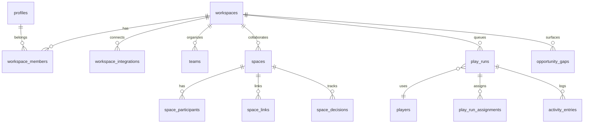

# Database Architecture

> **Source of truth:** `supabase/migrations/` + generated types. **Do not guess table names.**

**Last updated:** 2026-08-07 — verified against `supabase/migrations/` through `20260807000000`, including `20260806051000` (`workspaces.keeper_auto_execute_threshold` → `memory_care_auto_apply_threshold`; Memory Care replaces Keeper system playbooks)

> **Naming canon + rename roadmap:** [docs/plans/2026-07-02-schema-modernization.md](../plans/2026-07-02-schema-modernization.md). Several live tables carry legacy names until the rename waves land: `client_meetings` = the Meetings record table, `projects` = Work, `project_files` = Files, `client_emails` = synced email messages.

## Principles

| Aspect | Implementation |
|--------|----------------|
| Database | PostgreSQL (Supabase) |
| Tenancy | Row Level Security on `workspace_id` through `workspace_members` |
| Naming | `snake_case` in DB; mappers to camelCase at app boundary |
| Access | Data Access Layer in `app/_features/*/queries.ts` and `app/_lib/` |

## Tenant model

### `workspaces`

Workspace container and primary tenant boundary. `studios` is a deprecated compatibility view during the rollout window.

| Column | Type | Notes |
|--------|------|-------|
| `id` | uuid | PK |
| `name` | text | Display name |
| `slug` | text | Unique subdomain slug |
| `memory_care_auto_apply_threshold` | int | Memory Care standard-tier auto-apply bar (50–100, default 85). Renamed from `keeper_auto_execute_threshold` (`20260806051000`). Read via `app/_lib/memory-tools/get-threshold.ts`; managed by the Rules tab slider. |

### `workspace_members`

| Column | Type | Notes |
|--------|------|-------|
| `workspace_id` | uuid | FK → `workspaces.id` |
| `user_id` | uuid | FK → `profiles.id` |
| `role` | text | Owner/admin/member |

**RLS:** User can read/write rows where `user_id = auth.uid()`.

### `profiles`

Auth user profile + Stripe SaaS/Connect fields. See migrations under `supabase/migrations/*profiles*`.

## Integrations

### `workspace_integrations`

Per-workspace OAuth connections. Composio fields: `composio_connection_id`, `composio_status`; legacy `studio_integrations` is only a temporary compatibility alias.

Legacy `gmail_connections` table remains for historical rows; **new connects use Composio only.**

## Plays & opportunities (Wave 1)

Migration: `20260609100000_create_plays_and_opportunity_gaps.sql`

### `players`

Functional roles: follow-up, brief, client-risk, scope, billing.

### `play_runs`

State machine: `draft → queued → approved → scheduled → ran → dismissed`

| Column | Purpose |
|--------|---------|
| `title`, `preview`, `draft_body` | Queue UI |
| `recipient_label`, `channel` | Display |
| `opportunity_gap_id` | Link to briefing card |
| `prepared_by_player_id` | AI Player that prepared or recommended the Play |
| `owner_member_id`, `owner_team_id` | Human or Team accountable for the Play outcome |
| `space_id` | Optional Space the Play belongs to |
| `target_type`, `target_id`, `target_label` | Entity or context the Play is about |
| `approved_at`, `ran_at`, `dismissed_at` | Activity trail |

Wave 1 approve action: **log only** — transitions to `ran` without external send.

### `play_run_assignments`

Assignments for execution, review, approval, or watching. A row points to exactly one workspace member or one Team.

Migration: `20260609234000_add_spaces_and_play_ownership.sql`

### `opportunity_gaps`

HQ briefing LEARN surface: claim, amount range, confidence, `is_primary`.

### `activity_entries`

Trust trail for approve/dismiss/edit actions.

## Teams & Spaces

Migration: `20260514000000_create_entity_architecture_tables.sql` introduced `teams` and `team_members`. Migration `20260609234000_add_spaces_and_play_ownership.sql` extends Teams and adds Spaces.

### `teams`

Workspace-scoped internal groups. Teams organize accountability and can own Spaces or Plays.

| Column | Purpose |
|--------|---------|
| `workspace_id` | Tenant boundary |
| `name`, `slug`, `description` | Display and routing/search |
| `status` | `active` or `archived` |
| `metadata` | Flexible product metadata |

### `team_members`

**Dropped 2026-07-02** (`20260702170000_drop_bridge_tables.sql`; zero app references — the `/teams` surface renders static scaffolding). Team membership returns as `entity_links` person↔team edges under the unified graph.

### `spaces`

Role-aware collaboration containers around active client, project, relationship, or work context.

| Column | Purpose |
|--------|---------|
| `workspace_id` | Tenant boundary |
| `title`, `slug`, `description`, `status` | Core Space identity |
| `linked_entity_type`, `linked_entity_id` | Optional primary Memory/work context |
| `owner_member_id`, `owner_team_id` | Human or Team accountable for the Space |
| `visibility` | `internal`, `team`, `client`, or `mixed` |
| `worth_attention`, `is_pinned` | HQ/Spaces prioritization |

### `space_participants`

Members, Teams, and external people participating in a Space. Exactly one of the workspace member, Team, or person references is set.

### `space_links`

Context links from a Space to Memory records, files, conversations, meetings, Play runs, opportunity gaps, or Teams.

### `space_decisions`

Open and resolved decisions attached to a Space, with visibility scope and source metadata.

## Memory records (2026-07 state)

One table per Memory record type; children prefixed with the parent noun; workspace config under `workspace_*`; graph/provenance infra under `entity_*`.

| Record | Table | Notes |
|--------|-------|-------|
| People | `people` | Primary person store. `relationship_type` CHECK = the 9-value canon (`client, prospect, lead, past_client, team, partner, vendor, personal, unknown`) |
| Orgs | `organizations` | `relationship_status` CHECK = same 9-value canon (legacy `other` backfilled to `unknown`, default `unknown`); `industry_parent`/`industry_child` taxonomy columns are live (ledger drift repaired 2026-07-02) |
| Work | `projects` (rename pending) | Counterparty is `person_id`/`organization_id` FKs (`client_id` dropped 2026-07-03) |
| Billing | `billing_records` (+ `billing_payments`, `billing_accounts`) | THE billing source. All Bridge `portal_*` reads were migrated here (HQ metrics, health signals) |
| Files | `project_files` (rename pending) | `person_id`/`organization_id` FKs, `brand_metadata` JSONB (Brand Kit extraction), `is_operator_asset` boolean (Me Files tab scope); Bridge-era `project_files_has_owner` CHECK dropped — files are workspace-scoped, links optional |
| Meetings | `client_meetings` (rename pending) | THE live meetings table despite the name. `person_id`/`organization_id` FKs, `address`, `phone_number`; `meeting_type` CHECK widened to 8 values (`discovery, kickoff, check-in, review, presentation, workshop, interview, other`) |
| Me | `profiles` + `workspaces` + `operator_*` | `operator_goals`, `operator_memory_facts`, `operator_voice_profile` |
| Notes | `notes` | Wikilinks sync to `entity_links` as `relation_type = 'mention'` edges (edge convergence, 2026-07-03) |

### Record status (2026-07-02)

`people` and `organizations` carry `record_status` (`active`/`inactive`, default `active`), `record_status_source` (`manual`/`keeper` historically — Memory Care writes use care provenance; NULL = never explicitly set), `record_status_changed_at`. Precedence: a manual value is never silently overridden by Memory Care. Definition of *active* lives in the field-contract canon (90-day signal window).

### Field-contract vocabularies (2026-07-02)

DB constraints are aligned with `app/_features/memory/taxonomy/registry.ts` (single source for dropdowns, Memory Care fill rules, and AI prompts):

| Vocabulary | DB enforcement |
|---|---|
| Relationship (9 values) | `people.relationship_type` + `organizations.relationship_status` CHECKs |
| Work status (6 values: `draft, signed, active, on_hold, completed, archived`) | `projects.status` — registry `WORK_STATUSES` is the canon |
| Payment terms (6 values) | `work_payment_terms` enum gained `net_45`, `custom` |
| Meeting type (8 values) | `client_meetings` + `meeting_templates` CHECKs |
| File category (11 values) | `file_category` enum gained `invoice, proposal, reference, media, notes, process` |
| Currency (10 values, uppercase ISO-4217: `USD, EUR, GBP, CAD, AUD, CHF, JPY, SGD, NZD, INR`) | `20260703180000_currency_uppercase_canon.sql` — CHECKs on `billing_records`, `billing_payments`, `meeting_types`, `proposals`, `projects.currency`, `workspaces.default_currency`; lowercase data uppercased |

### Memory Care tables (2026-08-06)

Memory Care (`app/_features/memory/care/`) replaced the retired Keeper "system playbooks". Its persistence surface:

| Table | Purpose |
|-------|---------|
| `entity_evidence` | Evidence accumulation ("Watching"). Unresolved proposals below the bar: `field_path`, `proposed_value`, `confidence`, `evidence_type` (enum still named `keeper_evidence_type` — rename pending), `resolution` / `resolved_at`, `source_capture_id`, `undo_*` columns for rollback. Historical `playbook_slug` values (`keeper-*`) are provenance only — display mapping in `records-engine/memory-care-display.ts`. |
| `salt_learnings` | Lessons from user corrections ("That's wrong" → `memoryRecordCorrection`). Historical `playbook_slug` provenance as above. |
| `profile_playbook_settings` | Per-capability on/off + config rows for the four care capabilities (same rows carried over from the playbook era; read via `care/settings.ts`). |
| `profile_field_provenance` | Every care write records provenance with `previous_value` for rollback (see Provenance & lifecycle below). Destructive-tier ops also write pre-operation snapshots so Handled "That's wrong" can undo. |

Activity provenance: care scheduler writes activity entries with source `memory-care`; historical rows carry `player_slug: "keeper"`.

### Explicit edges: `entity_links` (converged 2026-07-03)

`entity_links` is **the one explicit-edge store**. `20260703120000_entity_links_convergence.sql` added `relation_type` (`employment | payment | attachment | mention | related`) plus provenance columns (`source`, `confidence`, `because`), copied every `entity_relations` row in, and `20260703130000` **dropped `entity_relations`** (and the unused `get_entity_backlinks()` function).

- Entity types use the **short dialect** — the CHECKs admit `person, org, work, billing, meeting, file, note, space` (dialect adapters in `app/_features/memory/types/entity-type.ts`).
- Note `[[wikilink]]` mentions sync as `relation_type = 'mention'` edges.
- App writes go through `app/_features/memory/lib/edge-store.ts` — do not insert edges directly.

### Provenance & lifecycle (widened 2026-07-03)

`profile_field_provenance` and `lifecycle_events` `entity_type` CHECKs admit: `person, organization, work, operator, workspace, billing_record, meeting, file` (`20260703150000` added operator/workspace; `20260703190000` added billing_record/meeting/file). All person/org/operator/workspace scalar writes record provenance; inline edits on Billing, Meetings, and Files detail pages do too. Field coverage report: [memory-field-coverage.md](../reference/memory-field-coverage.md) (regenerate with `pnpm coverage:fields`).

### `clients` table (DROPPED 2026-07-03)

Bridge-era objects are fully deleted. `20260703170000_drop_clients_table.sql` dropped the `clients` table, **every `client_id` column** (on `projects`, `client_meetings`, `project_files`, `client_emails`, `conversations`, `proposals`, and others), and the `migrated_from_client_id` mapping columns. Counterparties are `person_id`/`organization_id` everywhere. Preceding sweeps: `20260703100000` (orphaned `client_users` auth trigger), `20260703160000` (orphaned `is_client_user_of_client()` + policy). Only the table *names* (`client_meetings`, `client_emails`) remain, pending renames.

### Retired Bridge-era tables (DROPPED 2026-07-02)

`20260702170000_drop_bridge_tables.sql` removed (staging-first policy; production cuts over later from the migration set): `client_intakes`, `intake_templates`, `client_knowledge_base`, `client_announcements`, `client_activity_events`, `client_users`, all six `portal_*` tables, `tasks`, `team_members`, `companies`, `service_items`, `calendar_connections`, `knowledge_items`, `discovery_cache`, and the `client_engagement_stats` materialized view. Table count 126 → 107. The 2026-07-03 wave then dropped `clients` (+ all `client_id` columns) and `entity_relations` — see the sections above. Still present pending their own steps: `project_retainers` (folds into work), `studio_*` compat views (final sweep). `teams` stays (live Memory surface). `meeting_types` stays — live Cal.com event-type sync storage, renaming to `calcom_event_types` later.

## System tables

### `agent_audit_log`

System-level agent operation audit (not tenant-scoped). **`log_agent_operation`** is executable by **`service_role` only** (June 2026 grant lockdown).

## Marketing & waitlist (partial environments)

| Object | Access notes |
|--------|----------------|
| `waitlist_leads` | Upsert via app service role (`saveWaitlistLeadAction`) |
| `waitlist_leads_sheet` | View, `security_invoker`; **SELECT → `service_role` only** |
| `marketing_funnel_events` | Funnel analytics events |
| `pipeline_runs`, `youtube_video_stats` | When present: **`service_role` only** (anon policies removed) |

## Security hardening (2026-06 batch)

Migration: `supabase/migrations/20260610120000_security_remediation_batch.sql`. App + webhook context: [security-model.md](./security-model.md).

### RPC / function grants

| Function | Callable by |
|----------|-------------|
| `add_purchased_credits`, `deduct_ai_credits`, `reset_monthly_ai_credits` | `service_role` |
| `log_agent_operation` | `service_role` |
| `handle_new_user` | Trigger only — not PostgREST RPC |
| `is_workspace_member`, `is_studio_member` | `authenticated` (RLS helpers; **not** `anon`) |

All four credit/audit functions use `search_path = pg_catalog, public`.

### RLS tightening (when tables exist)

| Table | Change |
|-------|--------|
| `client_intakes` | *(table dropped 2026-07-02 with the Bridge retirement)* Historically: public INSERT required tenant context, `website_url`, `primary_goal` (min length), `status = 'submitted'` |
| `gmail_sync_logs` | INSERT **`service_role` only** |
| `pipeline_runs`, `youtube_video_stats` | ALL **`service_role` only** |

### Views & analytics

| Object | Change |
|--------|--------|
| `client_engagement_stats` (materialized) | SELECT **`service_role` only** *(view dropped 2026-07-02 with the Bridge retirement)* |

### Storage (`storage.objects`)

Public SELECT is path-scoped (no bucket-wide listing):

- `user-assets` — only `avatars/` prefix
- `bridge-branding` — objects with a folder prefix (`foldername(name)[1] IS NOT NULL`)

## Safety

- Read `supabase/CLAUDE.md` before authoring migrations
- Never run destructive migrations without explicit approval
- Do not re-grant `anon`/`authenticated` on locked RPCs or `waitlist_leads_sheet` without security review
- Full inventory: `docs/plans/2026-06-09-database-alignment-audit.md`
