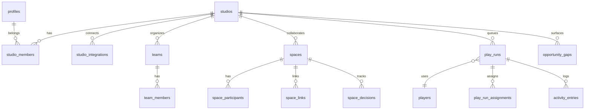

# Database Architecture

> **Source of truth:** `supabase/migrations/` + generated types. **Do not guess table names.**

**Last updated:** 2026-06-10 (June security batch inventory)

## Principles

| Aspect | Implementation |
|--------|----------------|
| Database | PostgreSQL (Supabase) |
| Tenancy | Row Level Security on `studio_id` (rename to `workspace_id` planned — see [workspace rename RFC](../plans/2026-06-09-workspace-rename-rfc.md)) |
| Naming | `snake_case` in DB; mappers to camelCase at app boundary |
| Access | Data Access Layer in `app/_features/*/queries.ts` and `app/_lib/` |

## Tenant model

### `studios`

Workspace container (product term: workspace; DB name unchanged until rename wave).

| Column | Type | Notes |
|--------|------|-------|
| `id` | uuid | PK |
| `name` | text | Display name |
| `slug` | text | Unique subdomain slug |

### `studio_members`

| Column | Type | Notes |
|--------|------|-------|
| `studio_id` | uuid | FK → `studios.id` |
| `user_id` | uuid | FK → `profiles.id` |
| `role` | text | Owner/admin/member |

**RLS:** User can read/write rows where `user_id = auth.uid()`.

### `profiles`

Auth user profile + Stripe SaaS/Connect fields. See migrations under `supabase/migrations/*profiles*`.

## Integrations

### `studio_integrations`

Per-studio OAuth connections. Composio fields: `composio_connection_id`, `composio_status` (see `20260530041443_add_composio_fields_to_studio_integrations.sql`).

Legacy `gmail_connections` table remains for historical rows; **new connects use Composio only.**

## Plays & opportunities (Wave 1)

Migration: `20260609100000_create_plays_and_opportunity_gaps.sql`

### `players`

Functional roles: follow-up, brief, client-risk, scope, billing.

### `play_runs`

State machine: `draft → queued → approved → scheduled → ran → dismissed`

| Column | Purpose |
|--------|---------|
| `title`, `preview`, `draft_body` | Queue UI |
| `recipient_label`, `channel` | Display |
| `opportunity_gap_id` | Link to briefing card |
| `prepared_by_player_id` | AI Player that prepared or recommended the Play |
| `owner_member_id`, `owner_team_id` | Human or Team accountable for the Play outcome |
| `space_id` | Optional Space the Play belongs to |
| `target_type`, `target_id`, `target_label` | Entity or context the Play is about |
| `approved_at`, `ran_at`, `dismissed_at` | Activity trail |

Wave 1 approve action: **log only** — transitions to `ran` without external send.

### `play_run_assignments`

Assignments for execution, review, approval, or watching. A row points to exactly one workspace member or one Team.

Migration: `20260609234000_add_spaces_and_play_ownership.sql`

### `opportunity_gaps`

HQ briefing LEARN surface: claim, amount range, confidence, `is_primary`.

### `activity_entries`

Trust trail for approve/dismiss/edit actions.

## Teams & Spaces

Migration: `20260514000000_create_entity_architecture_tables.sql` introduced `teams` and `team_members`. Migration `20260609234000_add_spaces_and_play_ownership.sql` extends Teams and adds Spaces.

### `teams`

Workspace-scoped internal groups. Teams organize accountability and can own Spaces or Plays.

| Column | Purpose |
|--------|---------|
| `studio_id` | Tenant boundary; rename to `workspace_id` in the workspace rename wave |
| `name`, `slug`, `description` | Display and routing/search |
| `status` | `active` or `archived` |
| `metadata` | Flexible product metadata |

### `team_members`

Links `studio_members` to Teams. Existing role values are lightweight (`lead`, `member`) and can be expanded later if needed.

### `spaces`

Role-aware collaboration containers around active client, project, relationship, or work context.

| Column | Purpose |
|--------|---------|
| `studio_id` | Tenant boundary; rename to `workspace_id` in the workspace rename wave |
| `title`, `slug`, `description`, `status` | Core Space identity |
| `linked_entity_type`, `linked_entity_id` | Optional primary Memory/work context |
| `owner_member_id`, `owner_team_id` | Human or Team accountable for the Space |
| `visibility` | `internal`, `team`, `client`, or `mixed` |
| `worth_attention`, `is_pinned` | HQ/Spaces prioritization |

### `space_participants`

Members, Teams, and external people participating in a Space. Exactly one of `studio_member_id`, `team_id`, or `person_id` is set.

### `space_links`

Context links from a Space to Memory records, files, conversations, meetings, Play runs, opportunity gaps, or Teams.

### `space_decisions`

Open and resolved decisions attached to a Space, with visibility scope and source metadata.

## CRM & work (partial product wiring)

Tables include `clients`, `projects_new`, project members, relationships-era schema. Backend queries live in `app/_features/relationships`, `projects`, etc. UI surfaces may still use demo data.

## System tables

### `agent_audit_log`

System-level agent operation audit (not tenant-scoped). **`log_agent_operation`** is executable by **`service_role` only** (June 2026 grant lockdown).

## Marketing & waitlist (partial environments)

| Object | Access notes |
|--------|----------------|
| `waitlist_leads` | Upsert via app service role (`saveWaitlistLeadAction`) |
| `waitlist_leads_sheet` | View, `security_invoker`; **SELECT → `service_role` only** |
| `marketing_funnel_events` | Funnel analytics events |
| `pipeline_runs`, `youtube_video_stats` | When present: **`service_role` only** (anon policies removed) |

## Security hardening (2026-06 batch)

Migration: `supabase/migrations/20260610120000_security_remediation_batch.sql`. App + webhook context: [security-model.md](./security-model.md).

### RPC / function grants

| Function | Callable by |
|----------|-------------|
| `add_purchased_credits`, `deduct_ai_credits`, `reset_monthly_ai_credits` | `service_role` |
| `log_agent_operation` | `service_role` |
| `handle_new_user` | Trigger only — not PostgREST RPC |
| `is_workspace_member`, `is_studio_member` | `authenticated` (RLS helpers; **not** `anon`) |

All four credit/audit functions use `search_path = pg_catalog, public`.

### RLS tightening (when tables exist)

| Table | Change |
|-------|--------|
| `client_intakes` | Public INSERT requires `studio_id`, `website_url`, `primary_goal` (min length), `status = 'submitted'` |
| `gmail_sync_logs` | INSERT **`service_role` only** |
| `pipeline_runs`, `youtube_video_stats` | ALL **`service_role` only** |

### Views & analytics

| Object | Change |
|--------|--------|
| `client_engagement_stats` (materialized) | SELECT **`service_role` only** |

### Storage (`storage.objects`)

Public SELECT is path-scoped (no bucket-wide listing):

- `user-assets` — only `avatars/` prefix
- `bridge-branding` — objects with a folder prefix (`foldername(name)[1] IS NOT NULL`)

## Safety

- Read `supabase/CLAUDE.md` before authoring migrations
- Never run destructive migrations without explicit approval
- Do not re-grant `anon`/`authenticated` on locked RPCs or `waitlist_leads_sheet` without security review
- Full inventory: `docs/plans/2026-06-09-database-alignment-audit.md`
