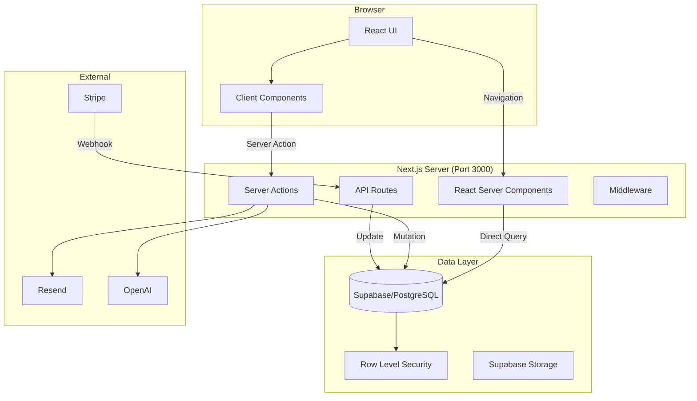

# Full-Stack Next.js Architecture

**Context:** Salt Core uses Next.js as a full-stack framework with Server Components, Server Actions, and direct Supabase access.

## Core Principles

1. **Single Server**: Everything runs on port 3000
2. **Server Actions First**: Preferred method for data mutations
3. **Direct Database Access**: Supabase client with RLS policies
4. **No Separate Backend**: API routes only for webhooks/external integrations

## Architecture Overview



## Data Flow Patterns

### 1. Data Fetching (Server Components)

```typescript
// app/(dashboard)/projects/page.tsx
import { createClient } from "@/libs/supabase/server";

export default async function ProjectsPage() {
  const supabase = await createClient();

  // Direct database query with RLS applied
  const { data: projects } = await supabase
    .from("projects")
    .select("*, client:clients(*)")
    .order("created_at", { ascending: false });

  return <ProjectList projects={projects} />;
}
```

### 2. Data Mutations (Server Actions)

```typescript
// app/actions/projects/create.ts
"use server";
import { createClient } from "@/libs/supabase/server";
import { revalidatePath } from "next/cache";

export async function createProject(formData: FormData) {
  const supabase = await createClient();

  // Auth check
  const { data: { user } } = await supabase.auth.getUser();
  if (!user) throw new Error("Unauthorized");

  // Direct mutation
  const { data, error } = await supabase
    .from("projects")
    .insert({
      name: formData.get("name"),
      client_id: formData.get("clientId"),
    })
    .select()
    .single();

  if (error) throw error;

  // Revalidate cache
  revalidatePath("/dashboard/projects");

  return { success: true, data };
}
```

### 3. Real-time Subscriptions (Client Components)

```typescript
"use client";
import { createClient } from "@/libs/supabase/client";
import { useEffect } from "react";

export function RealtimeMessages({ projectId }) {
  const supabase = createClient();

  useEffect(() => {
    const channel = supabase
      .channel(`project:${projectId}`)
      .on(
        "postgres_changes",
        {
          event: "*",
          schema: "public",
          table: "messages",
          filter: `project_id=eq.${projectId}`,
        },
        (payload) => {
          // Handle real-time update
        }
      )
      .subscribe();

    return () => {
      supabase.removeChannel(channel);
    };
  }, [projectId]);
}
```

### 4. External Webhooks (API Routes)

```typescript
// app/api/webhook/stripe/route.ts
import { headers } from "next/headers";
import { createClient } from "@/libs/supabase/admin";

export async function POST(req: Request) {
  const body = await req.text();
  const signature = (await headers()).get("stripe-signature");

  // Verify webhook
  const event = stripe.webhooks.constructEvent(
    body,
    signature,
    process.env.STRIPE_WEBHOOK_SECRET
  );

  // Process with admin client (bypasses RLS)
  const supabase = createClient();

  switch (event.type) {
    case "checkout.session.completed":
      await supabase
        .from("subscriptions")
        .update({ status: "active" })
        .eq("stripe_customer_id", event.data.object.customer);
      break;
  }

  return Response.json({ received: true });
}
```

## Security Model

### Authentication
- Supabase Auth with cookie-based sessions
- Server-side session validation
- Protected routes via middleware

### Authorization
- Row Level Security (RLS) policies in PostgreSQL
- Server Actions verify user permissions
- No client-side security decisions

### Data Access
- Server Components: Direct Supabase queries with user context
- Client Components: Server Actions or real-time subscriptions
- API Routes: Admin client for webhook processing

## File Organization

```
salt-core/
├── app/
│   ├── (routes)/          # Pages with layouts
│   ├── api/               # External webhooks only
│   │   └── webhook/
│   └── actions/           # Server Actions
│       ├── billing/
│       ├── clients/
│       ├── projects/
│       └── seo/
├── components/            # UI components
├── libs/
│   ├── supabase/         # DB clients
│   ├── stripe/           # Payment logic
│   └── email/            # Email templates
└── src/features/         # Feature modules
```

## Best Practices

### DO:
- Use Server Components by default
- Implement mutations via Server Actions
- Let RLS handle data authorization
- Cache aggressively with `unstable_cache`
- Use `revalidatePath` after mutations

### DON'T:
- Create REST APIs for internal use
- Use API routes for data fetching
- Implement auth logic in client
- Store sensitive data in client
- Bypass RLS without good reason

## Common Patterns

### Form with Server Action
```tsx
export default function ProjectForm() {
  return (
    <form action={createProject}>
      <input name="name" required />
      <button type="submit">Create</button>
    </form>
  );
}
```

### Optimistic Updates
```tsx
"use client";
import { useOptimistic } from "react";

export function ProjectList({ projects, createAction }) {
  const [optimisticProjects, addOptimistic] = useOptimistic(
    projects,
    (state, newProject) => [...state, newProject]
  );

  async function create(formData) {
    const temp = { id: "temp", name: formData.get("name") };
    addOptimistic(temp);
    await createAction(formData);
  }
}
```

### Protected Pages
```tsx
// app/(dashboard)/settings/page.tsx
import { createClient } from "@/libs/supabase/server";
import { redirect } from "next/navigation";

export default async function SettingsPage() {
  const supabase = await createClient();
  const { data: { user } } = await supabase.auth.getUser();

  if (!user) {
    redirect("/signin");
  }

  // Page content
}
```