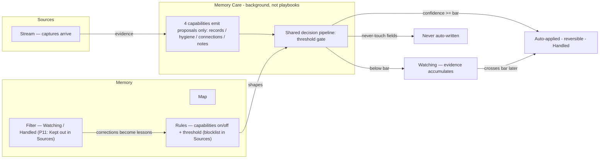

# Memory Care

> **Memory Care is the learn-layer system that keeps Memory complete, clean, connected, and noted.** It replaces the retired Keeper / system-playbook packages (`v2/_meta/`). It is not a playbook.

Canonical module: **`app/_features/memory/care/`**.

---

## Concept

Salt maintains Memory in the background. Capabilities emit **proposals only**. A shared decision pipeline applies, watches, or refuses each proposal by tiered confidence bars. Users never approve Memory mutations up front — they correct wrong Handled writes from Filter. Approvals stay on the act layer (Plays Queue).

| Concern | Owner |
|---------|--------|
| Enrich / relate / maintain / journal | Four care capabilities |
| Apply / watch / refuse | Decision pipeline + field tiers |
| Entity writes | `app/_lib/memory-tools` |
| Configuration | Memory → Rules |
| Transparency | Memory → Filter |

---

## Flow



---

## Module layout

```
app/_features/memory/care/
├── index.ts                 # Public API
├── types.ts                 # Capabilities, proposals, decisions
├── settings.ts              # Threshold + enablement accessors
├── decision-pipeline.ts     # apply / watch / refuse
├── scheduler.ts             # Cron + signal + on-demand entry points
├── actions.ts               # Server actions for Rules UI
├── capabilities/
│   ├── records.ts
│   ├── hygiene.ts
│   ├── connections.ts
│   └── notes.ts
└── intake/                  # Ask Salt intake for records (chat.yaml + PLAYBOOK.md)
```

Entry points:

| Caller | Function |
|--------|----------|
| Cron (`playbook-schedules`) | `runDueCareCapabilities` |
| Signal dispatch | `runCareForSignal` |
| Sync & Scan | `runCareCapability` / `runRecordsForWorkspace` |

Activity metadata uses `source: "memory-care"` only (no `player_slug`). Plays Activity excludes these rows — Care transparency lives on Memory → Filter and record Activity timelines.

**Ask Salt:** record creation uses `load_memory_intake` + `parse_intake` against `care/intake/`. It is not a playbook and must not call `propose_play`.

---

## Capabilities

Capabilities **never write Memory directly**. They emit `CareProposal`s into `processCareProposal` (or call `memoryUpdateField` with a bar from `getCareFieldBar`).

| Capability | Settings slug | Role |
|------------|---------------|------|
| `records` | `memory-records` | Keep people / org fields complete (v1: scheduled scan covers person/org only; work/billing enrichment via capture signals) |
| `hygiene` | `memory-hygiene` | Merges, formatting, stale/orphan cleanup |
| `connections` | `memory-connections` | Infer and strengthen entity links |
| `notes` | `memory-notes` | Synthesize durable notes |

**Capabilities can be disabled.** Memory → Rules toggles persist in `profile_playbook_settings` (`blueprint_slug` = settings slug). Missing rows mean **enabled** (opt-out). Legacy `keeper-*` slugs are read as fallbacks in `care/settings.ts`.

> Historical note: migration `20260711160000_playbook_enabled_flag.sql` commented that system playbooks cannot be disabled. That comment is obsolete. The live contract is Rules toggles + `isCareCapabilityEnabled`.

---

## Decision pipeline

`decision-pipeline.ts` + `app/_lib/learning/field-tiers.ts` replace the retired playbook `execution-router` / confidence-gate approval path.

| Outcome | When | Effect |
|---------|------|--------|
| `apply` | Aggregated confidence ≥ tier bar | Caller writes via memory-tools; pipeline records learning + Handled activity |
| `watch` | Below bar | Evidence in `entity_evidence`; Watching activity; **no** `play_runs` |
| `refuse` | Never-touch field | No write, no evidence, no queue |

### Tiered bars

| Tier | Bar | Examples |
|------|-----|----------|
| standard | Workspace threshold (default **85**) | Notes, preferences, addresses |
| sensitive | `max(threshold, 95)` | Industry, relationship type, first-time classifications |
| destructive | `max(threshold, 95)` + provenance snapshot | Status → `past_client` / `completed` / `void` |
| never_touch | Refused at any confidence | Billing `total` / `amount_paid`, money-model fields |

Low-risk observation fields (names, emails, `last_contacted_at`, …) bypass gating (`isAlwaysAutoField`).

There is **no** `approval_required` path in the learn layer. Correction replaces approval.

---

## No play_runs

Memory Care never creates `play_runs`. Historical keeper / memory-records runs may remain in the DB for audit; UI display maps them to Memory Care labels. Act-layer risk/routing findings still use the Plays Queue.

---

## Memory surface

Route: `/memory`

| Tab | Role |
|-----|------|
| **Map** | Graph of records and relationships |
| **Filter** | Transparency: **Watching** / **Handled** / **Kept out** |
| **Rules** | Capability toggles + auto-apply threshold + blocklist |

### Filter

- **Watching** — evidence below bar; optional nudges teach, never chore queues
- **Handled** — auto-applied writes with why + **"That's wrong"** → rollback + correction → lesson
- **Kept out** — admission noise/drop/held; "actually, let this in" moves to Watching

Filter is a window into what Salt is doing, not a work queue. No nav/HQ badge counts for Watching.

### Rules

- Capability on/off (`getCareCapabilityStates` / Rules UI)
- Workspace threshold slider → `workspaces.memory_care_auto_apply_threshold`
- Blocklist for admission / learning exclusions

---

## Settings

Owned by **`care/settings.ts`**:

| Setting | Storage | Accessor |
|---------|---------|----------|
| Auto-apply threshold | `workspaces.memory_care_auto_apply_threshold` (renamed from `keeper_auto_execute_threshold`) | `getCareThreshold` |
| Capability enablement | `profile_playbook_settings` with slugs `memory-records` / `memory-hygiene` / `memory-connections` / `memory-notes`; legacy `keeper-*` fallback | `getCareCapabilityStates`, `isCareCapabilityEnabled` |

`memoryUpdateField` reads the same column via `getWorkspaceThreshold` (`source: "care"`). Per-playbook threshold overrides are retired.

Tool calls from care use `source: "care"`.

---

## Hard constraints

1. Capabilities emit proposals; memory-tools perform writes.
2. Never create `play_runs` for Memory Care.
3. Never auto-write never-touch (money) fields.
4. Meter LLM spend at `_lib/ai` primitives — not at capabilities.
5. Care ops are internal (no `external_effect`); not billable as Plays.
6. Do not reintroduce `_meta` playbook packages or Keeper naming in new code.

---

## See also

- [Primitives Overview](primitives.md)
- [Playbooks Reference](playbooks.md) — act-layer only
- [Legacy naming](legacy-naming.md) — Keeper / `_meta` retirement
- [Memory Tools](../../app/_lib/memory-tools/CLAUDE.md)
- [Learning Infrastructure](../../app/_lib/learning/CLAUDE.md)
- [Memory feature](../../app/_features/memory/CLAUDE.md)
