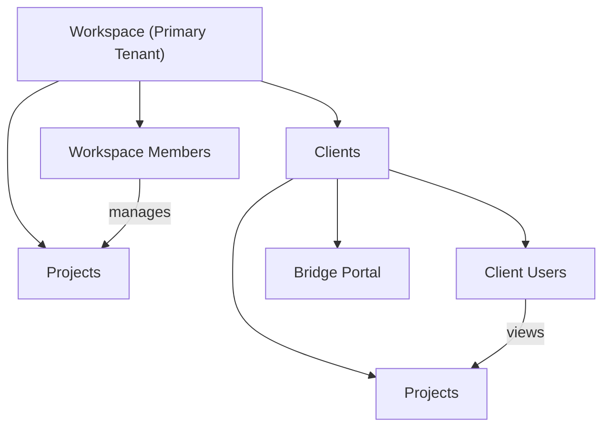

# Multi-Tenant Architecture

**Context:** Salt implements strict multi-tenancy to isolate data between workspaces and their clients.

## Tenant Hierarchy



## Core Concepts

### Primary Tenant: Workspaces

Workspaces are the main tenant in Salt. They represent the authenticated product boundary for a Salt account.

```typescript
interface Workspace {
  id: string;
  name: string;
  slug: string;            // Unique identifier for URLs
  owner_id: string;        // User who created the workspace
  subscription_status: string;
  created_at: Date;
}
```

### Secondary Tenant: Clients

Clients belong to workspaces. They represent the workspace's customers.

```typescript
interface Client {
  id: string;
  workspace_id: string;    // Foreign key to workspace
  name: string;
  email: string;
  slug: string;            // For bridge URLs
  created_at: Date;
}
```

### Shared Resource: Projects

Projects belong to both workspace and client, creating a junction.

```typescript
interface Project {
  id: string;
  workspace_id: string;    // Workspace that manages it
  client_id: string;       // Client who owns it
  name: string;
  status: string;
  created_at: Date;
}
```

## Access Control Model

### Workspace Members

Can access everything within their workspace:

```typescript
type WorkspaceMemberRole = "owner" | "admin" | "member" | "viewer";

interface WorkspaceMember {
  user_id: string;
  workspace_id: string;
  role: WorkspaceMemberRole;
  joined_at: Date;
}
```

### Client Users

Can only access their client's data via Bridge:

```typescript
interface ClientUser {
  user_id: string;
  client_id: string;
  role: "admin" | "member";
  invited_by_workspace_member_id: string;
}
```

## Route Architecture

Salt uses route groups to organize authenticated and public surfaces:

```
app/
├── (public)/              # Marketing, auth pages (no auth required)
│   ├── page.tsx           # Landing page
│   └── pricing/           # Public pricing
│
├── (product)/             # Authenticated product routes
│   ├── hq/                # HQ Today view
│   ├── people/            # People & relationships
│   ├── spaces/            # Shared workspaces
│   ├── work/              # Work surface
│   └── ...                # plays, connections, billing, etc.
│
└── (settings)/            # Full-page settings
    └── settings/          # Settings UI
```

## Tenant Context Resolution

The system determines tenant context using centralized libraries:

### 1. Get Tenant Context

```typescript
// app/_lib/tenancy/context.ts
export async function getTenantContext(userId: string) {
  const supabase = await createServerClient()

  const { data: workspaceMember } = await supabase
    .from('workspace_members')
    .select('*, workspace:workspaces(*)')
    .eq('user_id', userId)
    .single()

  if (workspaceMember) {
    return {
      type: 'workspace' as const,
      workspaceId: workspaceMember.workspace_id,
      role: workspaceMember.role,
      workspace: workspaceMember.workspace,
    }
  }

  return { type: 'anonymous' as const }
}
```

### 2. Use in Routes

```typescript
// app/(product)/hq/page.tsx
export default async function HqPage() {
  const supabase = await createServerClient()
  const { data: { user } } = await supabase.auth.getUser()

  if (!user) redirect('/signin')

  const context = await getTenantContext(user.id)

  if (context.type !== 'workspace') {
    redirect('/') // Not a workspace member
  }

  // Proceed with workspace-scoped queries
  const { data: projects } = await supabase
    .from("projects")
    .select("*")
    .eq("workspace_id", context.workspaceId);
}
```

## Database Schema Design

### Workspaces Table

```sql
CREATE TABLE workspaces (
  id UUID PRIMARY KEY DEFAULT gen_random_uuid(),
  name TEXT NOT NULL,
  slug TEXT UNIQUE NOT NULL,
  owner_id UUID REFERENCES auth.users(id),
  subscription_status TEXT DEFAULT 'active',
  created_at TIMESTAMPTZ DEFAULT NOW()
);

-- RLS: Only members can see
ALTER TABLE workspaces ENABLE ROW LEVEL SECURITY;
```

### Clients Table

```sql
CREATE TABLE clients (
  id UUID PRIMARY KEY DEFAULT gen_random_uuid(),
  workspace_id UUID REFERENCES workspaces(id) ON DELETE CASCADE,
  name TEXT NOT NULL,
  email TEXT NOT NULL,
  slug TEXT NOT NULL,
  created_at TIMESTAMPTZ DEFAULT NOW(),
  UNIQUE(workspace_id, slug) -- Slug unique per workspace
);

-- RLS: Workspace members can see their clients
ALTER TABLE clients ENABLE ROW LEVEL SECURITY;
```

### Projects Table

```sql
CREATE TABLE projects (
  id UUID PRIMARY KEY DEFAULT gen_random_uuid(),
  workspace_id UUID REFERENCES workspaces(id) ON DELETE CASCADE,
  client_id UUID REFERENCES clients(id) ON DELETE CASCADE,
  name TEXT NOT NULL,
  status TEXT DEFAULT 'active',
  created_at TIMESTAMPTZ DEFAULT NOW()
);

-- RLS: Both workspace members AND client users can see
ALTER TABLE projects ENABLE ROW LEVEL SECURITY;
```

## Safety Rails

### 1. Never Trust Client-Side Data

```typescript
// ❌ BAD: Trusting client-provided workspaceId
export async function POST(req: NextRequest) {
  const { workspaceId, projectName } = await req.json();
  // DANGER: User could provide any workspaceId!
}

// ✅ GOOD: Get workspaceId from authenticated context
export async function POST(req: NextRequest) {
  const { projectName } = await req.json();
  const context = await getTenantContext(user.id);

  if (context.type !== "workspace") {
    return NextResponse.json({ error: "Unauthorized" }, { status: 403 });
  }

  // Use context.workspaceId - guaranteed to be user's workspace
}
```

### 2. Always Scope Queries

```typescript
// ❌ BAD: Unscoped query
const { data } = await supabase.from("projects").select("*");

// ✅ GOOD: Scoped to tenant
const { data } = await supabase
  .from("projects")
  .select("*")
  .eq("workspace_id", context.workspaceId);
```

### 3. Use RLS as Last Line of Defense

Even if application code has bugs, RLS prevents data leaks:

```sql
CREATE POLICY "workspace_members_see_own_projects" ON projects
FOR SELECT TO authenticated
USING (
  EXISTS (
    SELECT 1 FROM workspace_members
    WHERE workspace_members.workspace_id = projects.workspace_id
      AND workspace_members.user_id = auth.uid()
  )
);
```

## Common Patterns

### Check Workspace Ownership

```typescript
export async function canManageWorkspace(
  userId: string,
  workspaceId: string
): Promise<boolean> {
  const { data } = await supabase
    .from("workspace_members")
    .select("role")
    .eq("user_id", userId)
    .eq("workspace_id", workspaceId)
    .single();

  return data?.role === "owner" || data?.role === "admin";
}
```

### Get User's Workspaces

```typescript
export async function getUserWorkspaces(userId: string) {
  const { data: memberships } = await supabase
    .from("workspace_members")
    .select(`
      role,
      joined_at,
      workspace:workspaces(*)
    `)
    .eq("user_id", userId);

  return memberships?.map(m => ({
    ...m.workspace,
    role: m.role,
    joinedAt: m.joined_at,
  })) || [];
}
```

### Switch Between Workspaces

```typescript
// Store active workspace in user session
export async function switchWorkspace(userId: string, workspaceId: string) {
  // Verify membership
  const { data: member } = await supabase
    .from("workspace_members")
    .select("role")
    .eq("user_id", userId)
    .eq("workspace_id", workspaceId)
    .single();

  if (!member) {
    throw new Error("Not a member of this workspace");
  }

  // Update session or cookie with active workspace
  cookies().set("active-workspace", workspaceId);
}
```

## Security Checklist

- [ ] All routes check tenant context before queries
- [ ] No workspaceId/clientId accepted from request body
- [ ] RLS policies match application logic
- [ ] Cross-tenant queries are impossible
- [ ] Audit logs track tenant access
- [ ] API endpoints validate tenant membership
- [ ] Bridge routes verify client user access