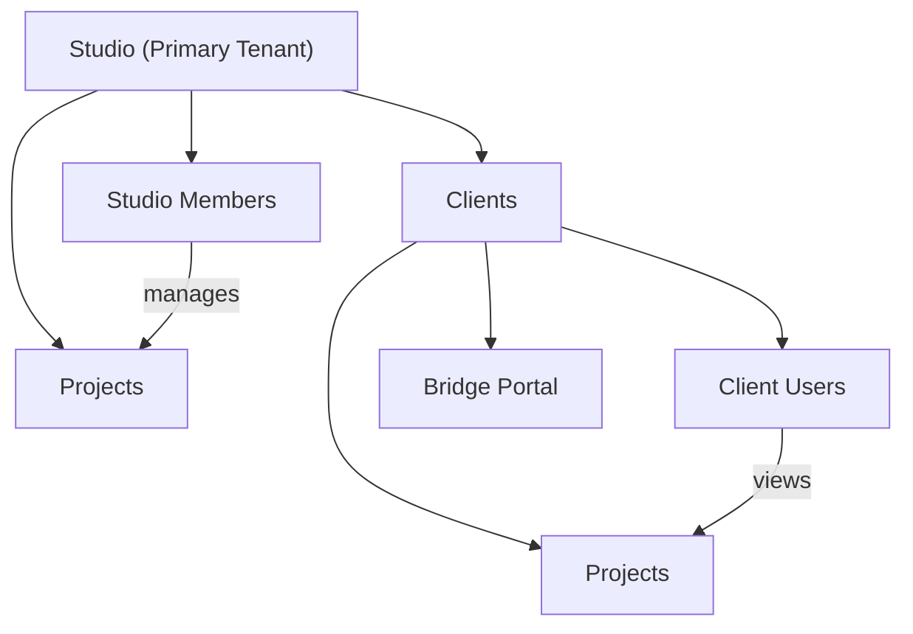

# Multi-Tenant Architecture

**Context:** Salt Core implements strict multi-tenancy to isolate data between studios (your customers) and their clients.

## Tenant Hierarchy



## Core Concepts

### Primary Tenant: Studios

Studios are the main tenant in Salt Core. They represent your customers who purchase Salt Core.

```typescript
interface Studio {
  id: string;
  name: string;
  slug: string;            // Unique identifier for URLs
  owner_id: string;        // User who created the studio
  subscription_status: string;
  created_at: Date;
}
```

### Secondary Tenant: Clients

Clients belong to studios. They represent the studio's customers.

```typescript
interface Client {
  id: string;
  studio_id: string;       // Foreign key to studio
  name: string;
  email: string;
  slug: string;            // For bridge URLs
  created_at: Date;
}
```

### Shared Resource: Projects

Projects belong to BOTH studio AND client, creating a junction.

```typescript
interface Project {
  id: string;
  studio_id: string;       // Studio that manages it
  client_id: string;       // Client who owns it
  name: string;
  status: string;
  created_at: Date;
}
```

## Access Control Model

### Studio Members

Can access everything within their studio:

```typescript
type StudioMemberRole = "owner" | "admin" | "member" | "viewer";

interface StudioMember {
  user_id: string;
  studio_id: string;
  role: StudioMemberRole;
  joined_at: Date;
}
```

### Client Users

Can only access their client's data via Bridge:

```typescript
interface ClientUser {
  user_id: string;
  client_id: string;
  role: "admin" | "member";
  invited_by_studio_member_id: string;
}
```

## Route Architecture

Salt Core uses route groups to enforce tenant boundaries:

```
app/
├── (core_marketing_site)/    # Public pages
│   ├── page.tsx             # Landing page
│   └── pricing/             # Public pricing
│
├── (user_dashboard)/         # Studio member access
│   ├── dashboard/           # Requires studio membership
│   ├── settings/            # Studio settings
│   └── clients/             # Client management
│
└── (client_bridge)/          # Client user access
    └── bridge/
        └── [clientSlug]/    # Dynamic client portals
```

## Tenant Context Resolution

The system determines tenant context using centralized libraries:

### 1. Get Tenant Context

```typescript
// libs/tenancy/context.ts
export async function getTenantContext(userId: string) {
  const supabase = await createClient();

  // Check studio membership
  const { data: studioMember } = await supabase
    .from("studio_members")
    .select("*, studio:studios(*)")
    .eq("user_id", userId)
    .single();

  if (studioMember) {
    return {
      type: "studio" as const,
      studioId: studioMember.studio_id,
      role: studioMember.role,
      studio: studioMember.studio,
    };
  }

  // Check client user
  const { data: clientUser } = await supabase
    .from("client_users")
    .select("*, client:clients(*)")
    .eq("user_id", userId)
    .single();

  if (clientUser) {
    return {
      type: "client" as const,
      clientId: clientUser.client_id,
      role: clientUser.role,
      client: clientUser.client,
    };
  }

  return { type: "anonymous" as const };
}
```

### 2. Use in Routes

```typescript
// app/(user_dashboard)/dashboard/page.tsx
export default async function DashboardPage() {
  const supabase = await createClient();
  const { data: { user } } = await supabase.auth.getUser();

  if (!user) redirect("/signin");

  const context = await getTenantContext(user.id);

  if (context.type !== "studio") {
    redirect("/"); // Not a studio member
  }

  // Proceed with studio-scoped queries
  const { data: projects } = await supabase
    .from("projects")
    .select("*")
    .eq("studio_id", context.studioId);
}
```

## Database Schema Design

### Studios Table

```sql
CREATE TABLE studios (
  id UUID PRIMARY KEY DEFAULT gen_random_uuid(),
  name TEXT NOT NULL,
  slug TEXT UNIQUE NOT NULL,
  owner_id UUID REFERENCES auth.users(id),
  subscription_status TEXT DEFAULT 'active',
  created_at TIMESTAMPTZ DEFAULT NOW()
);

-- RLS: Only members can see
ALTER TABLE studios ENABLE ROW LEVEL SECURITY;
```

### Clients Table

```sql
CREATE TABLE clients (
  id UUID PRIMARY KEY DEFAULT gen_random_uuid(),
  studio_id UUID REFERENCES studios(id) ON DELETE CASCADE,
  name TEXT NOT NULL,
  email TEXT NOT NULL,
  slug TEXT NOT NULL,
  created_at TIMESTAMPTZ DEFAULT NOW(),
  UNIQUE(studio_id, slug) -- Slug unique per studio
);

-- RLS: Studio members can see their clients
ALTER TABLE clients ENABLE ROW LEVEL SECURITY;
```

### Projects Table

```sql
CREATE TABLE projects (
  id UUID PRIMARY KEY DEFAULT gen_random_uuid(),
  studio_id UUID REFERENCES studios(id) ON DELETE CASCADE,
  client_id UUID REFERENCES clients(id) ON DELETE CASCADE,
  name TEXT NOT NULL,
  status TEXT DEFAULT 'active',
  created_at TIMESTAMPTZ DEFAULT NOW()
);

-- RLS: Both studio members AND client users can see
ALTER TABLE projects ENABLE ROW LEVEL SECURITY;
```

## Safety Rails

### 1. Never Trust Client-Side Data

```typescript
// ❌ BAD: Trusting client-provided studioId
export async function POST(req: NextRequest) {
  const { studioId, projectName } = await req.json();
  // DANGER: User could provide any studioId!
}

// ✅ GOOD: Get studioId from authenticated context
export async function POST(req: NextRequest) {
  const { projectName } = await req.json();
  const context = await getTenantContext(user.id);

  if (context.type !== "studio") {
    return NextResponse.json({ error: "Unauthorized" }, { status: 403 });
  }

  // Use context.studioId - guaranteed to be user's studio
}
```

### 2. Always Scope Queries

```typescript
// ❌ BAD: Unscoped query
const { data } = await supabase.from("projects").select("*");

// ✅ GOOD: Scoped to tenant
const { data } = await supabase
  .from("projects")
  .select("*")
  .eq("studio_id", context.studioId);
```

### 3. Use RLS as Last Line of Defense

Even if application code has bugs, RLS prevents data leaks:

```sql
CREATE POLICY "studio_members_see_own_projects" ON projects
FOR SELECT TO authenticated
USING (
  EXISTS (
    SELECT 1 FROM studio_members
    WHERE studio_members.studio_id = projects.studio_id
    AND studio_members.user_id = auth.uid()
  )
);
```

## Common Patterns

### Check Studio Ownership

```typescript
export async function canManageStudio(
  userId: string,
  studioId: string
): Promise<boolean> {
  const { data } = await supabase
    .from("studio_members")
    .select("role")
    .eq("user_id", userId)
    .eq("studio_id", studioId)
    .single();

  return data?.role === "owner" || data?.role === "admin";
}
```

### Get User's Studios

```typescript
export async function getUserStudios(userId: string) {
  const { data: memberships } = await supabase
    .from("studio_members")
    .select(`
      role,
      joined_at,
      studio:studios(*)
    `)
    .eq("user_id", userId);

  return memberships?.map(m => ({
    ...m.studio,
    role: m.role,
    joinedAt: m.joined_at,
  })) || [];
}
```

### Switch Between Studios

```typescript
// Store active studio in user session
export async function switchStudio(userId: string, studioId: string) {
  // Verify membership
  const { data: member } = await supabase
    .from("studio_members")
    .select("role")
    .eq("user_id", userId)
    .eq("studio_id", studioId)
    .single();

  if (!member) {
    throw new Error("Not a member of this studio");
  }

  // Update session or cookie with active studio
  cookies().set("active-studio", studioId);
}
```

## Security Checklist

- [ ] All routes check tenant context before queries
- [ ] No studioId/clientId accepted from request body
- [ ] RLS policies match application logic
- [ ] Cross-tenant queries are impossible
- [ ] Audit logs track tenant access
- [ ] API endpoints validate tenant membership
- [ ] Bridge routes verify client user access