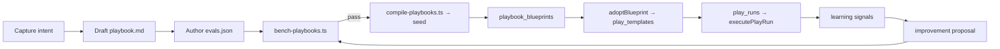

# Playbook Formula

> **⚠️ Superseded 2026-08-08.** The blueprint → adopt → compile architecture described here (`playbook_blueprints`, `play_templates`, `adoptPlaybookBlueprint`, `pnpm playbooks:compile`, `players`) was never built this way and the pieces that existed are retired. Current truth: playbooks are repo-discovered `definition.yaml` packages run by the v2 executor with per-step `auto|ask` gates — no compile step, no adoption layer. See **[playbooks.md](./playbooks.md)** and `.cursor/plans/2026-08-07-plays-canonical.md`. This doc is kept for design history only.

**Date:** 2026-06-20  
**Status:** ❌ Superseded (was: Approved architecture)  
**Related:** [Plays Wave 2 acting engine](../../.cursor/plans/2026-06-12-plays-wave-2-acting-engine.md), [play-definition.ts](../../app/_features/plays/utils/play-definition.ts)

## Purpose

A **Playbook** is Salt's repeatable recipe for prepared work — the product-facing name for a compiled `play_template`. Playbooks give consistency: the same steps run the same way every time, with human approval at the boundary, and improvements that are versioned and benchmark-gated.

This document is the contract for authoring, compiling, adopting, running, and improving playbooks.

> **Attribution:** Lifecycle and eval methodology inspired by [Anthropic's Apache-2.0 skill-creator](https://github.com/anthropics/skills/tree/main/skills/skill-creator). Salt implements its own schema and runtime; no Anthropic source is copied.

## Concepts (do not confuse)

| Concept                | What it is                                           | Table / code                          |
| ---------------------- | ---------------------------------------------------- | ------------------------------------- |
| **System play**        | Atomic Memory operation (create person, link org, …) | `system_plays`, `executeSystemPlay()` |
| **Playbook blueprint** | Global, Salt-authored, versioned recipe              | `playbook_blueprints`                 |
| **Play template**      | Workspace-adopted instance of a blueprint            | `play_templates`                      |
| **Play run**           | One queue item / one approval boundary               | `play_runs`, `executePlayRun()`       |
| **Player**             | AI work role that owns/default-attributed playbooks  | `players`                             |

**System plays** mutate Memory directly (no approval queue). **Playbooks** compose external actions (Gmail draft, Stripe read, …) through the acting engine with consent and approval.

## Anatomy (dual layer)

Every playbook has two layers — same pattern as a Claude skill (`SKILL.md` + bundled scripts):

| Layer          | Field                                                          | Audience           | Purpose                                                          |
| -------------- | -------------------------------------------------------------- | ------------------ | ---------------------------------------------------------------- |
| **Identity**   | slug, name, `player_slug`, description, `when_to_use`, trigger | Human + routing    | When Salt should use this recipe                                 |
| **Procedure**  | `procedure_md`                                                 | Human (default UI) | Plain-language steps and reasoning                               |
| **Definition** | `definition` JSON                                              | Machine            | Compiled step DSL (`fetch` → `guard` → `render` → `llm` → `act`) |
| **Consent**    | `required_actions`, approval behavior                          | Trust              | Which Composio slugs must be pre-approved                        |
| **Value**      | `value_model`                                                  | Metering           | What outcome this play claims                                    |

Progressive disclosure in UI: **card metadata → readable steps → Advanced (definition JSON)**.

## Authoring format (`playbook.md`)

Source of truth lives in git under `app/_features/plays/playbooks/<slug>/`:

```
app/_features/plays/playbooks/
├── quiet-lead-nudge/
│   ├── playbook.md      # frontmatter + procedure + definition fence
│   └── evals.json       # regression suite
├── overdue-invoice-reminder/
└── meeting-recap/
```

### Frontmatter (YAML)

```yaml
---
slug: quiet-lead-nudge
name: Quiet Lead Nudge
player_slug: follow-up
description: Revive a quiet lead with a personalized follow-up draft.
when_to_use: >
  Use when a person has gone silent after a promised next step or open
  thread. Proactively suggest when Capture shows no response for 14+ days.
trigger:
  type: pattern
  signal: no_response
  min_days_since_contact: 14
consent:
  approval_required: true
value:
  kind: gap_closed
  fromGap: true
# Optional: explicit toolkit dependencies (otherwise derived from action slugs)
# required_toolkits:
#   - gmail
---
```

### Body

Markdown sections: **What this does**, **When it runs**, **Steps** (numbered, explain _why_ not just _what_), **What you approve**.

Avoid rigid ALL-CAPS MUSTs; explain reasoning so personalization steps stay grounded.

### Definition fence

Fenced JSON block validated by [`validatePlayDefinition`](../../app/_features/plays/utils/play-definition.ts):

```json
{
  "version": 1,
  "steps": [
    { "kind": "fetch", "tool": "GMAIL_FETCH_EMAILS", "params": {}, "bind": "thread" },
    { "kind": "guard", "path": "thread.days_since_reply", "op": "gte", "value": 14 },
    { "kind": "render", "template": "Hi {{run.recipient_label}}, …", "bind": "body" },
    { "kind": "act", "tool": "GMAIL_CREATE_EMAIL_DRAFT", "params": { "body": "{{body}}" } }
  ],
  "value": { "kind": "gap_closed", "fromGap": true }
}
```

**Compile-time rules:**

- Tool slugs are **fixed** at compile time; runtime LLM never chooses actions.
- `fetch` steps may only use `read` tools.
- `act` steps may not use `destructive` tools.
- Guards fail closed (missing values → skip/dismiss).
- Max 10 linear steps (no branching DSL).

## Lifecycle



### Commands

```bash
pnpm playbooks:bench    # Run eval suite against authored playbooks
pnpm playbooks:compile  # Validate + emit blueprint seed SQL
```

A blueprint version cannot be marked `active` unless it passes its eval suite.

## Eval harness

Each playbook ships with `evals.json`:

```json
{
  "playbook_slug": "quiet-lead-nudge",
  "evals": [
    {
      "id": "stale-thread-drafts",
      "name": "Drafts when thread is stale",
      "input": {
        "run": { "recipient_label": "Alex", "title": "Follow up" },
        "thread": { "days_since_reply": 21 }
      },
      "mocks": {
        "GMAIL_FETCH_EMAILS": { "days_since_reply": 21 }
      },
      "assertions": [
        { "type": "bound_contains", "bind": "body", "substring": "Alex" },
        { "type": "act_executed", "tool": "GMAIL_CREATE_EMAIL_DRAFT" }
      ]
    }
  ]
}
```

**Edge cases become permanent tests:** when a real run fails, is heavily edited, or a guard misfires, promote the scenario into `evals.json` with `"origin": "from_edge_case"`.

## Learning loop (human-approved, benchmark-gated)

1. **Capture signals** on edit, dismiss, failure, guard-skip (`playbook_learning_signals`).
2. **Synthesize proposal** from accumulated signals (`playbook_improvement_proposals`).
3. **Benchmark gate:** auto-run proposed definition against full eval suite; only improvements that hold or beat current score reach the user.
4. **Approve:** bumps `playbook_blueprints.version`, archives prior row in `playbook_blueprint_versions`.

Never auto-apply playbook changes without human approval.

## Adoption (hybrid model)

- **Blueprints** are global, Salt-authored (`playbook_blueprints`).
- **Templates** are per-workspace copies (`play_templates` + `blueprint_slug`, `blueprint_version`).
- Users adopt via `adoptBlueprint(slug)`; workspace may tune `procedure_md` locally but `definition` changes should flow from approved blueprint upgrades.

## Consent and trust

- Mutating `act` slugs populate `required_actions` at compile time.
- Execution requires `approved_actions` + `actions_approved_by` on the template (Wave 2 acting engine).
- Workspace trust level `act_with_approval` required for acting steps.

## Files

| Path                                               | Role                                  |
| -------------------------------------------------- | ------------------------------------- |
| `app/_features/plays/playbooks/`                   | v2 playbook packages + services       |
| `app/_features/plays/playbooks/types.ts`           | Shared types                          |
| `app/_features/plays/playbooks/schema/v2/`         | v2 `definition.yaml` schema: discovery, parser, executor |
| `supabase/migrations/*_playbook_blueprints.sql`    | Registry + learning tables            |
| `app/_features/plays/playbooks/memory-monopoly.ts` | Memory-write constraint enforcement   |

> Deleted with the v1 engine: `parse-playbook.ts`, `eval-runner.ts`, `learning/`, `scripts/compile-playbooks.ts`, `scripts/bench-playbooks.ts`.

## Two-Pipeline Reality (historical — superseded)

> **Superseded (2026-08):** Keeper / system playbooks are retired. Learn-layer
> Memory enrichment is [Memory Care](memory-care.md)
> (`app/_features/memory/care/`). Playbooks are **act-layer only**. The text
> below is kept for historical context of the old dual pipeline.

### Compiled Playbooks (Acting) — superseded by v2 packages

The old standard path (kept for history):

1. Author `playbook.md` in `app/_features/plays/playbooks/<slug>/`
2. Create `evals.json` with test cases
3. Run `pnpm playbooks:compile` — validates definition, runs evals, emits seed migration
4. Seed migration UPSERTS into `playbook_blueprints`

**Current path:** v2 `definition.yaml` packages discovered by `discoverV2Playbooks()` (`schema/v2/discovery.ts`); there is no compile/adoption layer (`compile-playbooks.ts` and `parse-playbook.ts` are deleted).

### Keeper Playbooks (retired)

Retired path for Memory record policies (do not author new ones):

1. ~~Author `playbook.md` in `app/_features/plays/playbooks/keeper-<surface>/`~~
2. Policy and fill rules now live in Memory Care + the field registry
3. See [Memory Care](memory-care.md) for the current system

**Discovered by:** ~~`discoverKeeperPlaybookDirs()`~~ (deleted with the Keeper retirement).

### Why the Split?

- Keeper playbooks are **policy documents** consumed by the records engine, not step-based procedures
- They define admission rules, taxonomy, field-completion logic — concepts that don't fit the acting DSL
- Manual seeding gives precise control over migration ordering (keepers must exist before adoption)
- Validation runs on both pipelines; compilation (seed generation) runs only on acting playbooks

### Authoring Decision Tree

```
Is your playbook for Memory record management?
├── Yes → Is it the Keeper player?
│   ├── Yes → keeper-* directory, manual seed, policy-in-markdown ✓
│   └── No → FORBIDDEN (Memory-monopoly constraint)
└── No → standard playbook directory, compiled seed ✓
```

## Memory-Monopoly Constraint

**Invariant:** No playbook may mutate Memory records. Playbooks may READ memory (fetch steps); any act step with a memory-mutating slug is rejected. Memory mutations are owned by Memory Care (`app/_features/memory/care`) and the protected memory tools (`app/_lib/memory-tools`).

### Mutating Slugs (Denylist)

These action slugs are forbidden in all playbooks:

| Category       | Slugs                                                                                             |
| -------------- | ------------------------------------------------------------------------------------------------- |
| Person         | `memory_create_person`, `memory_update_person`, `memory_archive_person`, `memory_classify_person` |
| Org            | `memory_create_org`, `memory_update_org`, `memory_archive_org`                                    |
| Work           | `memory_create_work`, `memory_update_work`, `memory_archive_work`                                 |
| Links          | `memory_link_*`, `memory_unlink_*` (all variants)                                                 |
| Notes/Meetings | `memory_create_note`, `memory_create_meeting`                                                     |

### Enforcement Layers

1. **Parse-time** (`playbooks/schema/v2/parser.ts`): any playbook with memory-mutating `act` slugs fails validation
2. **Runtime** (`playbooks/schema/v2/executor.ts`): defense-in-depth backstop refuses execution even if a definition bypasses parse

### Exception

Ask SALT's chat `memory_*` system plays are the **human-in-chat path** — they execute via `executeSystemPlay()`, not the playbook engine, and are unaffected by this constraint.

### Rationale

- Single records pipeline: provenance, admission rules, and consistency live in one place
- Structural guardrail making user-created playbooks safe by construction
- Outcomes that should update records emit signals/captures for Memory Care to process

## Integration Contract (Playbooks × Connectors) — v1, historical

> **Historical (v1 engine):** `adoptPlaybookBlueprint()` and `executePlayRun()` are deleted with the v1 engine; `required_toolkits` survives only as a type. The v2 executor performs the equivalent toolkit-health gate (a run with a disconnected toolkit transitions to `blocked`). The mechanics below describe the v1 flow.

Playbooks that execute Composio tools require their toolkits to be connected. The contract:

### Declaration

```yaml
# Explicit in frontmatter (optional)
required_toolkits:
  - gmail
  - stripe

# Or derived automatically from required_actions:
# GMAIL_SEND_EMAIL → gmail
# STRIPE_CREATE_INVOICE → stripe
```

Derivation (v1, historical): `deriveToolkitSlugsFromActions()` split action slugs at the first `_` to extract the toolkit prefix. Capability-based actions (`capability:*`) were skipped (resolved at runtime). The v2 schema declares required connectors in the package — see `schema/v2/CLAUDE.md`.

### Adoption

`adoptPlaybookBlueprint()` checks all `required_toolkits` against `workspace_integrations`:

| Status        | Result                                                                        |
| ------------- | ----------------------------------------------------------------------------- |
| All connected | Adoption proceeds normally                                                    |
| Some missing  | Adoption succeeds but returns `missingToolkits[]` for UI to prompt connection |
| Some expired  | Same as missing; UI shows reconnect prompt                                    |

The adoption-time check is advisory, not blocking — the user may want to adopt and then connect. The run-time check is hard.

### Run-Time

Before executing steps, `executePlayRun()` verifies all `required_toolkits` are healthy:

| Status                   | Play State                     |
| ------------------------ | ------------------------------ |
| All connected            | Proceeds with execution        |
| Any disconnected/expired | Transitions to `blocked` state |

**Blocked state behavior:**

- Play pauses (does NOT fail permanently)
- `metadata.blocked_toolkits` records which toolkits need attention
- Activity log entry guides user: "Connect in Sources → Connectors, then re-approve"
- User reconnects, then the play can be retried

### Consent Layer

Toolkit connection is **above** the action consent layer:

```
required_toolkits (declared) → connected? (adoption check, run-time gate)
    ↓
required_actions (declared) → approved_actions (consent approval)
    ↓
PlayApprovalContext (execution gate)
```

A playbook must pass both checks: connection for the toolkit, consent for the specific actions.

## Player Capability Contract (retired)

> **Retired (2026-08):** the Players system and its capability registry (`app/_features/plays/players/`) are deleted. The matrix below is design history. The live guardrails are the memory-monopoly (above) and the consent/approval layer in the v2 executor.

### Capability Matrix (historical)

| Player      | Memory Writes | Destructive | Always Approval | Playbook Kinds | Domain Toolkits               |
| ----------- | ------------- | ----------- | --------------- | -------------- | ----------------------------- |
| keeper      | ✅            | ❌          | ❌              | profile        | —                             |
| billing     | ❌            | ❌          | ❌              | acting         | stripe, quickbooks            |
| follow-up   | ❌            | ❌          | ❌              | acting         | gmail, slack                  |
| brief       | ❌            | ❌          | ❌              | acting         | googlecalendar, gmail, notion |
| client-risk | ❌            | ❌          | ❌              | acting         | —                             |
| scope       | ❌            | ❌          | ❌              | acting         | notion, clickup, asana        |
| general\*   | ❌            | ❌          | ✅              | acting         | —                             |

\*General player is Phase 3 (user-created playbooks).

### Player Context

Per-workspace, per-player context stored in `player_context` table:

| Field                  | Purpose                                         |
| ---------------------- | ----------------------------------------------- |
| `domain_knowledge`     | Industry terms, common entities, business rules |
| `tone_preferences`     | How this player should communicate              |
| `workflow_preferences` | Timing, channels, approval patterns             |
| `context_doc`          | Raw context doc for LLM injection               |
| `context_budget`       | Char limit for injection (default 1500)         |

Context was injected into LLM steps fenced with `<player-context>` tags to prevent injection attacks. (`assemblePlayerContext()` is deleted; the `player_context` table remains, written by a settings action.)

### Heuristic: Player vs Playbook

- **Playbook** = skill with a start and end (versioned, auditable procedure)
- **Player** = agent role (owns playbooks, dispatch, shared context)
- Repetition changes **trust level**, never location (earned autonomy)
- Judgment about _when_ to run → player; _what_ to run → playbook
