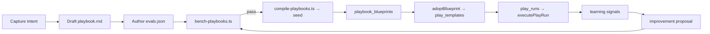

# Playbook Formula

**Date:** 2026-06-20  
**Status:** Approved architecture  
**Related:** [Plays Wave 2 acting engine](../../.cursor/plans/2026-06-12-plays-wave-2-acting-engine.md), [play-definition.ts](../../app/_features/plays/utils/play-definition.ts)

## Purpose

A **Playbook** is Salt's repeatable recipe for prepared work — the product-facing name for a compiled `play_template`. Playbooks give consistency: the same steps run the same way every time, with human approval at the boundary, and improvements that are versioned and benchmark-gated.

This document is the contract for authoring, compiling, adopting, running, and improving playbooks.

> **Attribution:** Lifecycle and eval methodology inspired by [Anthropic's Apache-2.0 skill-creator](https://github.com/anthropics/skills/tree/main/skills/skill-creator). Salt implements its own schema and runtime; no Anthropic source is copied.

## Concepts (do not confuse)

| Concept | What it is | Table / code |
|---------|------------|----------------|
| **System play** | Atomic Memory operation (create person, link org, …) | `system_plays`, `executeSystemPlay()` |
| **Playbook blueprint** | Global, Salt-authored, versioned recipe | `playbook_blueprints` |
| **Play template** | Workspace-adopted instance of a blueprint | `play_templates` |
| **Play run** | One queue item / one approval boundary | `play_runs`, `executePlayRun()` |
| **Player** | AI work role that owns/default-attributed playbooks | `players` |

**System plays** mutate Memory directly (no approval queue). **Playbooks** compose external actions (Gmail draft, Stripe read, …) through the acting engine with consent and approval.

## Anatomy (dual layer)

Every playbook has two layers — same pattern as a Claude skill (`SKILL.md` + bundled scripts):

| Layer | Field | Audience | Purpose |
|-------|-------|----------|---------|
| **Identity** | slug, name, `player_slug`, description, `when_to_use`, trigger | Human + routing | When Salt should use this recipe |
| **Procedure** | `procedure_md` | Human (default UI) | Plain-language steps and reasoning |
| **Definition** | `definition` JSON | Machine | Compiled step DSL (`fetch` → `guard` → `render` → `llm` → `act`) |
| **Consent** | `required_actions`, approval behavior | Trust | Which Composio slugs must be pre-approved |
| **Value** | `value_model` | Metering | What outcome this play claims |

Progressive disclosure in UI: **card metadata → readable steps → Advanced (definition JSON)**.

## Authoring format (`playbook.md`)

Source of truth lives in git under `app/_features/plays/playbooks/<slug>/`:

```
app/_features/plays/playbooks/
├── quiet-lead-nudge/
│   ├── playbook.md      # frontmatter + procedure + definition fence
│   └── evals.json       # regression suite
├── overdue-invoice-reminder/
└── meeting-recap/
```

### Frontmatter (YAML)

```yaml
---
slug: quiet-lead-nudge
name: Quiet Lead Nudge
player_slug: follow-up
description: Revive a quiet lead with a personalized follow-up draft.
when_to_use: >
  Use when a person has gone silent after a promised next step or open
  thread. Proactively suggest when Capture shows no response for 14+ days.
trigger:
  type: pattern
  signal: no_response
  min_days_since_contact: 14
consent:
  approval_required: true
value:
  kind: gap_closed
  fromGap: true
---
```

### Body

Markdown sections: **What this does**, **When it runs**, **Steps** (numbered, explain *why* not just *what*), **What you approve**.

Avoid rigid ALL-CAPS MUSTs; explain reasoning so personalization steps stay grounded.

### Definition fence

Fenced JSON block validated by [`validatePlayDefinition`](../../app/_features/plays/utils/play-definition.ts):

```json
{
  "version": 1,
  "steps": [
    { "kind": "fetch", "tool": "GMAIL_FETCH_EMAILS", "params": {}, "bind": "thread" },
    { "kind": "guard", "path": "thread.days_since_reply", "op": "gte", "value": 14 },
    { "kind": "render", "template": "Hi {{run.recipient_label}}, …", "bind": "body" },
    { "kind": "act", "tool": "GMAIL_CREATE_EMAIL_DRAFT", "params": { "body": "{{body}}" } }
  ],
  "value": { "kind": "gap_closed", "fromGap": true }
}
```

**Compile-time rules:**

- Tool slugs are **fixed** at compile time; runtime LLM never chooses actions.
- `fetch` steps may only use `read` tools.
- `act` steps may not use `destructive` tools.
- Guards fail closed (missing values → skip/dismiss).
- Max 10 linear steps (no branching DSL).

## Lifecycle



### Commands

```bash
pnpm playbooks:bench    # Run eval suite against authored playbooks
pnpm playbooks:compile  # Validate + emit blueprint seed SQL
```

A blueprint version cannot be marked `active` unless it passes its eval suite.

## Eval harness

Each playbook ships with `evals.json`:

```json
{
  "playbook_slug": "quiet-lead-nudge",
  "evals": [
    {
      "id": "stale-thread-drafts",
      "name": "Drafts when thread is stale",
      "input": {
        "run": { "recipient_label": "Alex", "title": "Follow up" },
        "thread": { "days_since_reply": 21 }
      },
      "mocks": {
        "GMAIL_FETCH_EMAILS": { "days_since_reply": 21 }
      },
      "assertions": [
        { "type": "bound_contains", "bind": "body", "substring": "Alex" },
        { "type": "act_executed", "tool": "GMAIL_CREATE_EMAIL_DRAFT" }
      ]
    }
  ]
}
```

**Edge cases become permanent tests:** when a real run fails, is heavily edited, or a guard misfires, promote the scenario into `evals.json` with `"origin": "from_edge_case"`.

## Learning loop (human-approved, benchmark-gated)

1. **Capture signals** on edit, dismiss, failure, guard-skip (`playbook_learning_signals`).
2. **Synthesize proposal** from accumulated signals (`playbook_improvement_proposals`).
3. **Benchmark gate:** auto-run proposed definition against full eval suite; only improvements that hold or beat current score reach the user.
4. **Approve:** bumps `playbook_blueprints.version`, archives prior row in `playbook_blueprint_versions`.

Never auto-apply playbook changes without human approval.

## Adoption (hybrid model)

- **Blueprints** are global, Salt-authored (`playbook_blueprints`).
- **Templates** are per-workspace copies (`play_templates` + `blueprint_slug`, `blueprint_version`).
- Users adopt via `adoptBlueprint(slug)`; workspace may tune `procedure_md` locally but `definition` changes should flow from approved blueprint upgrades.

## Consent and trust

- Mutating `act` slugs populate `required_actions` at compile time.
- Execution requires `approved_actions` + `actions_approved_by` on the template (Wave 2 acting engine).
- Workspace trust level `act_with_approval` required for acting steps.

## Files

| Path | Role |
|------|------|
| `app/_features/plays/playbooks/` | Authoring source + evals |
| `app/_features/plays/playbooks/types.ts` | Shared types |
| `app/_features/plays/playbooks/parse-playbook.ts` | Parse `playbook.md` |
| `app/_features/plays/playbooks/eval-runner.ts` | Mocked definition runner + assertions |
| `app/_features/plays/playbooks/learning/` | Signal capture + proposal synthesis |
| `scripts/compile-playbooks.ts` | Author → validated seed |
| `scripts/bench-playbooks.ts` | Eval benchmark runner |
| `supabase/migrations/*_playbook_blueprints.sql` | Registry + learning tables |
