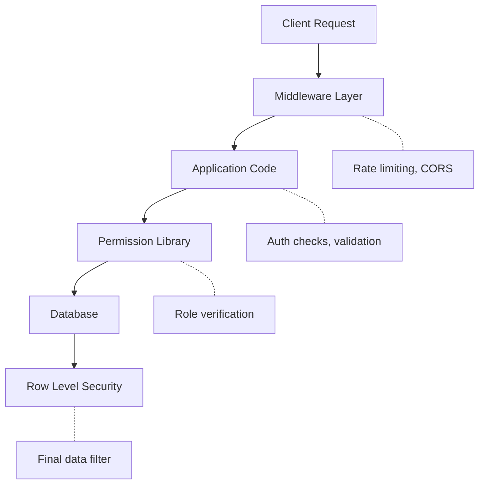

# Security Model

**Context:** Salt Core implements defense-in-depth security with RLS as the final guarantee.

## Security Layers



## Authentication Flow

### 1. Initial Authentication

```typescript
// Handled by Supabase Auth
const { data, error } = await supabase.auth.signInWithOAuth({
  provider: "google",
  options: {
    redirectTo: `${window.location.origin}/api/auth/callback`,
  },
});
```

### 2. Session Verification

```typescript
// Every protected route must verify
export default async function ProtectedRoute() {
  const supabase = await createClient();
  const { data: { user }, error } = await supabase.auth.getUser();

  if (!user || error) {
    redirect("/signin");
  }

  // Continue with authenticated user
}
```

### 3. Tenant Authorization

```typescript
// After auth, check what user can access
const context = await getTenantContext(user.id);

switch (context.type) {
  case "studio":
    // Studio member - full dashboard access
    break;
  case "client":
    // Client user - bridge access only
    break;
  case "anonymous":
    // No tenant access
    redirect("/");
}
```

## Row Level Security (RLS)

### Core Principle

**Every table has RLS enabled.** No exceptions.

```sql
-- Enable RLS on creation
CREATE TABLE sensitive_data (
  id UUID PRIMARY KEY,
  studio_id UUID REFERENCES studios(id),
  data TEXT
);

ALTER TABLE sensitive_data ENABLE ROW LEVEL SECURITY;

-- Without policies, table is inaccessible
-- Even with valid Supabase connection!
```

### Policy Patterns

#### 1. Studio Isolation

```sql
-- Studios table: Only members can see
CREATE POLICY "studio_members_read_studio"
ON studios FOR SELECT
TO authenticated
USING (
  EXISTS (
    SELECT 1 FROM studio_members
    WHERE studio_members.studio_id = studios.id
    AND studio_members.user_id = auth.uid()
  )
);

-- Studios table: Only owner can update
CREATE POLICY "studio_owner_update"
ON studios FOR UPDATE
TO authenticated
USING (owner_id = auth.uid())
WITH CHECK (owner_id = auth.uid()); -- Prevent ownership transfer
```

#### 2. Hierarchical Access

```sql
-- Projects: Studio members OR client users
CREATE POLICY "project_access"
ON projects FOR SELECT
TO authenticated
USING (
  -- Studio member path
  EXISTS (
    SELECT 1 FROM studio_members sm
    WHERE sm.studio_id = projects.studio_id
    AND sm.user_id = auth.uid()
  )
  OR
  -- Client user path
  EXISTS (
    SELECT 1 FROM client_users cu
    WHERE cu.client_id = projects.client_id
    AND cu.user_id = auth.uid()
  )
);
```

#### 3. Role-Based Operations

```sql
-- Clients: Only admins can delete
CREATE POLICY "studio_admin_delete_client"
ON clients FOR DELETE
TO authenticated
USING (
  EXISTS (
    SELECT 1 FROM studio_members
    WHERE studio_members.studio_id = clients.studio_id
    AND studio_members.user_id = auth.uid()
    AND studio_members.role IN ('owner', 'admin')
  )
);
```

## Permission Checks

### Permission Library

```typescript
// libs/permissions/checks.ts

export async function hasStudioAccess(
  userId: string,
  studioId: string,
  requiredRole?: StudioMemberRole[]
): Promise<boolean> {
  const { data } = await supabase
    .from("studio_members")
    .select("role")
    .eq("user_id", userId)
    .eq("studio_id", studioId)
    .single();

  if (!data) return false;

  if (requiredRole && !requiredRole.includes(data.role)) {
    return false;
  }

  return true;
}

export async function hasClientAccess(
  userId: string,
  clientId: string
): Promise<boolean> {
  // Check via studio membership
  const { data: studioAccess } = await supabase
    .from("clients")
    .select("studio_id")
    .eq("id", clientId)
    .single();

  if (studioAccess) {
    return hasStudioAccess(userId, studioAccess.studio_id);
  }

  // Check direct client user access
  const { data: clientAccess } = await supabase
    .from("client_users")
    .select("role")
    .eq("user_id", userId)
    .eq("client_id", clientId)
    .single();

  return !!clientAccess;
}
```

### Usage in API Routes

```typescript
export async function DELETE(
  req: NextRequest,
  { params }: { params: Promise<{ clientId: string }> }
) {
  const { clientId } = await params;
  const supabase = await createClient();
  const { data: { user } } = await supabase.auth.getUser();

  if (!user) {
    return NextResponse.json({ error: "Unauthorized" }, { status: 401 });
  }

  // Get client's studio
  const { data: client } = await supabase
    .from("clients")
    .select("studio_id")
    .eq("id", clientId)
    .single();

  if (!client) {
    return NextResponse.json({ error: "Not found" }, { status: 404 });
  }

  // Check permissions
  const canDelete = await hasStudioAccess(
    user.id,
    client.studio_id,
    ["owner", "admin"]
  );

  if (!canDelete) {
    return NextResponse.json({ error: "Forbidden" }, { status: 403 });
  }

  // Proceed with deletion
  const { error } = await supabase
    .from("clients")
    .delete()
    .eq("id", clientId);

  if (error) {
    return NextResponse.json({ error: error.message }, { status: 500 });
  }

  return NextResponse.json({ success: true });
}
```

## Input Validation

### Zod Schemas

```typescript
import { z } from "zod";

// Define schemas for all inputs
export const CreateProjectSchema = z.object({
  name: z.string().min(1).max(100),
  description: z.string().optional(),
  clientId: z.string().uuid(),
  // Note: studioId comes from context, not input!
});

// Use in API route
export async function POST(req: NextRequest) {
  const body = await req.json();

  // Validate input
  const validated = CreateProjectSchema.safeParse(body);

  if (!validated.success) {
    return NextResponse.json(
      { error: "Invalid input", details: validated.error.flatten() },
      { status: 400 }
    );
  }

  const { name, description, clientId } = validated.data;

  // Get studioId from context, not user input!
  const context = await getTenantContext(user.id);

  if (context.type !== "studio") {
    return NextResponse.json({ error: "Forbidden" }, { status: 403 });
  }

  // Create with validated data + secure context
  const { data, error } = await supabase
    .from("projects")
    .insert({
      name,
      description,
      client_id: clientId,
      studio_id: context.studioId, // From context, not input
    });
}
```

## Security Headers

### Middleware Configuration

```typescript
// middleware.ts
export function middleware(request: NextRequest) {
  const response = NextResponse.next();

  // Security headers
  response.headers.set("X-Frame-Options", "DENY");
  response.headers.set("X-Content-Type-Options", "nosniff");
  response.headers.set("X-XSS-Protection", "1; mode=block");
  response.headers.set(
    "Strict-Transport-Security",
    "max-age=31536000; includeSubDomains"
  );
  response.headers.set(
    "Content-Security-Policy",
    "default-src 'self'; script-src 'self' 'unsafe-inline' 'unsafe-eval' https:; style-src 'self' 'unsafe-inline';"
  );

  return response;
}
```

## API Security

### Rate Limiting

```typescript
// libs/rate-limit.ts
const limiter = new Map();

export async function rateLimit(
  identifier: string,
  limit = 10,
  window = 60000 // 1 minute
) {
  const now = Date.now();
  const userLimits = limiter.get(identifier) || [];

  // Clean old entries
  const recentRequests = userLimits.filter(
    (timestamp: number) => now - timestamp < window
  );

  if (recentRequests.length >= limit) {
    throw new Error("Rate limit exceeded");
  }

  recentRequests.push(now);
  limiter.set(identifier, recentRequests);
}

// Use in API route
export async function POST(req: NextRequest) {
  const { data: { user } } = await supabase.auth.getUser();

  try {
    await rateLimit(user.id, 5, 60000); // 5 requests per minute
  } catch (error) {
    return NextResponse.json(
      { error: "Too many requests" },
      { status: 429 }
    );
  }

  // Continue with request
}
```

### CORS Configuration

```typescript
// For API routes that need CORS
export async function OPTIONS(request: Request) {
  return new Response(null, {
    status: 200,
    headers: {
      "Access-Control-Allow-Origin": process.env.NEXT_PUBLIC_SITE_URL!,
      "Access-Control-Allow-Methods": "GET, POST, PUT, DELETE, OPTIONS",
      "Access-Control-Allow-Headers": "Content-Type, Authorization",
      "Access-Control-Max-Age": "86400",
    },
  });
}
```

## Data Sanitization

### Output Encoding

```typescript
// Always sanitize user-generated content
import DOMPurify from "isomorphic-dompurify";

export function sanitizeHTML(dirty: string): string {
  return DOMPurify.sanitize(dirty, {
    ALLOWED_TAGS: ["b", "i", "em", "strong", "a", "p", "br"],
    ALLOWED_ATTR: ["href", "target", "rel"],
  });
}

// Usage example:
// When rendering user content, always sanitize first
// For React, consider using libraries that handle sanitization automatically
```

### SQL Injection Prevention

Supabase client automatically parameterizes queries:

```typescript
// Safe - parameterized
const { data } = await supabase
  .from("projects")
  .select("*")
  .eq("name", userInput); // Automatically escaped

// Never use raw SQL with user input!
```

## Security Monitoring

### Audit Logging

```typescript
// Log security-relevant events
export async function logSecurityEvent(
  userId: string,
  action: string,
  resource: string,
  result: "success" | "denied",
  metadata?: Record<string, any>
) {
  await supabase.from("audit_logs").insert({
    user_id: userId,
    action,
    resource,
    result,
    metadata,
    ip_address: headers().get("x-forwarded-for"),
    user_agent: headers().get("user-agent"),
    timestamp: new Date().toISOString(),
  });
}

// Use in sensitive operations
await logSecurityEvent(
  user.id,
  "DELETE_CLIENT",
  clientId,
  "success",
  { studioId: context.studioId }
);
```

## Security Checklist

### Development
- [ ] All tables have RLS enabled
- [ ] RLS policies cover all CRUD operations
- [ ] Input validation on all endpoints
- [ ] No sensitive data in client-side code
- [ ] Environment variables properly scoped
- [ ] Error messages don't leak information

### Deployment
- [ ] HTTPS enforced
- [ ] Security headers configured
- [ ] Rate limiting enabled
- [ ] CORS properly configured
- [ ] Audit logging active
- [ ] Regular security updates applied

### Code Review
- [ ] No hardcoded secrets
- [ ] All user inputs validated
- [ ] SQL injection prevention verified
- [ ] XSS prevention in place
- [ ] CSRF protection enabled
- [ ] Authentication checks on all routes
- [ ] Authorization verified for operations
- [ ] Sensitive operations logged