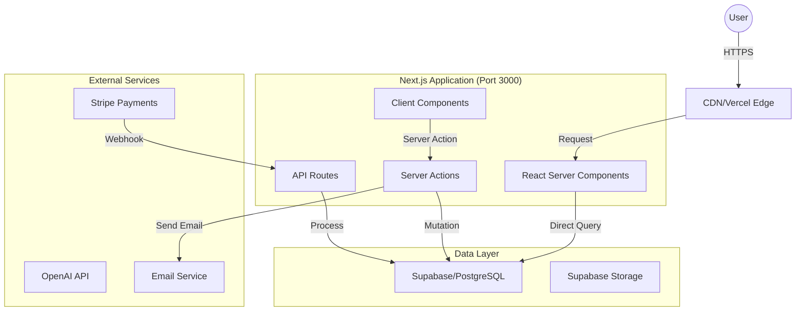

# 🗺️ System Overview

**AI Instruction:** Read this to understand how data flows through the system and which external services we rely on.

## 1. High-Level Architecture (Full-Stack Next.js)

Salt runs as a unified Next.js application with all logic on a single server.

## 2. Core Components

**Architecture**: Full-stack Next.js App Router with feature-based organization. Server Actions and API routes handle backend logic—no separate API server. Supabase for database with RLS policies enforced.

| Component | Tech Stack | Responsibility | Location |
|-----------|------------|----------------|----------|
| Pages & Layouts | Next.js 15 App Router | UI rendering, routing | `app/(product)/`, `app/(settings)/`, `app/(public)/` |
| Server Components | React RSC | Data fetching, server-side rendering | `app/**/page.tsx` |
| Client Components | React | Interactivity, browser APIs | `"use client"` files |
| Server Actions | Next.js Actions | Data mutations, form handling | `app/_features/*/actions/` |
| API Routes | Next.js Route Handlers | Webhooks, external APIs only | `app/api/` |
| Database | Supabase (PostgreSQL) | Data persistence with RLS | Direct client access |

## 3. Key Data Flows

### A. User Onboarding Flow

1. User signs up via `(public)/signin/` (Supabase Auth).
2. Supabase creates the auth user; app onboarding creates workspace membership.
3. Server Action sends welcome email via Resend.

### B. AI Generation Flow

1. User submits prompt via Ask Salt or Plays.
2. Server Action validates auth and calls OpenAI via `app/_lib/ai/`.
3. Result is persisted in Supabase and surfaced in HQ or Plays.
4. Client receives updated UI via revalidation or realtime subscription.

## 4. External Integrations

Strict rules on how to talk to the outside world.

* **Stripe:** We strictly use Webhooks to sync subscription state. Do NOT trust client-side success states.
* **Supabase Storage:** File uploads use Supabase Storage with signed URLs. The Frontend never touches storage keys directly.