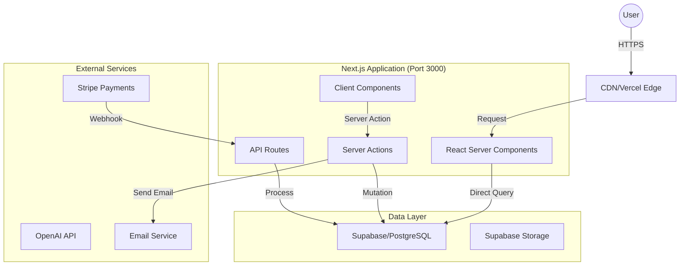

# 🗺️ System Overview

**AI Instruction:** Read this to understand how data flows through the system and which external services we rely on.

## 1. High-Level Architecture (Full-Stack Next.js)

Salt runs as a unified Next.js application with all logic on a single server.

## 2. Core Components

**Architecture**: Full-stack Next.js App Router with feature-based organization. Server Actions and API routes handle backend logic—no separate API server. Supabase for database with RLS policies enforced.

| Component | Tech Stack | Responsibility | Location |
|-----------|------------|----------------|----------|
| Pages & Layouts | Next.js 15 App Router | UI rendering, routing | `app/(routes)/` |
| Server Components | React RSC | Data fetching, server-side rendering | `app/**/page.tsx` |
| Client Components | React | Interactivity, browser APIs | `"use client"` files |
| Server Actions | Next.js Actions | Data mutations, form handling | `app/actions/` |
| API Routes | Next.js Route Handlers | Webhooks, external APIs only | `app/api/` |
| Database | Supabase (PostgreSQL) | Data persistence with RLS | Direct client access |

## 3. Key Data Flows

### A. User Onboarding Flow

1. User signs up via Frontend (Clerk/Auth.js).
2. Webhook triggers API to create `User` record in Postgres.
3. API enqueues `send-welcome-email` job to Redis.
4. Worker picks up job and calls SendGrid.

### B. AI Generation Flow

1. User submits prompt via Frontend.
2. API validates credits and creates `Job` record (Status: `PENDING`).
3. Worker polls job, calls OpenAI, saves result to S3.
4. Worker updates `Job` record (Status: `COMPLETED`).
5. Frontend polls (or receives WebSocket) for completion.

## 4. External Integrations

Strict rules on how to talk to the outside world.

* **Stripe:** We strictly use Webhooks to sync subscription state. Do NOT trust client-side success states.
* **S3:** All file uploads must use Presigned URLs generated by the API. The Frontend never touches AWS keys directly.