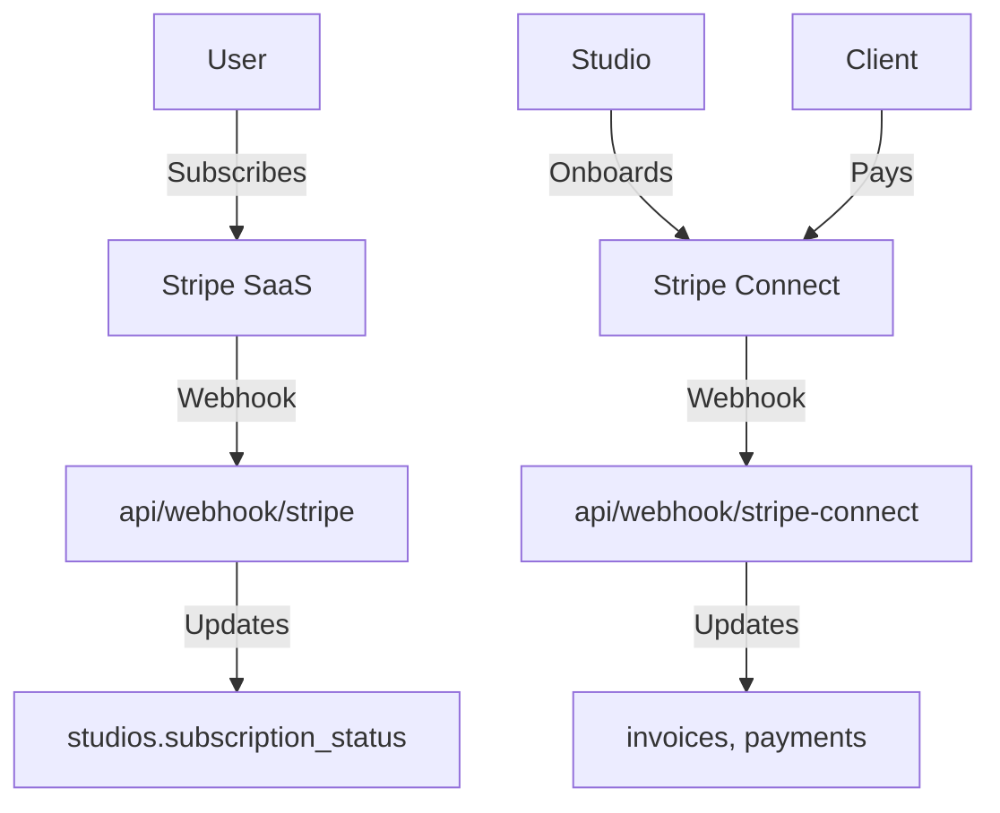

# Stripe Integration Guide

**Context:** Salt uses Stripe for SaaS subscriptions and Stripe Connect for client billing.

## Architecture Overview



## SaaS Subscriptions (Studio Billing)

### Configuration

```typescript
// libs/stripe-saas.ts
import Stripe from "stripe";

export const stripe = new Stripe(
  process.env.STRIPE_SECRET_KEY!,
  {
    apiVersion: "2024-06-20",
  }
);
```

### Create Checkout Session

```typescript
// app/api/stripe/create-checkout/route.ts
export async function POST(req: NextRequest) {
  const supabase = await createClient();
  const { data: { user } } = await supabase.auth.getUser();

  if (!user) {
    return NextResponse.json({ error: "Unauthorized" }, { status: 401 });
  }

  // Get or create Stripe customer
  let customerId: string;

  const { data: existingCustomer } = await supabase
    .from("users")
    .select("stripe_customer_id")
    .eq("id", user.id)
    .single();

  if (existingCustomer?.stripe_customer_id) {
    customerId = existingCustomer.stripe_customer_id;
  } else {
    // Create new Stripe customer
    const customer = await stripe.customers.create({
      email: user.email,
      metadata: {
        userId: user.id,
      },
    });

    customerId = customer.id;

    // Save to database
    await supabase
      .from("users")
      .update({ stripe_customer_id: customerId })
      .eq("id", user.id);
  }

  // Create checkout session
  const session = await stripe.checkout.sessions.create({
    customer: customerId,
    mode: "subscription",
    payment_method_types: ["card"],
    line_items: [
      {
        price: process.env.STRIPE_PRICE_ID!,
        quantity: 1,
      },
    ],
    success_url: `${process.env.NEXT_PUBLIC_SITE_URL}/dashboard?session_id={CHECKOUT_SESSION_ID}`,
    cancel_url: `${process.env.NEXT_PUBLIC_SITE_URL}/pricing`,
    metadata: {
      userId: user.id,
    },
  });

  return NextResponse.json({ url: session.url });
}
```

### Webhook Handler

```typescript
// app/api/webhook/stripe/route.ts
export async function POST(req: NextRequest) {
  const body = await req.text();
  const headersList = await headers();
  const signature = headersList.get("stripe-signature");

  if (!signature) {
    return NextResponse.json({ error: "Missing signature" }, { status: 400 });
  }

  let event: Stripe.Event;

  try {
    event = stripe.webhooks.constructEvent(
      body,
      signature,
      process.env.STRIPE_WEBHOOK_SECRET!
    );
  } catch (error) {
    console.error("Webhook signature verification failed");
    return NextResponse.json({ error: "Invalid signature" }, { status: 400 });
  }

  const supabase = createAdminClient(); // Admin for webhook processing

  switch (event.type) {
    case "checkout.session.completed": {
      const session = event.data.object as Stripe.Checkout.Session;

      // Create studio for new subscription
      if (session.metadata?.userId) {
        const { data: user } = await supabase
          .from("users")
          .select("*")
          .eq("id", session.metadata.userId)
          .single();

        if (user && session.subscription) {
          // Create studio
          const { data: studio } = await supabase
            .from("studios")
            .insert({
              name: `${user.name || user.email.split("@")[0]}'s Studio`,
              slug: generateUniqueSlug(),
              owner_id: user.id,
              stripe_subscription_id: session.subscription,
              subscription_status: "active",
            })
            .select()
            .single();

          // Add owner as member
          await supabase.from("studio_members").insert({
            user_id: user.id,
            studio_id: studio.id,
            role: "owner",
          });
        }
      }
      break;
    }

    case "customer.subscription.updated": {
      const subscription = event.data.object as Stripe.Subscription;

      // Update subscription status
      await supabase
        .from("studios")
        .update({
          subscription_status: subscription.status,
          subscription_period_ends_at: new Date(
            subscription.current_period_end * 1000
          ).toISOString(),
        })
        .eq("stripe_subscription_id", subscription.id);
      break;
    }

    case "customer.subscription.deleted": {
      const subscription = event.data.object as Stripe.Subscription;

      // Mark as canceled
      await supabase
        .from("studios")
        .update({
          subscription_status: "canceled",
          subscription_canceled_at: new Date().toISOString(),
        })
        .eq("stripe_subscription_id", subscription.id);
      break;
    }
  }

  return NextResponse.json({ received: true });
}
```

### Customer Portal

```typescript
// app/api/stripe/create-portal/route.ts
export async function POST(req: NextRequest) {
  const supabase = await createClient();
  const { data: { user } } = await supabase.auth.getUser();

  const { data: userData } = await supabase
    .from("users")
    .select("stripe_customer_id")
    .eq("id", user.id)
    .single();

  if (!userData?.stripe_customer_id) {
    return NextResponse.json({ error: "No customer found" }, { status: 404 });
  }

  const session = await stripe.billingPortal.sessions.create({
    customer: userData.stripe_customer_id,
    return_url: `${process.env.NEXT_PUBLIC_SITE_URL}/dashboard/settings/billing`,
  });

  return NextResponse.json({ url: session.url });
}
```

## Stripe Connect (Client Billing)

### Onboarding Studios

```typescript
// libs/stripe-connect.ts
export async function createConnectAccount(studioId: string) {
  const account = await stripe.accounts.create({
    type: "standard",
    metadata: {
      studioId,
    },
  });

  // Save account ID
  await supabase
    .from("studios")
    .update({ stripe_connect_account_id: account.id })
    .eq("id", studioId);

  // Create onboarding link
  const accountLink = await stripe.accountLinks.create({
    account: account.id,
    refresh_url: `${process.env.NEXT_PUBLIC_SITE_URL}/dashboard/settings/billing`,
    return_url: `${process.env.NEXT_PUBLIC_SITE_URL}/dashboard/settings/billing?connected=true`,
    type: "account_onboarding",
  });

  return accountLink.url;
}
```

### Creating Invoices for Clients

```typescript
// app/actions/create-invoice.ts
export async function createInvoice(
  projectId: string,
  items: InvoiceItem[]
) {
  // Get project with studio's Connect account
  const { data: project } = await supabase
    .from("projects")
    .select(`
      *,
      client:clients(*),
      studio:studios(stripe_connect_account_id)
    `)
    .eq("id", projectId)
    .single();

  if (!project.studio.stripe_connect_account_id) {
    throw new Error("Studio not connected to Stripe");
  }

  // Create invoice on Connect account
  const invoice = await stripe.invoices.create(
    {
      customer_email: project.client.email,
      collection_method: "send_invoice",
      days_until_due: 30,
      metadata: {
        projectId,
        clientId: project.client_id,
        studioId: project.studio_id,
      },
    },
    {
      stripeAccount: project.studio.stripe_connect_account_id,
    }
  );

  // Add line items
  for (const item of items) {
    await stripe.invoiceItems.create(
      {
        invoice: invoice.id,
        customer: invoice.customer as string,
        amount: Math.round(item.amount * 100), // Convert to cents
        currency: "usd",
        description: item.description,
      },
      {
        stripeAccount: project.studio.stripe_connect_account_id,
      }
    );
  }

  // Finalize and send
  const finalizedInvoice = await stripe.invoices.finalizeInvoice(
    invoice.id,
    {},
    {
      stripeAccount: project.studio.stripe_connect_account_id,
    }
  );

  // Save to database
  await supabase.from("invoices").insert({
    project_id: projectId,
    stripe_invoice_id: finalizedInvoice.id,
    amount: finalizedInvoice.amount_due,
    status: finalizedInvoice.status,
    due_date: new Date(finalizedInvoice.due_date! * 1000).toISOString(),
    invoice_pdf: finalizedInvoice.invoice_pdf,
  });

  return finalizedInvoice;
}
```

## Local Development Setup

### Install Stripe CLI

```bash
# macOS
brew install stripe/stripe-cli/stripe

# Windows (Scoop)
scoop bucket add stripe https://github.com/stripe/scoop-stripe-cli.git
scoop install stripe

# Linux
# Download from https://github.com/stripe/stripe-cli/releases
```

### Authenticate

```bash
stripe login
```

### Forward Webhooks

```bash
# Single command for both webhooks
pnpm stripe:webhooks
```

This runs:
```json
{
  "scripts": {
    "stripe:webhooks": "stripe listen --forward-to localhost:3000/api/webhook/stripe --forward-to localhost:3000/api/webhook/stripe-connect"
  }
}
```

### Environment Variables

```env
# .env.local

# Stripe API Keys
STRIPE_SECRET_KEY=sk_test_...
NEXT_PUBLIC_STRIPE_PUBLISHABLE_KEY=pk_test_...

# Product/Price IDs
STRIPE_PRICE_ID=price_... # Monthly subscription price

# Webhook Secrets (from stripe listen output)
STRIPE_WEBHOOK_SECRET=whsec_...
STRIPE_CONNECT_WEBHOOK_SECRET=whsec_...
```

## Testing

### Test Cards

| Card | Number | Use Case |
|------|--------|----------|
| Success | 4242 4242 4242 4242 | Normal payment |
| Decline | 4000 0000 0000 0002 | Card declined |
| 3D Secure | 4000 0000 0000 3220 | Authentication required |
| Insufficient | 4000 0000 0000 9995 | Insufficient funds |

### Test Connect Account

For Connect onboarding in test mode:
- Use test business information
- SSN (last 4): 0000
- Test bank: Routing 110000000, Account 000123456789

### Webhook Testing

1. Create subscription:
   ```bash
   stripe trigger checkout.session.completed
   ```

2. Update subscription:
   ```bash
   stripe trigger customer.subscription.updated
   ```

3. Cancel subscription:
   ```bash
   stripe trigger customer.subscription.deleted
   ```

## Production Checklist

### Before Launch

- [ ] Set up production webhook endpoints in Stripe Dashboard
- [ ] Add production webhook secrets to environment
- [ ] Configure production price IDs
- [ ] Set up Connect OAuth (if using OAuth flow)
- [ ] Enable Stripe Tax if needed
- [ ] Configure invoice templates
- [ ] Set up email receipts

### Monitoring

- [ ] Set up webhook failure alerts
- [ ] Monitor failed payments
- [ ] Track subscription churn
- [ ] Monitor Connect account status
- [ ] Set up revenue reporting

## Common Issues

### Webhook Signature Failures

```typescript
// Ensure raw body for signature verification
export async function POST(req: NextRequest) {
  const body = await req.text(); // NOT req.json()!
  // ...
}
```

### Missing Customer

Always create customer before subscription:

```typescript
let customerId = user.stripe_customer_id;

if (!customerId) {
  const customer = await stripe.customers.create({
    email: user.email,
  });
  customerId = customer.id;
  // Save to database
}
```

### Connect Account Not Ready

Check account status before creating invoices:

```typescript
const account = await stripe.accounts.retrieve(
  stripeConnectAccountId
);

if (!account.charges_enabled) {
  throw new Error("Complete Stripe onboarding first");
}
```

## AI Agent Integration

### payment-keeper Agent

Salt includes a specialized AI agent for Stripe operations. The `payment-keeper` agent provides secure payment observation, auditing, and draft-only operations.

**Philosophy:** "Read-only by default, draft-only for writes, never auto-execute money-moving operations."

#### Available Commands

```bash
# Tier 1: Read-Only Operations (Always Safe)
/payment audit                    # Full security audit
/payment monitor                  # Real-time health check
/payment sandbox                  # Verify test environment
/payment analyze "pi_xxx"         # Investigate a payment
/payment connect acct_xxx         # Check Connect account
/payment test checkout            # Guide through test scenario
/payment help "refunds"           # Search Stripe documentation

# Tier 2: Draft Operations (Human Approval Required)
/payment refund "pi_xxx" [amount] # Draft refund for review
/payment radar                    # Analyze fraud, propose rules
/payment dispute "dp_xxx"         # Draft dispute response
```

#### Tiered Permission Model

```
TIER 3: Execution [HUMAN ONLY]
  └── Refunds, payouts, cancellations → Stripe Dashboard
        ▲
TIER 2: Draft [Explicit Command]
  └── /payment refund, /payment radar → Proposals for review
        ▲
TIER 1: Observe [DEFAULT]
  └── /payment audit, monitor, analyze → Always safe
```

#### Security Guarantees

| Guarantee | Enforcement |
|-----------|-------------|
| No live keys in dev | Agent halts if detected |
| No auto-refunds | Tier 3 is human-only |
| No card data access | PCI compliance enforced |
| Full audit trail | All operations logged |
| Test mode isolation | Strict environment checks |

#### MCP Configuration

The agent uses the Stripe MCP server configured in `.mcp.json` with restricted read-only tools:

```json
{
  "stripe": {
    "command": "npx",
    "args": [
      "-y",
      "@stripe/mcp",
      "--tools=customers.read,products.read,prices.read,invoices.read,subscriptions.read,payment_intents.read,balance.read,disputes.read,refunds.read,documentation.search"
    ],
    "env": {
      "STRIPE_SECRET_KEY": "${STRIPE_SECRET_KEY}"
    }
  }
}
```

**Note:** The MCP server is intentionally restricted to read-only tools. Write operations are explicitly excluded for safety.

#### Related Documentation

- `.claude/agents/payment-keeper.md` - Full agent specification
- `.claude/commands/payment.md` - Command reference
- `supabase/CLAUDE.md` - Similar pattern for database operations