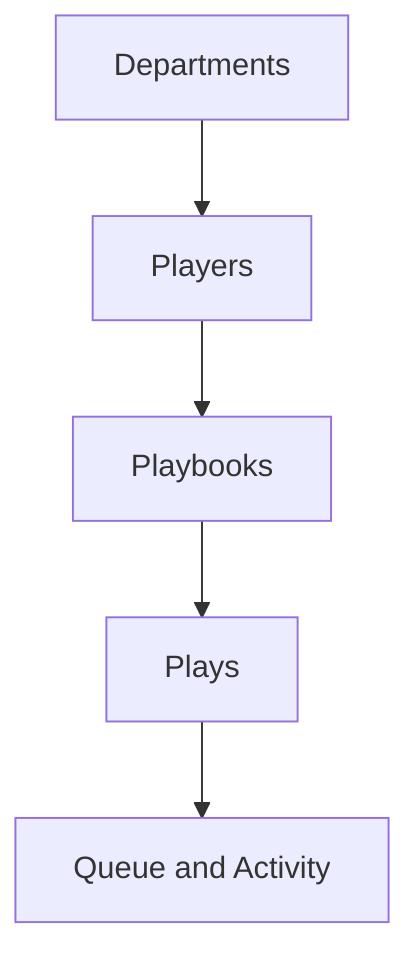
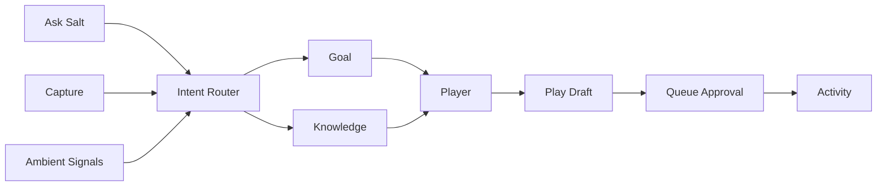

# Architecture Transition: Master Plan

**Date:** 2026-05-14  
**Status:** Active  
**Supersedes:** `2026-05-13-relationships-transition.md`, `2026-05-14-entity-architecture-plan.md`

---

## 🚀 ACTIVE SPRINT: YC Demo Build

**Status:** ACTIVE — takes priority over scheduled phases below.

**Goal:** Ship a 90-second Loom demo for Y Combinator submission within 3 days. Recording on Day 4.

**Strategy:** Front-load the visible UI layer of Phase 4 with mock data. Defer backend wiring. Every component built here is real Phase 4 work — just disconnected from real data temporarily. Work is not throwaway: this counts as Phase 4 progress.

### The build principle: production-aware mocking

What we mock vs build "for real":

| Build for real (counts as Phase 4) | Mock (revisit in Phase 3/6) |
|-----------------------------------|----------------------------|
| All components (from `@repo/ui`, `@repo/patterns`) | JSON data fixtures (one file) |
| Real routes (`/hq`, `/actions`, `/capture`, `/people`, `/connections`) | Auth (bypass via `DEMO_MODE`) |
| TypeScript types matching Phase 1 schema | Supabase queries (read from JSON instead) |
| Sidebar architecture (WorkspaceSwitcher, Connections group, etc.) | AI responses (pre-baked, realistic timing) |
| Page-level tabs and entity filters | Graph computation (static beautiful data) |
| Real micro-interactions (undo, loading, transitions) | Voice transcription (UI shell only) |
| Real feature flag system for `DEMO_MODE` | Persistence (state lives in memory) |

Result: ~80% of the demo work is real Phase 4 UI shells. Wiring Phase 3 backend later is a query-layer swap, not a UI rewrite.

### Demo storyline (6 beats, ~90 seconds)

The script for the Loom recording. Every screen below has to look pixel-perfect for these moments.

| # | Beat | Duration | Screen | Action |
|---|------|----------|--------|--------|
| 1 | Open Salt | 10s | Workspace + sidebar + HQ Today | Cold open → fade in. *"Salt is AI-first software for creative agencies."* |
| 2 | Actions queue | 15s | Actions page (Yours tab, 3 items) | Click Actions [3] → click an item → see draft + reasoning. *"AI drafts your replies, schedules check-ins, generates invoices."* |
| 3 | Approve in one click | 10s | Action detail → sent + undo | Hit Approve & Send → ✓ Sent animation + 30s undo bar. *"Every AI action is transparent. You're always in control."* |
| 4 | Capture (THE wow moment) | 15s | Capture page | Type *"Sarah said Tuesday is bad for Q3 launch, suggested pushing to following week. Also Mike likes the new logo but wants one more iteration."* → AI routes to Sarah's profile, Q3 project, creates Action for Mike. *"Just say it. AI files it where it belongs."* |
| 5 | Ask Salt | 15s | Cmd+K modal | *"Ask Salt to draft a quarterly check-in for everyone quiet 30+ days"* → see 4 drafts preview. *"Or tell Salt what to do. It builds the work."* |
| 6 | Worth Attention | 15s | People page → Person detail | Click People → Worth Attention shows 3 surfaced relationships → click Sarah → see AI insight card. *"Salt doesn't just store your relationships. It remembers them."* |
| Close | Salt logo | 10s | Logo | *"Salt. The agency, smarter."* |

### Day-by-day sprint plan

#### Day 1 — Foundation (~8 hours)
| # | Task | Maps to | Output |
|---|------|---------|--------|
| D1.1 | Set up `DEMO_MODE` feature flag + mock data fixtures file | New infra | `app/_lib/demo/mock-data.ts` |
| D1.2 | Build WorkspaceSwitcher component | Phase 4 task 4.1a | Real component, single mock workspace |
| D1.3 | Build unified sidebar (HQ, Actions, Messages, Capture, Connections group with People/Work/Payments, Teams, Try) | Phase 4 tasks 4.1b–4.1e | Pixel-perfect, all sections |
| D1.4 | Build HQ Today view with briefing card, today's meetings widget, key metrics | Phase 4 task 4.10 | Landing page |
| D1.5 | Build Actions queue page (Yours tab) with 3 mock items | Phase 4 task 4.11 | Queue + cards |

#### Day 2 — AI moments (~8 hours)
| # | Task | Maps to | Output |
|---|------|---------|--------|
| D2.1 | Action detail view with reasoning + draft preview | Phase 4 task 4.11 + Phase 6 6.9 (activity log entry shape) | Approval surface |
| D2.2 | Build approval flow: click Approve → animation → "✓ Sent" + 30s undo bar | Phase 6 task 6.15 (undo) | The approval moment |
| D2.3 | Build Capture page: input box, voice icon placeholder, recent capture cards | Phase 4 task 4.13 | Quick capture surface |
| D2.4 | Build Capture routing animation: type → AI thinking spinner → routing cards appear | Phase 6 task 6.26 (UI shell only) | The "wow" moment |
| D2.5 | Build "Ask Salt" modal (Cmd+K and ✨ icon) with mock generation flow | Phase 6 task 6.16 (UI shell only) | The command moment |

#### Day 3 — Polish + wow visual (~8 hours)
| # | Task | Maps to | Output |
|---|------|---------|--------|
| D3.1 | Build People page with Worth Attention tab + All tab | Phase 4 task 4.2 | List + AI insights |
| D3.2 | Build Person detail page with AI insight card | Phase 4 task 4.4 | Detail story |
| D3.3 | Build Connections page with static graph view | Phase 7 (Linking) preview | The visual stunner |
| D3.4 | Final visual polish pass: typography, spacing, color, motion, hover states | All | Demo-ready |
| D3.5 | Light/dark mode check, responsive smoke test | All | Confidence |

#### Day 4 — Record
- Storyline rehearsal (3 dry runs)
- Loom recording with screen + voiceover
- Edit + submit to YC

### Mock data requirements

The mocks have to feel real. Avoid lorem ipsum. Use:

- **Agency clients:** Acme Corp, Beta Inc, Helios Studio, Northwind Co
- **People:** Sarah Chen, Mike Hart, Jane Park, Marcus Webb, Alice Chen
- **Projects:** "Q3 Rebrand", "Series A Launch", "Pricing Page Redesign", "Brand Refresh"
- **AI drafts:** Use Claude to generate the actual draft text in fixtures — it'll look authentic because it IS

Single fixtures file: `app/_lib/demo/mock-data.ts` — all pages import from here. Easy to tweak between recording takes.

### What we explicitly DO NOT do during the sprint

| Skip | Why | Where it lives |
|------|-----|----------------|
| Real Supabase queries | Demo doesn't need persistence | Phase 3 |
| Real AI calls (OpenAI/Anthropic) | Pre-baked responses look identical on video | Phase 6 |
| Auth flows (signup, signin) | `DEMO_MODE` bypasses | Existing system |
| Settings panels | Out of scope for 90s | Phase 4 task 6.12 |
| Multi-AI coordination UI | Phase 6 territory | Phase 6 |
| Voice notes (real recording/transcription) | Phase 6, show "Coming soon" tooltip | Phase 6 task 6.27 |
| Plays UI | Phase 8, mentioned in voiceover only | Phase 8 |
| Activity log full detail tab | Use a card inline on Action detail instead | Phase 6 task 6.9 |
| Per-client autonomy settings | Out of scope | Phase 6 task 6.12 |
| Real Stripe / payments | Mock invoice line items | Phase 6 task 6.7 |
| Multi-workspace | Single mock workspace | Phase 9 |
| Trust gradient UI | Not visible in demo flow | Phase 6 task 6.13 |
| Tests | Sprint, not maintainable code (yet) | After demo |

### "Coming soon" placeholders for the demo

These features are visible but non-functional (tooltips or disabled state):
- 🎤 Voice icon in Capture (tooltip: "Voice notes — coming soon")
- "+ New team" in Teams sidebar (tooltip: "Team creation — coming soon")
- Settings gear (tooltip: "Workspace settings — coming soon")
- Connections page → Insights/Paths/Find tabs (visible, but show "Coming soon" cards inside)

### Demo recording prep checklist

- [ ] All 6 storyline beats rehearsed (3+ dry runs)
- [ ] Mock data names/projects feel real (no obviously fake content)
- [ ] All transitions feel polished (no jank on click)
- [ ] Cursor highlighting on in Loom
- [ ] 1080p minimum, 16:9 aspect
- [ ] Background apps closed, notifications silenced
- [ ] Voiceover script written and timed
- [ ] Backup take if first one has flubs

### After the demo

Resume the master plan. Specifically:
1. **Phase 3 backend wiring** for the screens built (swap mock data → real Supabase queries)
2. **Phase 4 continues** — fill in remaining UI shells (Work page, Payments page, Teams detail, etc.)
3. **Phase 6 AI behavior** — replace pre-baked responses with real AI calls + activity log

The components, routes, types, and demo-mode infrastructure all carry forward.

---

## What's Already Done

| Phase | Status | What Was Completed |
|-------|--------|-------------------|
| Route Aliasing | **DONE** | `/relationships` routes created alongside `/clients` |
| Feature Module Rename | **DONE** | `_features/clients/` → `_features/relationships/` |
| Sidebar Navigation | **DONE** | Relationships section detected, shows correct nav items |
| Logo SVGs | **DONE** | Text-based SVGs for relationships.svg and hq.svg |
| Phase 1: Schema Foundation | **DONE** | organizations, people, teams, entity_relations tables + RLS |
| Phase 2: Data Migration | **DONE** | Migrated clients → organizations + people |
| Phase 3: Queries & API Layer | **IN PROGRESS** | TypeScript types, queries, feature flags, dual-write actions |

---

## Current Database Schema (What We Have)

```
studios                    -- The workspace/agency
├── owner_id → users
├── studio_members         -- Internal team (users in workspace)
│   ├── user_id → users
│   └── role: owner|admin|member|viewer
│
├── clients                -- External entities (will become people + organizations)
│   ├── client_type: individual|organization
│   ├── lifecycle_stage: prospect|discovery|pitch|client|complete|on-hold|lost
│   └── client_users       -- Portal access for contacts
│
├── companies              -- Separate companies table (underutilized)
│
└── projects               -- Work
    ├── studio_id
    └── client_id
```

---

## Target Database Schema (Where We're Going)

```
workspaces                 -- Renamed from studios (multi-workspace ready)
├── owner_id → users
├── workspace_memberships  -- Renamed from studio_members
│   ├── user_id → users
│   └── role: owner|admin|member|guest
│
├── teams                  -- NEW: groups within workspace
│   └── team_members       -- Junction to workspace_memberships
│
├── organizations          -- Evolved from companies (external companies)
│   └── relationship_status: prospect|client|past_client|partner|vendor
│
├── people                 -- NEW: external contacts (replaces clients as entity)
│   ├── relationship_status: prospect|client|past_client|partner|vendor
│   ├── organization_id (optional)
│   └── portal_user_id (optional, for The Table access)
│
├── organization_people    -- Junction: person works at organization
│   ├── role: primary_contact|billing|technical|etc
│   └── is_primary: boolean
│
├── entity_relations       -- NEW: Obsidian-style linking
│   ├── from_entity_type + from_entity_id
│   ├── to_entity_type + to_entity_id
│   └── relation_type: works_at|contact_for|related_to|mentioned_in
│
└── projects               -- Enhanced
    ├── workspace_id
    ├── organization_id (optional, replaces client_id)
    ├── team_id (optional)
    └── primary_contact_id → people
```

---

## Implementation Phases

### Phase 1: Schema Foundation (Non-Breaking)
**Timeline:** 3-5 days  
**Risk:** LOW  
**Visible Changes:** None (backend only)

**Goal:** Add new tables alongside existing ones. No data migration yet, no UI changes.

**Tasks:**

| # | Task | Type | Details |
|---|------|------|---------|
| 1.1 | Create `organizations` table | Migration | Copy structure from `companies`, add `relationship_status` |
| 1.2 | Create `people` table | Migration | New table for external contacts |
| 1.3 | Create `organization_people` junction | Migration | Links people to organizations |
| 1.4 | Create `teams` table | Migration | Groups within workspace |
| 1.5 | Create `team_members` junction | Migration | Links studio_members to teams |
| 1.6 | Create `entity_relations` table | Migration | For Obsidian-style linking |
| 1.7 | Add `workspace_id` alias to studios | Migration | `ALTER TABLE studios ADD COLUMN workspace_id UUID GENERATED ALWAYS AS (id) STORED` or create view |
| 1.8 | Create compatibility views | Migration | `CREATE VIEW workspaces AS SELECT * FROM studios` |

**SQL Preview:**

```sql
-- organizations (evolve from companies concept)
CREATE TABLE organizations (
  id UUID PRIMARY KEY DEFAULT gen_random_uuid(),
  studio_id UUID NOT NULL REFERENCES studios(id) ON DELETE CASCADE,
  name TEXT NOT NULL,
  relationship_status TEXT DEFAULT 'prospect' 
    CHECK (relationship_status IN ('prospect', 'client', 'past_client', 'partner', 'vendor', 'other')),
  website TEXT,
  industry TEXT,
  notes TEXT,
  metadata JSONB DEFAULT '{}',
  created_at TIMESTAMPTZ DEFAULT NOW(),
  updated_at TIMESTAMPTZ DEFAULT NOW()
);

-- people (external contacts)
CREATE TABLE people (
  id UUID PRIMARY KEY DEFAULT gen_random_uuid(),
  studio_id UUID NOT NULL REFERENCES studios(id) ON DELETE CASCADE,
  name TEXT NOT NULL,
  email TEXT,
  phone TEXT,
  title TEXT,
  relationship_status TEXT DEFAULT 'other'
    CHECK (relationship_status IN ('prospect', 'client', 'past_client', 'partner', 'vendor', 'other')),
  notes TEXT,
  metadata JSONB DEFAULT '{}',
  avatar_url TEXT,
  portal_user_id UUID REFERENCES auth.users(id), -- For The Table access
  created_at TIMESTAMPTZ DEFAULT NOW(),
  updated_at TIMESTAMPTZ DEFAULT NOW()
);

-- organization_people junction
CREATE TABLE organization_people (
  id UUID PRIMARY KEY DEFAULT gen_random_uuid(),
  organization_id UUID NOT NULL REFERENCES organizations(id) ON DELETE CASCADE,
  person_id UUID NOT NULL REFERENCES people(id) ON DELETE CASCADE,
  role TEXT, -- 'Primary Contact', 'Billing', 'Technical'
  is_primary BOOLEAN DEFAULT FALSE,
  created_at TIMESTAMPTZ DEFAULT NOW(),
  UNIQUE(organization_id, person_id)
);

-- teams
CREATE TABLE teams (
  id UUID PRIMARY KEY DEFAULT gen_random_uuid(),
  studio_id UUID NOT NULL REFERENCES studios(id) ON DELETE CASCADE,
  name TEXT NOT NULL,
  description TEXT,
  color TEXT, -- For UI display
  created_at TIMESTAMPTZ DEFAULT NOW(),
  updated_at TIMESTAMPTZ DEFAULT NOW()
);

-- team_members
CREATE TABLE team_members (
  id UUID PRIMARY KEY DEFAULT gen_random_uuid(),
  team_id UUID NOT NULL REFERENCES teams(id) ON DELETE CASCADE,
  studio_member_id UUID NOT NULL REFERENCES studio_members(id) ON DELETE CASCADE,
  created_at TIMESTAMPTZ DEFAULT NOW(),
  UNIQUE(team_id, studio_member_id)
);

-- entity_relations (Obsidian-style linking)
CREATE TABLE entity_relations (
  id UUID PRIMARY KEY DEFAULT gen_random_uuid(),
  studio_id UUID NOT NULL REFERENCES studios(id) ON DELETE CASCADE,
  from_entity_type TEXT NOT NULL, -- 'person', 'organization', 'project', 'note'
  from_entity_id UUID NOT NULL,
  to_entity_type TEXT NOT NULL,
  to_entity_id UUID NOT NULL,
  relation_type TEXT, -- 'works_at', 'contact_for', 'related_to', 'mentioned_in'
  context TEXT, -- Optional description
  created_at TIMESTAMPTZ DEFAULT NOW(),
  created_by UUID REFERENCES auth.users(id),
  UNIQUE(studio_id, from_entity_type, from_entity_id, to_entity_type, to_entity_id, relation_type)
);

-- Indexes for backlinks queries
CREATE INDEX idx_entity_relations_to ON entity_relations(to_entity_type, to_entity_id);
CREATE INDEX idx_entity_relations_studio ON entity_relations(studio_id);
```

**Verification:**
- [ ] All tables created without errors
- [ ] RLS policies added for all new tables
- [ ] Existing functionality still works (no breaking changes)

---

### Phase 2: Data Migration
**Timeline:** 3-5 days  
**Risk:** MEDIUM  
**Visible Changes:** None yet (data copied, not switched)

**Goal:** Migrate existing `clients` data to new `organizations` + `people` tables.

**Tasks:**

| # | Task | Type | Details |
|---|------|------|---------|
| 2.1 | Migrate `client_type: organization` clients | Script | Create org records + primary contact person |
| 2.2 | Migrate `client_type: individual` clients | Script | Create person records directly |
| 2.3 | Link `client_users` to `people.portal_user_id` | Script | Connect portal access |
| 2.4 | Create `organization_people` links | Script | Link contacts to their organizations |
| 2.5 | Copy `companies` to `organizations` | Script | Merge existing companies data |
| 2.6 | Validate migration | Script | Count checks, data integrity |
| 2.7 | Add `migrated_from_client_id` column | Migration | Track lineage for rollback |

**Migration Logic:**

```sql
-- For organization clients
INSERT INTO organizations (studio_id, name, relationship_status, website, notes, metadata, created_at)
SELECT 
  studio_id,
  name,
  lifecycle_stage::TEXT, -- Map lifecycle to relationship_status
  contact_email, -- Temporary, will move to person
  notes,
  settings,
  created_at
FROM clients 
WHERE client_type = 'organization';

-- Create primary contact person for each organization client
INSERT INTO people (studio_id, name, email, phone, relationship_status, created_at)
SELECT 
  c.studio_id,
  COALESCE(c.settings->>'primary_contact_name', c.name || ' Contact'),
  c.contact_email,
  c.contact_phone,
  c.lifecycle_stage::TEXT,
  c.created_at
FROM clients c
WHERE c.client_type = 'organization';

-- For individual clients (direct to people)
INSERT INTO people (studio_id, name, email, phone, relationship_status, notes, created_at)
SELECT 
  studio_id,
  name,
  contact_email,
  contact_phone,
  lifecycle_stage::TEXT,
  notes,
  created_at
FROM clients 
WHERE client_type = 'individual';
```

**Verification:**
- [ ] All clients migrated (count matches)
- [ ] No orphaned records
- [ ] `projects.client_id` still works (we haven't switched yet)

---

### Phase 3: Queries & API Layer
**Timeline:** 5-7 days  
**Risk:** MEDIUM  
**Visible Changes:** Minimal (same UI, new data source)

**Goal:** Update queries to read from new tables. Keep writing to both during transition.

**Tasks:**

| # | Task | Type | Details |
|---|------|------|---------|
| 3.1 | Create `_features/relationships/queries-v2.ts` | Code | New queries against organizations + people |
| 3.2 | Create TypeScript types | Code | `Person`, `Organization`, `Team` types |
| 3.3 | Update Server Actions for dual-write | Code | Write to old + new tables |
| 3.4 | Create feature flag | Code | `use_new_entity_model` flag |
| 3.5 | Update list queries | Code | Switch reads to new tables behind flag |
| 3.6 | Update detail queries | Code | Switch reads to new tables behind flag |

**Type Definitions:**

```typescript
// _features/relationships/types.ts

export type RelationshipStatus = 
  | 'prospect' 
  | 'client' 
  | 'past_client' 
  | 'partner' 
  | 'vendor' 
  | 'other';

export interface Organization {
  id: string;
  studioId: string;
  name: string;
  relationshipStatus: RelationshipStatus;
  website?: string;
  industry?: string;
  notes?: string;
  metadata: Record<string, unknown>;
  createdAt: Date;
  updatedAt: Date;
  // Joined data
  people?: Person[];
  primaryContact?: Person;
}

export interface Person {
  id: string;
  studioId: string;
  name: string;
  email?: string;
  phone?: string;
  title?: string;
  relationshipStatus: RelationshipStatus;
  notes?: string;
  avatarUrl?: string;
  portalUserId?: string; // For The Table access
  createdAt: Date;
  updatedAt: Date;
  // Joined data
  organizations?: Organization[];
}

export interface Team {
  id: string;
  studioId: string;
  name: string;
  description?: string;
  color?: string;
  members?: TeamMember[];
}

export interface TeamMember {
  id: string;
  teamId: string;
  studioMemberId: string;
  // Joined
  member?: StudioMember;
}

// Backwards compatibility
export type Client = Organization | Person;
```

**Verification:**
- [ ] Feature flag works (can toggle between old/new)
- [ ] List view loads from new tables
- [ ] Detail view loads from new tables
- [ ] Create/update writes to both tables

---

### Phase 4: UI Updates
**Timeline:** 5-7 days  
**Risk:** MEDIUM  
**Visible Changes:** YES - new UI, new terminology

**Goal:** Update components to use new data model. Replace AppSwitcher with unified sidebar + WorkspaceSwitcher. Change navigation labels.

**Design Direction:** Minimalist, Linear/Obsidian-inspired. Single unified sidebar (no app switching). Consolidate "command" items so the top of the sidebar stays small (3 items max).

**Tasks:**

| # | Task | Type | Details |
|---|------|------|---------|
| 4.1a | Replace AppSwitcher with WorkspaceSwitcher | UI | Top of sidebar shows workspace name (stub: single workspace dropdown). Removes per-app nav splitting. |
| 4.1b | Unify nav items into single sidebar | UI | Collapse `getNavItemsForApp()` into one flat nav. Use `Connections ▼` as a clickable + collapsible group header that contains People, Work, Billing. |
| 4.1d | Build clickable + collapsible Connections group | UI | Header is BOTH a destination (clicking label → `/connections`) and a collapse control (clicking ▼ → expand/collapse children). Linear-inspired. |
| 4.1e | Build Try section at sidebar bottom | UI | Below Favorites/Recents. Initial items: "Import contacts" + "Train your AI voice". Items hide on completion; section hides when empty. |
| 4.1c | Consolidate top items (HQ + Actions + Messages) | UI | Reduce 5 command items → 3: HQ, Actions, Messages. HQ absorbs Daily Briefing + Command Center + Insights + Calendar via on-page view switcher. Inbox splits into Actions (AI items) and Messages (human conversations). |
| 4.10 | Build HQ page shell with view switcher | UI | Today / Week / Month tabs on page (not in sidebar). Renders briefing, metrics, calendar widgets per view. Phase 6 fills with AI. |
| 4.11 | Build Actions page shell | UI | Queue tab + Activity tab layout. Empty states. Header has search icon + ✨ "Ask Salt" compose icon (Linear-style, top right). Phase 6 fills with AI behavior. |
| 4.12 | Build Messages page shell | UI | Thread list + thread view. Inline placeholders for AI marker components (Phase 6 wires up). |
| 4.13 | Build Capture page shell | UI | Quick-capture box (always at top), recent capture cards, tabs (Recent / All / Auto-routed / Needs review). Voice icon (UI placeholder, AI wired in Phase 6). |
| 4.14 | Build Floating Capture Button (FAB) + Quick Modal | UI | Persistent FAB at bottom-right of every authenticated page (24px offset, PenLine icon, primary-tinted with hover-lift). Click opens compact modal — textarea + Voice icon + Save — that runs through the same AI routing pipeline as /capture. Hides on /capture itself (redundant). Tooltip: "Capture · ⌘⇧N". |
| 4.15 | Wire global Cmd+Shift+N hotkey | UI | Opens the same FAB modal from anywhere. Listens at the DashboardLayoutWrapper level so it works on every authenticated page. Escapable via Esc or click-outside. |
| 4.2 | Build unified People page (single sidebar item) | UI | One "People" nav item. Page shows both entity types via page-level tabs/filters: `[Worth Attention]` `[All]` `[People]` `[Companies]`. People can exist without Organizations. Organizations are peers, not nested under People. AI-curated "Worth Attention" is the default tab. |
| 4.3 | Add relationship status UI | UI | Dropdown to change prospect→client etc |
| 4.4 | Update detail page | UI | Show organization + contacts structure |
| 4.5 | Add "Works At" UI | UI | Link person to organization |
| 4.6 | Update create flow | UI | Choose: create Person or Organization |
| 4.7 | Add Teams to sidebar | UI | New section in navigation (under PEOPLE or its own section) |
| 4.8 | Create Team management UI | UI | List/create/edit teams |
| 4.9 | Add team assignment to projects | UI | Select team for project |

**Navigation Change (Option C — Pragmatic Minimalism):**

```
Old sidebar (fragmented):            New sidebar (unified):
┌─────────────────────────┐          ┌─────────────────────────────┐
│ HQ                      │          │ 🏢 My Agency            ▼   │  ← Workspace switcher
├─────────────────────────┤          ├─────────────────────────────┤
│ • Daily Briefing        │          │ 🏢 HQ                       │  ← dashboard (views on page)
│ • Inbox            [•]  │          │ ⚡ Actions             [3]  │  ← AI items awaiting you
│ • Command Center        │          │ 💬 Messages            [•]  │  ← human conversations
│ • Insights              │          │ ✨ Capture                  │  ← AI-routed scratchpad
│                         │          │                             │
│ • Calendar              │          │ 🔗 Connections         ▼    │  ← clickable header + collapsible group
│                         │          │    👥 People                │  ← directory + filters + local connections
│ Nav changed based on    │          │    📁 Work                  │  ← projects / retainers / agreements
│ which "app" you were    │          │    💰 Payments              │  ← invoices / activity
│ in. Each section had    │          │                             │
│ its own nav.            │          │ 👨‍👩‍👧 Teams           ▼    │  ← collapsible + specific teams (Linear-style)
└─────────────────────────┘          │    🎨 Design Team           │
                                     │    💻 Dev Team              │
                                     │    ➕ New team              │
                                     │                             │
                                     │ Try                    ▼    │  ← onboarding/discovery
                                     │    📥 Import contacts       │
                                     │    ✨ Train your AI voice   │
                                     ├─────────────────────────────┤
                                     │ [Avatar] You             ⋯  │
                                     └─────────────────────────────┘
```

**Top section: 3 items (HQ + Actions + Messages)**

| Old (5 items)   | New (3 items)   | Notes |
|-----------------|------------------|-------|
| Daily Briefing  | **HQ**           | Becomes a dashboard with view switcher *on the page itself* |
| Command Center  | (merged into HQ) | Visible inside the Week / Month views of HQ |
| Insights        | (merged into HQ) | Visible inside the Month view of HQ, or contextual tabs inside Work/Billing |
| Calendar        | (merged into HQ) | Calendar widgets appear inside Today/Week/Month views of HQ |
| Inbox           | **Actions** + **Messages** | Split by type (see naming research below) |

**Why "Actions" instead of "Inbox" / "Approvals" / "Decisions":**

Backed by user-psychology research across four principles:

1. **Locus of control** — "Actions" is internal locus (user is the actor). "Inbox" / "Queue" are external locus (stuff arrives, user reacts).
2. **Decision fatigue** — "Decisions" is the most truthful name but explicitly triggers the cognitive frame that depletes willpower. "Actions" doesn't.
3. **Zeigarnik effect** — "Inbox" implies infinite accumulation (open loops never close). "Actions" implies completable items.
4. **Verb energy** — Action-derived labels reduce cognitive load and increase agency vs. passive nouns ("Pending," "Review").

Independent convergence: Vercel, GitHub, and Slack all chose "Actions" for their AI/agentic surfaces.

**HQ views live on the page, not in the sidebar:**

The view switcher (Today / This Week / This Month) is a page-level control inside HQ, not a sidebar entry. This matches Linear (view switcher in toolbar), Apple Calendar (Day/Week/Month buttons), and Notion (view tabs).

```
┌───────────────────────────────────────────────────────────────┐
│ HQ                                                            │
│ ┌─────────┬───────────┬────────────┐                          │
│ │  Today  │ This Week │ This Month │   ← page-level view tabs │
│ └─────────┴───────────┴────────────┘                          │
│                                                               │
│  [Today view contents: briefing, today's meetings,            │
│   approvals preview, since-yesterday metrics...]              │
└───────────────────────────────────────────────────────────────┘
```

**People section: single nav item, page-level entity filtering (research-backed):**

```
👥 People  (sidebar — one item only)
─────────────────────────────────────────
On the page:
[ ⚡ Worth Attention ] [ 📋 All ] [ 👤 People ] [ 🏢 Companies ] [ + Save view ]
```

| Decision | Choice | Why (research-backed) |
|----------|--------|----------------------|
| Sidebar items | **One** ("People") | Cognitive load (NN/G); minimalism principle |
| Entity model | **Co-equal peers** (People + Organizations) | CRM data-model literature; matches real B2B many-to-many |
| Nesting | **Never** (Organizations are NOT under People) | Implies hierarchy that doesn't exist; orgs have their own data (revenue, contracts) |
| People without Orgs | **Fully supported** | Freelancer clients are common; many CRMs over-rigid here |
| Orgs without People | **Fully supported** | "Acme Corp" can exist before you know who works there |
| Default page view | **AI-curated "Worth Attention"** | Matches AI-first lens applied to HQ |
| Filters | **Page-level tabs** (not sidebar items) | Notion-style, lower cognitive load than Linear sidebar views |
| Saved Views | **Page-level + AI-suggested** (not sidebar) | Sentry industry shift; AI nudge cuts manual creation friction |

**Why not separate "People" and "Organizations" sidebar items (HubSpot/Pipedrive convention)?**
Research shows agency owners think relationship-first, not entity-first. They search "Sarah at Acme" — they don't know whether they want the Person or Organization record. A unified surface matches the actual mental model, and Worth Attention treats both entity types as peers anyway.

**Saved Views pattern (Option 2 + Option 3 hybrid):**
- Users can click `+ Save view` after applying filters → becomes a tab
- AI detects repeated filtering (e.g., filtering by "overdue 14d" three times) and proactively offers: *"Save this as a quick-access tab?"*
- Views live on the page, not in sidebar — matches Notion's pattern, supports progressive disclosure for mixed audiences

**Connections: clickable section header + collapsible group + standalone destination**

`Connections` is the umbrella for everything relationship-driven in Salt — which is basically the whole product. It functions as three things at once:

1. **Brand-aligned section label** — tells the thesis of the app right in the nav ("everything below is about your connections")
2. **Collapsible group** — click the ▼ chevron to hide/show child items (People, Work, Billing)
3. **Clickable destination** — click the "Connections" label itself to open the relationship intelligence hub (`/connections` route)

```
🔗 Connections ▼            ← clickable label + collapsible chevron
   👥 People                ← child: directory + filters + local graphs per entity
   📁 Work                  ← child: projects / retainers / agreements
   💰 Billing               ← child: invoices / payments / services

The /connections page itself contains:
[ 🕸️ Graph ] [ ✨ Insights ] [ 🧭 Paths ] [ 🔍 Find ]
   visualization   AI patterns    intro paths   search
```

| Decision | Choice | Why (research-backed) |
|----------|--------|----------------------|
| Name | **"Connections"** | Most linguistically precise (a connection = a link); avoids transactional baggage of "Network"; avoids "Relationships" abstractness; natural verb ("connect with") |
| Scope | Full destination, not just a graph view | Graph + AI Insights + Paths + Find = relationship intelligence hub |
| Page tabs | Graph / Insights / Paths / Find | "Connections" used throughout — no "Network" anywhere in the UI |
| Sidebar placement | Below People, no section header | Two flat items at this level matches the minimalism principle |
| Data foundation | `entity_relations` table (Phase 7 schema) | Visualization layer of existing relational data |
| AI use | Powers "warm intro paths," common-neighbor detection, hub identification, underused connections, network growth tracking | Surfaces also flow up to HQ Today briefing |

**Sub-features inside Connections:**

| Tab | What it shows |
|-----|---------------|
| **🕸️ Graph** | Global visualization of your connections with filters (entity type, time range, focus point). Click node → open entity. Hover edge → see relationship context. |
| **✨ Insights** | AI-generated patterns: warm intro paths, common neighbors, hub people, underused connections, cluster detection, recent network growth |
| **🧭 Paths** | Natural-language "How am I connected to X?" — shortest-path tracer |
| **🔍 Find** | Natural-language search against the graph: "Who do I know at Acme?", "Mutual connections with Jane", "Most-introduced people" |

**Also: Local graph view (per entity)**

Every Person and Organization detail page has a "Show connections" button that displays just that entity's immediate 1-hop neighborhood (a focused mini-graph). This is the most useful day-to-day use of the graph data.

---

**Teams: dedicated sidebar section (Linear-style, outside Connections)**

Teams gets its own sidebar section — **outside Connections** because it represents internal operations (your studio's organization), not external network/CRM. Connections = your external relationships; Teams = your internal operations.

```
👨‍👩‍👧 Teams ▼            ← clickable header + collapsible (like Connections)
   🎨 Design Team
   💻 Dev Team
   📊 Strategy Team
   ➕ New team           ← inline action
```

**Behavior:**

- **Click "Teams" label** → opens `/teams` overview (cards of all teams with capacity/health at a glance)
- **Click ▼ chevron** → collapse/expand the children
- **Click a specific team** → opens that team's detail page (`/teams/design`, etc.)
- **Click "+ New team"** → opens team creation modal
- **Adaptive:** Hidden entirely for solo workspaces (workspace with only 1 member). Shows once a second member is added.

**Each team's detail page (`/teams/[slug]`):**

```
🎨 Design Team                       🔍   ✨   ⚙️ Settings
─ tabs ─
[ Overview ] [ Members ] [ Projects ] [ Capacity ] [ Performance ]
```

| Tab | What's shown |
|-----|--------------|
| **Overview** | Quick stats, AI insights, recent activity |
| **Members** | Who's on the team (drilled from People → Internal) |
| **Projects** | Active projects this team owns (drilled from Work) |
| **Capacity** | Current workload, allocation, free hours |
| **Performance** | Output metrics, completed projects, retro signals |

**The `/teams` overview page (clicked from "Teams" header):**

Same tab pattern as other pages:
```
👨‍👩‍👧 Teams                            🔍   ✨   ➕ New team
─ tabs ─
[ ⚡ Worth Attention ] [ All Teams ] [ + Save view ]
```

Team cards shown with capacity indicators, AI insights ("Design team at 110% this week — consider redistribution").

**Why Linear-style (specific teams in sidebar)?**

| Tradeoff | Linear-style (chosen) | Page-handled (rejected) |
|----------|----------------------|------------------------|
| Quick access | One click to any team | Two clicks (Teams → drill in) |
| Discoverability | All teams visible | Hidden until you visit /teams |
| Scaling | Works for 2-10 teams; >10 still OK | Always uniform |
| Matches familiar pattern (Linear) | ✓ | ✗ |
| Empty for solo users | ✓ (hidden via adaptive) | ✓ |

For Salt's target (agencies with 1-10 teams), Linear-style works well. If a workspace grows to 20+ teams, we'd revisit (likely add a "Show all teams" expand pattern).

**Team admin (creating team types, permissions, deletion) → Settings → Team Management.** The Teams sidebar section is for *operating* teams; Settings is for *configuring* them.

---

**Each Connections child page follows the same tab pattern**

Consistency across People, Work, and Payments. Every page has the same shape:

1. Header actions: 🔍 Search, ✨ Ask Salt, ➕ New
2. Default tab: ⚡ Worth Attention (AI-curated)
3. Entity-type filter tabs
4. + Save view (manual save + AI-suggested over time)

**👥 People page:**
```
[ ⚡ Worth Attention ] [ All ] [ Individuals ] [ Organizations ] [ Internal ] [ + Save view ]
```
- *Individuals* = external people (clients, prospects, partners)
- *Organizations* = companies
- *Internal* = your studio team members (where Teams folds in)

**📁 Work page:**
```
[ ⚡ Worth Attention ] [ Projects ] [ Retainers ] [ Agreements ] [ + Save view ]
```
- *Worth Attention* surfaces: stalled projects, expiring agreements, retainer renewals due
- *Agreements* = signed contracts (the artifact). Lifecycle tabs *inside* Agreements: Active / Expiring soon / Archived

**💰 Payments page:**
```
[ ⚡ Worth Attention ] [ Invoices ] [ Activity ] [ + Save view ]
```
- *Worth Attention* surfaces: overdue invoices, failed payments, drafts not yet sent
- *Activity* = payments received, refunds, failed payment events

**Important distinction: Proposals ≠ Agreements**

| Concept | Type | Where it lives |
|---------|------|---------------|
| **Agreement** | Noun (artifact) | Work → Agreements tab. The signed contract that governs work. |
| **Proposal** | Verb (workflow) | Created via "Ask Salt" → drafts an Action → reviewed → sent. Once signed, it becomes an Agreement. |

Proposals are an action you *do*, not a destination you *visit*. The proposal workflow (drafting, editing, sending) lives in the Actions queue, not as a sidebar/page item.

---

**Services & Rates → Settings (configuration, not daily work)**

The Services catalog is set-once-then-reference configuration. Lives at `Settings → Services & Rates`. Surfaces wherever needed:
- "+ Add service" line item in Invoice creation
- "+ Add service" line item in proposal-drafting workflow
- AI uses catalog as the menu when "Ask Salt" generates work artifacts

---

**Try section (Linear-inspired onboarding/discovery)**

Bottom of sidebar, below Favorites/Recents. Shows up to ~5 items helping new users complete setup. Items disappear once completed; the whole section hides when empty.

**Initial Try items (locked in for v1):**

| Item | Action | When it disappears |
|------|--------|---------------------|
| 📥 **Import contacts** | Opens import flow (CSV, Google Contacts, etc.) | After first import completed |
| ✨ **Train your AI voice** | Opens voice training flow (paste 5-10 sample messages → AI learns voice profile) | After voice profile has ≥10 samples |

**Future Try items (out of scope for v1, but the pattern supports):**
- Connect Stripe • Connect Google Calendar • Connect Gmail • Create first proposal template • Set up payment reminder defaults • Invite teammates • Create first client • Set up AI autonomy preferences

The section is intentionally minimal at launch — only items with clear "done" states. We'll expand as discovery patterns emerge from real users.

**Actions vs Messages split:**

| Surface | Contains | Mental model |
|---------|----------|--------------|
| **Actions** | AI-drafted replies awaiting approval, AI-proposed invoices, "AI wants to do X" requests, decisions AI can't make alone | Judge AI's work; yes / no / edit |
| **Messages** | Real human-to-human conversations (client portal, internal mentions, threads) | Have a conversation |

The split signals AI-first: Actions is for collaborating with AI, Messages is for collaborating with humans.

**Workspace Switcher dropdown (when clicked):**

```
┌─────────────────────────┐
│ ✓ My Agency             │  ← current
│   Side Hustle           │
│   Partner Co (guest)    │
│ ─────────────────       │
│ ⚙️  Workspace settings   │
│ + New Workspace         │
└─────────────────────────┘
```

Note: For Phase 4, the switcher is a stub showing only the current workspace. Real multi-workspace activates in Phase 7.

**Verification:**
- [ ] AppSwitcher removed, WorkspaceSwitcher in place
- [ ] Single unified sidebar (no nav changes when switching pages)
- [ ] Top section has exactly 3 items: Today, Inbox, Calendar
- [ ] Command Center + Insights live inside Today
- [ ] Section labels (PEOPLE/TEAMS/WORK/BILLING) render correctly
- [ ] List views show organizations + people correctly
- [ ] Detail view shows linked contacts
- [ ] Teams visible and functional
- [ ] Create flows work for both entity types

#### 4.16–4.19 Connections Sub-Pages (Work, Teams, Notes)

**Context:** The Connections section in the sidebar contains four sub-items: People, Work, Teams, Notes. People is complete; the others need UI shells.

**Vision:** Connections is the "professional intelligence layer" — not just contacts, but the full graph of everything the user knows professionally. Notes are standalone ideas that don't belong to a specific entity but enrich the knowledge graph.

| # | Task | Type | Details |
|---|------|------|---------|
| 4.16 | Build Work page shell | UI | List of projects + organizations. Tabs: Active Work, Organizations, Archive. Links to `/work/projects` for detail. Route: `/work` |
| 4.17 | Build Teams page shell | UI | List of internal teams with member counts, recent activity. Route: `/teams` |
| 4.18 | Build Notes page shell | UI | List of standalone notes grouped by date. Tabs: All, Pinned, Ideas, Reminders. Search + filter. Route: `/notes` |
| 4.19 | Add "Add Note" quick capture | UI | In Notes page header, button to add a new note inline or via modal |
| 4.20 | Wire Notes as Capture destination | Code | When routing a Capture to "Notes", create a Note entity instead of linking to Person/Org/Project |

**Notes data model:**

```typescript
interface Note {
  id: string;
  content: string;
  category: 'idea' | 'reminder' | 'reflection';
  is_pinned: boolean;
  is_archived: boolean;
  created_at: string;
  updated_at: string;
  // Optional: weak references to entities (for graph edges)
  linked_entity_ids?: string[];
}
```

**Verification (Connections sub-pages):**
- [ ] `/work` shows list of projects and organizations
- [ ] `/teams` shows list of internal teams
- [ ] `/notes` shows list of standalone notes with grouping
- [ ] Notes can be created from Notes page
- [ ] Capture can route items to Notes

---

### Phase 5: Deprecate Old Tables
**Timeline:** 2-3 days  
**Risk:** LOW (after verification)  
**Visible Changes:** None

**Goal:** Stop writing to old tables, add deprecation notices.

**Tasks:**

| # | Task | Type | Details |
|---|------|------|---------|
| 5.1 | Remove dual-write | Code | Only write to new tables |
| 5.2 | Update `projects.client_id` | Migration | Add `organization_id` + `primary_contact_id` |
| 5.3 | Migrate project links | Script | Copy client_id to organization_id/person_id |
| 5.4 | Remove feature flag | Code | New model is default |
| 5.5 | Add deprecation comments | Code | Mark old queries as deprecated |
| 5.6 | Update E2E tests | Tests | Point to new data model |

**Verification:**
- [ ] All reads from new tables
- [ ] All writes to new tables
- [ ] Projects linked correctly
- [ ] E2E tests pass

---

### Phase 6: AI-First Messages, Actions & Activity Log
**Timeline:** 3-4 weeks  
**Risk:** HIGH (AI behavior is complex and trust-sensitive)  
**Visible Changes:** YES — major AI capabilities, the moment Salt becomes truly AI-first

**Goal:** Turn the Actions and Messages surfaces (built in Phase 4) into intelligent, transparent, user-controllable AI experiences. AI drafts replies, sends acknowledgments, proactively reaches out, fires payment reminders — all with full audit trail and user-tunable autonomy.

**Core principles (the "glass box" doctrine):**

1. **Glass box, not black box** — every AI action is traceable: what, why, outcome, correction.
2. **Internal locus of control** — users feel they're in charge; AI assists. (See research-backed naming: chose **"Actions"** over "Approvals" / "Decisions" / "Inbox" — see Phase 4.)
3. **Trust gradient** — AI earns autonomy through demonstrated alignment with user voice. Starts conservative, promotes after N edit-free approvals.
4. **Commitment guardrails** — AI never auto-commits on behalf of humans (no deadlines, dollar amounts, scope changes auto-sent).
5. **Awareness surfaces** — humans always know what AI did. Three layers: HQ briefing, inline message markers, per-client activity feed.
6. **AI learning is reversible** — voice models are inspectable and resettable.

**Tasks:**

| # | Task | Type | Details |
|---|------|------|---------|
| 6.1 | Create AI schema | Migration | `ai_actions`, `ai_activity_log`, `ai_autonomy_settings`, `ai_voice_profiles`, `outreach_triggers` |
| 6.2 | Build intent classifier | AI/Code | Detects: acknowledgment, FAQ, commitment, scope-change, complaint, question |
| 6.3 | Build commitment guardrails | AI/Code | Blocks auto-send if reply contains commitment language (dates, money, scope, apology, refunds, legal) |
| 6.4 | Build voice profile learning | AI/Code | Learns user's tone, length, sign-offs, formality from edit patterns |
| 6.5 | Implement inbound reply drafting | AI/Code | AI drafts replies; routes to `auto_send` / `draft_queue` / `suggest_only` per settings |
| 6.6 | Implement proactive outreach engine | AI/Code | Triggers: silence, renewal, milestone, behavioral, meeting follow-up |
| 6.7 | Implement payment reminders | AI/Code | Tiered cadence: pre-due, +3d, +7d, +14d, +30d, failed-payment |
| 6.8 | Wire Actions page (built in Phase 4) | UI | Queue tab live; Activity tab live |
| 6.9 | Build activity log entries | UI | Four-part entry: **What / Why / Outcome / Correction** |
| 6.10 | Build "Worth reaching out" on HQ Today | UI | Proactive outreach surfacing with snooze/dismiss/stop-suggesting |
| 6.11 | Build per-message AI markers | UI | Inline 🤖 timestamp + "why was this auto-sent?" expander in Messages |
| 6.12 | Build AI Autonomy settings panel | UI | Per-user defaults, per-client overrides, commitment rules, always-escalate triggers |
| 6.13 | Build trust gradient | AI/Code | Auto-promote autonomy after 10 edit-free approvals; auto-demote on >30% edits |
| 6.14 | Build "What I learned" weekly digest | UI | Top of Activity tab shows pattern updates + reset controls |
| 6.15 | Build 30s undo + reasoning expander | UI | Every auto-send has 30s undo, every entry has "Why was this auto-sent?" |
| 6.16 | Build "Ask Salt" side panel | AI/UI | Global Ask Salt opens a right-side `Sheet`, not a standalone full-page chat. The panel is chat-shaped for intent gathering and artifact-shaped for outcomes: saved knowledge, assigned Player, Play draft, Queue item, Activity. Use shadcn `Sheet` plus AI Elements-style `Conversation`, `Message`, `PromptInput`, and `Suggestions` patterns. |
| 6.17 | Build prompt/capture → intent router | AI/Code | Shared router for Ask Salt, quick capture, and ambient capture. Resolves entity references, classifies whether input is knowledge, request, goal, or Playbook-building intent, assigns the right Player, and produces structured artifacts. |
| 6.18 | Build artifact preview-before-queue UI | UI | After parsing, show "Here's what I'll do" with durable artifact cards: Knowledge, Player, Play Draft, Queue item. Includes [Add context / Refine / Create Play / Add to Queue / Send now] actions. Send now still bound by commitment guardrails. |
| 6.19 | Add ownership fields to entities | Migration | `ALTER TABLE people/organizations/projects ADD COLUMN owner_membership_id UUID REFERENCES workspace_memberships(id)`. Enables AI to route Actions to the correct human. |
| 6.20 | Build `workspace_action_routing` table | Migration + Code | Role-based default routing: `(workspace_id, action_category, default_role)`. Used when entity has no specific owner. |
| 6.21 | Build AI coordination layer | AI/Code | Before AI acts: check presence locks, dedupe checks, ownership routing, related-entity pending actions, owner's settings. Implements "one AI brain, many hands" architecture. |
| 6.22 | Build Actions queue tabs | UI | Tabs on `/actions`: **Yours** (default) / **Team** / **All** / **Unassigned**. Real-time presence indicators when teammate is drafting. |
| 6.23 | Build OOO flag + deputy assignment | UI/Code | Users can mark themselves OOO; AI routes their Actions to designated deputy. UI in profile/settings. |
| 6.24 | Build ownership transfer flow | UI/Code | Manual reassignment via right-click on Actions. Auto-trigger on offboarding (forces explicit reassignment before user is removed). Activity log records handoffs. |
| 6.25 | Implement settings hierarchy | Code | Per-entity → owner → role → workspace → app. Apply correct precedence when AI determines autonomy levels, voice profile, etc. |
| 6.26 | Build Capture AI routing pipeline | AI/Code | Entity extraction, goal detection, confidence scoring, and Player/Play suggestion on every capture. Three-tier routing: HIGH confidence → save knowledge + activity log; GOAL detected → assign Player + propose/create Play draft; LOW confidence or commitment language → review card. |
| 6.27 | Build voice capture | AI/Code | 🎤 button in Capture box → record → transcribe → run through same routing pipeline. Press-and-hold UX. Supports "just got off a call" workflow. |
| 6.28 | Build capture trust gradient | AI/Code | Same trust gradient as inbound replies: auto-routing promoted after N edit-free approvals, demoted on >30% corrections. Per-routing-pattern (e.g., "person mentions" promoted independently from "action items"). |
| 6.29 | Build cross-owner Capture handoff | AI/Code | If user captures about a teammate-owned entity, AI offers FYI handoff to owner's Actions queue (not silent forwarding). Respects multi-AI coordination layer. |
| 6.30 | Add Plays architecture-awareness fields | Migration | `ALTER TABLE ai_actions ADD COLUMN play_id UUID; ADD COLUMN play_step INT`. Reserves the schema for Phase 8 (Plays — multi-step action chains) without implementing orchestration yet. Prevents painful migration later. |
| 6.31 | Add entity enrichment columns | Migration | `last_activity_at`, `activity_score`, `relationship_summary` to `people`, `organizations`, `projects`. Computed fields AI needs for context without deep joins. |
| 6.32 | Create activity update triggers | Migration | Auto-update `last_activity_at` on `ai_activity_log` insert. Trigger-based so it's always current. |
| 6.33 | Build activity score computation | Code | Recency (0-50) + Frequency (0-30) + Depth (0-20) = 0-100. Powers "Worth Attention" ranking. |
| 6.34 | Build relationship summary generator | AI/Code | Nightly job that generates AI summaries per entity ("Primary contact for Acme, responsive, 3 open items"). |
| 6.35 | Build semantic layer module | Code | `app/_lib/semantic/` — entity resolvers that map raw tables to business concepts. Enables NL queries. |
| 6.36 | Build NL→query translator | AI/Code | Parses "Sarah at Acme" → `people.name~Sarah, organization.name~Acme`. Powers Ask Salt entity resolution. |
| 6.37 | Define context window rules | Code | Per-entity-type limits: People (50 events), Projects (10 per org), Invoices (unpaid + 6mo). Prevents AI pulling entire history. |
| 6.38 | Build context window helpers | Code | `app/_lib/semantic/context-windows.ts` — applies scoped limits during query resolution. "Expand context" escape hatch for user-approved expansion. |

---

#### 6.31–6.38 Semantic Layer & Entity Enrichment (AI-First Data Architecture)

**The problem this solves:** AI currently queries raw tables. To answer "How much does Sarah owe us?", it must understand that Sarah is a person, linked to an organization, which has invoices. Without a semantic layer, every AI feature re-implements this resolution logic.

**Research-backed principles (Databricks, dbt, Notion AI, Linear):**

| Principle | Implementation |
|-----------|---------------|
| **Semantic Layer** | Translate raw tables to business concepts ("Person", "Work", "Payment") |
| **Flat resolution** | AI handles flat params better than nested; resolvers flatten joins |
| **Context Windows** | Linear limits: last 50 comments, last 10 cycles — prevents expensive full-history pulls |
| **Entity Enrichment** | Computed fields (`last_activity_at`, `activity_score`) give AI context without joins |

**Semantic entity types (map to Phase 1-2 schema):**

```typescript
// Maps to: people + organizations
type SemanticPerson = {
  id: string
  type: 'external_contact' | 'team_member'
  name: string
  email?: string
  relationship_status?: RelationshipStatus
  organizations: SemanticOrganization[]  // resolved via junction
  // Enrichment fields
  last_activity_at: Date
  activity_score: number  // 0-100
  relationship_summary: string  // AI-generated
  open_actions_count: number
}

// Maps to: organizations
type SemanticOrganization = {
  id: string
  name: string
  relationship_status: RelationshipStatus
  people: SemanticPerson[]
  projects: SemanticWork[]
  // Enrichment fields
  last_activity_at: Date
  revenue_summary: string  // "$10,000 total, $2,500 outstanding"
  primary_contact?: SemanticPerson
}

// Maps to: projects
type SemanticWork = {
  id: string
  type: 'project' | 'retainer' | 'agreement'
  name: string
  status: string
  organization?: SemanticOrganization
  primary_contact?: SemanticPerson
  team?: SemanticTeam
  // Enrichment fields
  progress_summary: string  // "3/5 milestones, on track"
  days_until_deadline: number | null
}

// Maps to: bridge_invoices, bridge_subscriptions
type SemanticPayment = {
  id: string
  type: 'invoice' | 'subscription' | 'payment'
  status: 'draft' | 'pending' | 'paid' | 'overdue' | 'cancelled'
  amount_cents: number
  organization: SemanticOrganization
  project?: SemanticWork
  // Enrichment fields
  days_overdue: number | null
  payment_pattern_summary: string  // "Usually pays within 7 days"
}
```

**Example NL→query translations:**

| Natural Language | Semantic Resolution |
|-----------------|---------------------|
| "How much does Sarah owe us?" | `people(name~Sarah) → organizations → bridge_invoices(status!=paid) → SUM(amount)` |
| "What's active for Acme?" | `organizations(name~Acme) → projects(status=active)` |
| "Who should I reach out to?" | `people(activity_score<30, relationship_status=client) ORDER BY activity_score` |

**Context window defaults:**

| Entity Type | Window | Rationale |
|-------------|--------|-----------|
| People | Last 50 activity events | Match Linear's comment limit |
| Organizations | Last 50 activity events | Same as people |
| Projects | Last 10 per organization | Focus on active work |
| Tasks | Active + last 30 days | Historical tasks rarely relevant |
| Invoices | Unpaid + last 6 months | Payment history bounded |

**Activity score formula:**

```
activity_score = recency(days_since_last) + frequency(actions_30d) + depth(avg_length)
                 └── 0-50 points ──────┘   └── 0-30 points ───┘   └── 0-20 points ─┘
```

Powers "Worth Attention" curation across People, Work, Payments pages.

**Integration with existing Phase 6 systems:**

| System | How Semantic Layer Integrates |
|--------|------------------------------|
| Ask Salt (6.16) | NL→query translator resolves entity references |
| Capture routing (6.26) | Entity extraction uses semantic types |
| Trust gradient (6.13) | Activity score informs AI confidence |
| Multi-AI coordination (6.19-6.25) | Semantic layer respects ownership routing |

---

#### 6.1 Schema preview

```sql
-- AI Actions queue (pending items needing human input)
CREATE TABLE ai_actions (
  id UUID PRIMARY KEY DEFAULT gen_random_uuid(),
  studio_id UUID NOT NULL REFERENCES studios(id) ON DELETE CASCADE,
  user_id UUID REFERENCES auth.users(id),
  action_type TEXT NOT NULL,        -- 'reply_draft', 'outbound_check_in', 'payment_reminder', 'invoice_send'
  related_entity_type TEXT,          -- 'message_thread', 'person', 'organization', 'invoice', 'project'
  related_entity_id UUID,
  draft_content JSONB NOT NULL,
  context JSONB DEFAULT '{}',        -- what AI used to draft this
  reasoning TEXT,
  confidence_score NUMERIC(3,2),
  trigger_reason TEXT,               -- 'silence_30d', 'milestone_complete', 'invoice_overdue_3d'
  status TEXT DEFAULT 'pending',     -- pending|approved|rejected|edited_and_sent|auto_sent|expired|snoozed
  snoozed_until TIMESTAMPTZ,
  created_at TIMESTAMPTZ DEFAULT NOW(),
  resolved_at TIMESTAMPTZ,
  resolved_by UUID REFERENCES auth.users(id)
);

-- Activity log (every AI decision, including auto-sends and non-actions)
CREATE TABLE ai_activity_log (
  id UUID PRIMARY KEY DEFAULT gen_random_uuid(),
  studio_id UUID NOT NULL REFERENCES studios(id) ON DELETE CASCADE,
  action_id UUID REFERENCES ai_actions(id),
  event_type TEXT NOT NULL,          -- 'auto_sent', 'queued', 'escalated', 'did_not_act', 'learned_pattern'
  what JSONB,                        -- the content/action taken
  why JSONB,                         -- reasoning, rules triggered, confidence
  outcome JSONB,                     -- what happened next (sent, approved, edited %, time-to-resolve)
  correction JSONB,                  -- if user marked as wrong, the diff
  created_at TIMESTAMPTZ DEFAULT NOW()
);
CREATE INDEX idx_ai_activity_log_time ON ai_activity_log(studio_id, created_at DESC);

-- Autonomy settings (per user + per-client overrides)
CREATE TABLE ai_autonomy_settings (
  id UUID PRIMARY KEY DEFAULT gen_random_uuid(),
  studio_id UUID NOT NULL REFERENCES studios(id) ON DELETE CASCADE,
  user_id UUID REFERENCES auth.users(id),
  scope_type TEXT NOT NULL,          -- 'default', 'per_person', 'per_organization'
  scope_id UUID,                     -- person/org id when scoped
  category TEXT NOT NULL,            -- 'acknowledgments', 'faq', 'project_updates', 'payment_reminders'
  autonomy_level TEXT NOT NULL,      -- 'auto_send', 'draft_queue', 'suggest_only', 'never'
  threshold_config JSONB DEFAULT '{}',
  created_at TIMESTAMPTZ DEFAULT NOW(),
  updated_at TIMESTAMPTZ DEFAULT NOW(),
  UNIQUE(user_id, scope_type, scope_id, category)
);

-- Voice profile learning
CREATE TABLE ai_voice_profiles (
  id UUID PRIMARY KEY DEFAULT gen_random_uuid(),
  studio_id UUID NOT NULL REFERENCES studios(id) ON DELETE CASCADE,
  user_id UUID REFERENCES auth.users(id),
  patterns JSONB DEFAULT '{}',       -- avg length, sign-offs, formality, common phrases
  per_client_overrides JSONB DEFAULT '{}',
  last_updated TIMESTAMPTZ DEFAULT NOW()
);

-- Outreach triggers (what causes proactive reach-out)
CREATE TABLE outreach_triggers (
  id UUID PRIMARY KEY DEFAULT gen_random_uuid(),
  studio_id UUID NOT NULL REFERENCES studios(id) ON DELETE CASCADE,
  trigger_type TEXT NOT NULL,
    -- 'silence', 'renewal_approaching', 'milestone_complete', 'proposal_viewed_unanswered',
    -- 'meeting_followup', 'invoice_due', 'invoice_overdue', 'birthday', 'anniversary'
  is_enabled BOOLEAN DEFAULT TRUE,
  threshold_config JSONB DEFAULT '{}', -- days, percentages, amounts
  max_frequency JSONB DEFAULT '{}',    -- per_client_per_month, per_global_per_week, etc.
  created_at TIMESTAMPTZ DEFAULT NOW()
);

-- Entity enrichment (AI context fields — added to existing tables)
ALTER TABLE people ADD COLUMN last_activity_at TIMESTAMPTZ;
ALTER TABLE people ADD COLUMN activity_score NUMERIC(5,2) DEFAULT 0;
ALTER TABLE people ADD COLUMN relationship_summary TEXT;

ALTER TABLE organizations ADD COLUMN last_activity_at TIMESTAMPTZ;
ALTER TABLE organizations ADD COLUMN activity_score NUMERIC(5,2) DEFAULT 0;
ALTER TABLE organizations ADD COLUMN relationship_summary TEXT;
ALTER TABLE organizations ADD COLUMN revenue_summary TEXT;

ALTER TABLE projects ADD COLUMN last_activity_at TIMESTAMPTZ;
ALTER TABLE projects ADD COLUMN progress_summary TEXT;

-- Trigger to auto-update last_activity_at on activity log insert
CREATE OR REPLACE FUNCTION update_entity_activity_timestamp()
RETURNS TRIGGER AS $$
BEGIN
  IF NEW.related_entity_type = 'person' THEN
    UPDATE people SET last_activity_at = NOW() WHERE id = NEW.related_entity_id;
  ELSIF NEW.related_entity_type = 'organization' THEN
    UPDATE organizations SET last_activity_at = NOW() WHERE id = NEW.related_entity_id;
  ELSIF NEW.related_entity_type = 'project' THEN
    UPDATE projects SET last_activity_at = NOW() WHERE id = NEW.related_entity_id;
  END IF;
  RETURN NEW;
END;
$$ LANGUAGE plpgsql;

CREATE TRIGGER activity_timestamp_trigger
AFTER INSERT ON ai_activity_log
FOR EACH ROW EXECUTE FUNCTION update_entity_activity_timestamp();
```

---

#### 6.2 Autonomy levels

| Level | What AI does | Default use |
|-------|-------------|-------------|
| `auto_send` | Sends without asking. Shows up in activity log + inline marker on the message. 30s undo. | Acknowledgments, FAQ matches, meeting confirmations |
| `draft_queue` | Drafts content, queues in Actions, waits for approval. | Project updates, check-ins, outbound outreach |
| `suggest_only` | Shows inline suggestion when user composes; never drafts proactively. | High-stakes conversations, new clients, sensitive topics |
| `never` | AI does not participate in this category at all. | Things user wants 100% manual control over |

---

#### 6.3 Commitment guardrails (always escalate, regardless of category settings)

These triggers bypass auto-send even when the message looks routine. Detected via intent classifier on AI's own draft:

| Trigger | Why |
|---------|-----|
| Deadline language ("by Friday", "next week", "soon") | Creates schedule commitments |
| Dollar amounts or price discussion | Creates financial commitments |
| Scope-expansion language ("yes, we can add that") | Creates project commitments |
| Apology for our error | Creates relationship/legal exposure |
| Refund / credit offers | Creates financial commitments |
| Legal / contract questions | Creates legal exposure |
| Negative sentiment in incoming message | Difficult conversation, human judgment needed |
| First reply in new thread (new client) | Establishes relationship tone |

---

#### 6.6 Proactive outreach engine — triggers

AI watches signals and surfaces opportunities to reach out. Outbound never auto-sends; always drafts to the Actions queue.

| Trigger | Example | Default cadence guard |
|---------|---------|----------------------|
| **Silence** | No contact in 30/60/90 days (configurable per client tier) | Max 1 suggestion per client per month |
| **Milestone passed** | Project shipped, anniversary of working together | One-shot per event |
| **Renewal approaching** | Contract renewal in 30 days | 1 reminder, then auto-stop |
| **Behavioral** | Client viewed proposal but didn't respond in 5 days | Once per artifact |
| **Meeting follow-up** | A meeting happened but no follow-up sent in 48h | 1 per meeting |
| **Stale project** | No project activity in 14 days | 1 per project per month |
| **Calendar event** | Birthday, work anniversary (opt-in, off by default) | Per-event |

Content quality requirement: AI must reference real context (Recall meeting transcripts, project notes, last conversation topic). If insufficient context, AI surfaces it as a suggestion without drafting ("I don't have enough context to write a non-generic check-in").

---

#### 6.7 Payment reminders — trigger schedule (defaults)

| Days from due date | Type | Default autonomy | Tone |
|--------------------|------|------------------|------|
| -3 (before due) | Friendly pre-reminder | `auto_send` | Helpful FYI |
| +3 (after due) | "Just a heads up" reminder | `auto_send` | Light, no pressure |
| +7 | Polite escalation | `draft_queue` | Clear ask |
| +14 | Direct ask | `draft_queue` | Firm but professional |
| +30 | Final notice / collections framing | `suggest_only` | High-stakes — human writes |
| Payment failed | Retry communication | `draft_queue` | Card update prompt |

Every reminder respects commitment guardrails. Any reply referencing payment plans or refunds escalates regardless of autonomy.

---

#### 6.9 Activity log entry structure (the four-part pattern)

Every entry on the Activity tab shows:

```
─────────────────────────────────────────────────────────────────
🤖 Today, 14:02   Auto-sent reply to Sarah Chen (Acme Corp)
─────────────────────────────────────────────────────────────────
   What:    "You're welcome — let me know if you need anything else!"

   Why:     Detected as acknowledgment-pattern (94% confidence)
            Settings rule: "Auto-send acknowledgments" is ON
            Client tier: Trusted (12 successful auto-sends to date)

   Outcome: ✓ Sent
            ✓ No commitment language detected
            ✓ Within autonomy budget for this client

   Actions: [View thread]  [This was wrong]  [Adjust rule]
─────────────────────────────────────────────────────────────────
```

The four parts (**What / Why / Outcome / Correction**) are non-negotiable. Every entry must have all four, even if "Outcome" is just "Waited for user."

---

#### 6.10 Actions page layout (built in Phase 4, wired in Phase 6)

```
┌────────────────────────────────────────────────────────────────┐
│ ⚡ Actions                                                     │
│ ┌────────────┬─────────────┐                                  │
│ │   Queue    │   Activity  │   ← tabs on page                 │
│ │   (3)      │             │                                  │
│ └────────────┴─────────────┘                                  │
│                                                                │
│ Queue tab: pending items needing approval (ranked)            │
│ Activity tab: full audit log + "what I learned" digest        │
└────────────────────────────────────────────────────────────────┘
```

---

#### 6.12 AI Autonomy settings panel

```
Settings → AI Autonomy

╭─ Auto-send categories ───────────────────────────────────────╮
│  ☑ Acknowledgments (thanks, got it, received, etc.)          │
│  ☑ FAQ answers (matches saved Q&A library)                   │
│  ☑ Meeting confirmations (no schedule changes)               │
│  ☐ Project status updates                                    │
│  ☐ Anything mentioning pricing                               │
│  ☐ Anything mentioning deadlines                             │
╰──────────────────────────────────────────────────────────────╯

╭─ Per-client overrides ───────────────────────────────────────╮
│  🏢 Acme Corp           [Auto-send: 5 categories]   [Edit]   │
│  🏢 Beta Inc            [Draft + approve only]      [Edit]   │
│  🏢 New Prospect Co     [Suggest only]              [Edit]   │
│  Default for new clients:  [Suggest only ▼]                  │
╰──────────────────────────────────────────────────────────────╯

╭─ Proactive outreach ─────────────────────────────────────────╮
│  ☑ Suggest check-ins when clients go quiet                   │
│      Threshold: [30] days   Max: [1 per client per month]    │
│  ☑ Suggest meeting follow-ups (within 48h)                   │
│  ☑ Suggest renewal nudges (30 days before)                   │
│  ☑ Suggest project milestone celebrations                    │
│  ☐ Birthday / anniversary messages (off by default)          │
│  Note: Outbound never auto-sends, always drafts to Actions.  │
╰──────────────────────────────────────────────────────────────╯

╭─ Payment reminders ──────────────────────────────────────────╮
│  ☑ Send pre-due reminder        [3] days before due          │
│  ☑ Send first overdue reminder  [+3] days after due          │
│  ☑ Send second reminder         [+7] days   [Auto-send: OFF] │
│  ☑ Send third reminder          [+14] days  [Auto-send: OFF] │
│  ☑ Surface collections drafts   [+30] days  [Suggest only]   │
╰──────────────────────────────────────────────────────────────╯

╭─ Always escalate to me ──────────────────────────────────────╮
│  ☑ Anything containing "yes" + a date                        │
│  ☑ Anything containing dollar amounts                        │
│  ☑ First reply in a new thread                               │
│  ☑ Reply to an angry/frustrated message (sentiment check)    │
│  ☑ Reply containing "we will" / "we can" / "we'll"           │
╰──────────────────────────────────────────────────────────────╯

╭─ Trust building ─────────────────────────────────────────────╮
│  ☑ Start new clients at "Suggest only"                       │
│  ☑ Promote to "Auto-send" after 10 edit-free approvals       │
│  ☑ Demote back if I edit > 30% of a draft                    │
│  ☑ Notify me when AI's autonomy level changes                │
╰──────────────────────────────────────────────────────────────╯
```

---

#### Awareness surfaces — three layers so humans always know what happened

1. **HQ Today briefing** — Morning recap:
   ```
   🤖 Since yesterday:
      • Sent 4 replies on your behalf (2 acknowledgments, 1 FAQ, 1 confirmation)
      • 0 commitments made
      • 3 drafts waiting in Actions
      • 2 clients you haven't talked to in 30+ days (Worth reaching out)
      → See full activity log
   ```

2. **Inline message markers** — every auto-sent message in a thread:
   ```
   14:02   🤖 Auto-sent at 14:02 (Auto-reply: acknowledgment)
           "You're welcome — let me know if you need anything else!"
           [Why was this auto-sent?] [Mark as wrong]
   ```

3. **Per-client activity feed** — on each person/organization detail page:
   ```
   Acme Corp — Activity
   ─────────────────────────
   🤖 14:02   Auto-replied: "You're welcome..."
   ✋ Yesterday  You approved AI draft: "Yes, Friday works..."
   🤖 Mon     Auto-replied: "Office hours are 9-5"
   ```

---

#### 6.16–6.18 "Ask Salt" — side assistant for Capture → Player → Play

Ask Salt is the universal intake surface. It should feel conversational like Claude's skill-builder, but it must produce durable Salt artifacts instead of leaving important work trapped in a chat transcript.

A ✨ compose icon lives globally in the app shell, in key page headers, and in Cmd+K. It opens a right-side panel similar to Ramp's side assistant: the main product remains visible while Salt works in a focused side surface.

**UI pattern:**

Use shadcn and AI Elements-style composition:

- `Sheet` for the right-side panel shell.
- `Conversation`, `Message`, `PromptInput`, and `Suggestions` patterns for the chat-like interaction.
- Salt `Card`, `Badge`, `Avatar`, and `Button` components for structured artifacts inside assistant responses.

```
┌────────────────────────────── main app ─────────────────────────────┬──────────────────────────────┐
│                                                                      │ Ask Salt                     │
│  Current page stays visible                                          │ ─────────────────────────── │
│                                                                      │ You                          │
│                                                                      │ I’m starting a new client... │
│                                                                      │                              │
│                                                                      │ Salt                         │
│                                                                      │ I’ll save this context and   │
│                                                                      │ have the Onboarding          │
│                                                                      │ Coordinator draft a Play.    │
│                                                                      │                              │
│                                                                      │ [Saved Context]              │
│                                                                      │ [Player] Onboarding Coord.   │
│                                                                      │ [Play Draft] Custom onboard  │
│                                                                      │                              │
│                                                                      │ What should happen before    │
│                                                                      │ kickoff?                     │
│                                                                      │ ┌──────────────────────────┐ │
│                                                                      │ │ Reply...                 │ │
│                                                                      │ └──────────────────────────┘ │
└──────────────────────────────────────────────────────────────────────┴──────────────────────────────┘
```

**Flow:**
1. User types or speaks naturally from Ask Salt, quick capture, or ambient capture.
2. The shared intent router saves useful context first, then classifies intent:
   - **Knowledge:** save and route to Capture/Notes/entity context.
   - **Request:** assign a Player and draft a Queue item.
   - **Goal:** assign a Player and create a Play draft.
   - **Reusable workflow:** assign a Player and draft a Playbook.
3. The panel shows structured artifact cards before committing:
   ```
   Here's what Salt understood:
   ───────────────────────────────────────────────
   Knowledge: New client uses Notion + Slack
   Player: Onboarding Coordinator
   Play Draft: Custom client onboarding
   Needs input: approval process before kickoff

   [Add context] [Refine] [Create Play] [Add to Queue]
   ───────────────────────────────────────────────
   ```
4. Anything client-visible or tool-mutating lands in Plays Queue with full Activity trace.

**Design rule:** Chat is the input and clarification layer. Capture knowledge, Player assignment, Play drafts, Queue approvals, and Activity are the system of record.

**Supported command types:**

| Command type | Example | Result |
|--------------|---------|--------|
| Save knowledge | "Sarah prefers Tuesday meetings" | Knowledge saved to Sarah and Capture Stream |
| Compose message | "Draft a check-in to Mike" | Message draft in Actions |
| Bulk outreach | "Send check-ins to clients quiet 60+ days" | Multiple drafts, batch approve |
| Create invoice | "Invoice Beta Inc $3,500 for Q2 work" | Invoice draft in Actions |
| Schedule meeting | "Sync with Mike next Tuesday afternoon" | Calendar proposal with time slots |
| Generate content | "Write a project update for Acme" | Document draft in Actions |
| Query / report | "Show me revenue trend for last 6 months" | Report rendered inline (no Action created) |
| Set up automation | "Remind me to check in with Acme every 30 days" | Creates `outreach_trigger` rule |
| Build Play | "I need a different onboarding system for this client" | Player drafts a custom Play or Playbook |

**Difference from Linear's compose:**

| Linear | Salt "Ask Salt" |
|--------|----------------|
| Structured form (title, project, labels) | Natural language input |
| Deterministic record | AI-interpreted artifacts with preview |
| Always shows form fields | Shows Salt's interpretation before committing |

---

#### 6.26–6.29 Capture: AI-routed knowledge and goal intake ("the mouth of the AI funnel")

**The problem this solves:** In an AI-first product, AI's biggest weakness is that it only knows what you tell it. Without a frictionless capture surface, AI is stuck inferring from messages/meetings/projects — missing everything you just heard in a hallway conversation, on a phone call, or thought of in the shower.

Capture isn't a "Notes app." It's the **unstructured-input funnel** where AI catches your word-vomit and routes it. After Players/Plays, Capture also becomes the first place where raw context can turn into a goal, a Player assignment, and a Play draft.

**Naming research:** "Capture" wins over Notes/Jot/Brain/Stash on five dimensions: verb-derived noun (low cognitive load, matches "Actions"), signals AI participation, zero-friction framing ("capture first, organize later" — Forte Labs' Building a Second Brain), industry-validated terminology, distinct from passive "Notes."

**The capture flow:**

```
1. You type/speak a capture         → saves IMMEDIATELY (zero friction)
2. Intent router analyzes it        → extracts knowledge + detects goals
3. Routing decision:
   ┌── KNOWLEDGE only              → Save to entity/notes. Activity log. 30s undo.
   ├── GOAL detected               → Assign Player + suggest/create Play draft.
   ├── LOW confidence              → Create review card: "Where should this go?"
   └── COMMITMENT language         → Always create review/Queue item.
```

**Example:**

Raw capture (text or voice):
> *"Sarah said Tuesday is bad for Q3 launch, suggested pushing to following week. Also Mike likes the new logo direction but wants one more iteration."*

AI extracts and routes:

| Piece | Routes to | Type |
|-------|-----------|------|
| "Sarah said..." | Note on Sarah Chen profile | Auto-route |
| Q3 timeline shift | Note on Q3 project + Action: "Confirm new launch date" | Action (commitment-adjacent) |
| Mike likes logo | Note on Mike Hart profile | Auto-route |
| "wants one more iteration" | Action: "Draft third logo iteration" | Action (task language) |

**Goal-to-Play example:**

Raw Ask Salt or Capture:
> *"I'm starting a new client. I need a different onboarding system because they already use Notion and Slack and have a weird approval process."*

Salt routes:

| Extracted item | System artifact |
|----------------|-----------------|
| Client uses Notion + Slack | Knowledge item saved to client/project context |
| Approval process differs | Follow-up question in Ask Salt panel |
| Goal: different onboarding system | Assigned to Onboarding Coordinator |
| Desired outcome | Draft `Custom Client Onboarding` Play |
| Client-facing steps | Queue approvals before sending |

**Three entry points (matches the friction-elimination principle):**

| Entry point | Purpose | When users reach for it |
|-------------|---------|--------------------------|
| **Sidebar item** | Destination — browse recent captures, manage routing | "I want to see what I captured this week" |
| **Ask Salt side panel** | Universal intake — chat-like input that can save context and draft Plays | "I want to say the messy thing once and let Salt organize it" |
| **Floating Capture Button (FAB)** | Fast interrupt — bottom-right of every page; can open the same Ask Salt intake in capture mode | "I need to jot this down RIGHT NOW without losing my context" |
| **Cmd+Shift+N** | Invisible interrupt for power users | "I want it captured without taking my hands off the keyboard" |

```
Sidebar:                          Every page (bottom-right):
🏢 HQ                                              ┌─────┐
⚡ Actions          [3]                            │  ✎  │  ← FAB
💬 Messages         [•]                            └─────┘
✎ Capture                          (24px from edge, primary-tinted,
                                    hover lifts, tooltip "Capture · ⌘⇧N")
```

**Ask Salt / FAB behavior:**
- Ask Salt opens a right-side `Sheet` with conversational intake and structured artifact cards.
- The FAB can either open the same panel pre-set to capture mode or a compact capture composer that submits into the same intent router.
- If the input is only context, Salt saves it and shows the Capture artifact.
- If the input contains an end goal, Salt assigns a Player and proposes a Play draft immediately.

**Legacy compact FAB behavior (if kept):**
- Position: `fixed bottom-6 right-6`, z-index above content but below modals/dialogs
- Icon: `PenLine` (matches sidebar for visual consistency)
- Click → opens compact modal: textarea + Voice icon + Save button (no recent-list, no tabs)
- Modal runs through identical AI routing pipeline as `/capture` page
- Modal has "View all captures →" link routing to `/capture` for browsing
- Esc or click-outside dismisses
- Hides on `/capture` itself (redundant when input box is already visible)
- Hides on signin / public pages (auth-only)

**Why this matters for the brand thesis:**

A persistent FAB on every screen is a constant visual reminder that Salt is AI-first. Every page communicates "drop a thought, AI handles it" — the entire product premise expressed in one piece of UI. It also enables the demo storyline's "capture from any screen" beat.

**Page layout:**

```
✨ Capture                              🔍   🎤 Voice   ⚙️
─ tabs ─
[ ⚡ Recent ] [ All ] [ Auto-routed ] [ Needs review ] [ + Save view ]
─────────────────────────────────────────────────────────────
[ Always-on quick-capture box at top:                          ]
┌──────────────────────────────────────────────────────────────┐
│  What's on your mind?  (Cmd+Enter to save)        🎤  ✕     │
└──────────────────────────────────────────────────────────────┘

Recent capture cards with routing transparency:
┌──────────────────────────────────────────────────────────────┐
│ 🕐 2h ago • You                                              │
│ "Sarah said Tuesday is bad for Q3 launch..."                │
│                                                               │
│ ✅ Auto-routed:                                              │
│    → Note added to Sarah Chen                                │
│    → Note added to Q3 project                                │
│    → Action created: "Confirm new launch date"               │
│ [Undo] [View activity]                                       │
└──────────────────────────────────────────────────────────────┘
```

**Schema:**

```sql
CREATE TABLE captures (
  id UUID PRIMARY KEY DEFAULT gen_random_uuid(),
  studio_id UUID NOT NULL REFERENCES studios(id) ON DELETE CASCADE,
  user_id UUID NOT NULL REFERENCES auth.users(id),
  content TEXT NOT NULL,
  source TEXT NOT NULL,              -- 'text', 'voice', 'imported'
  voice_audio_url TEXT,              -- for voice captures
  ai_extracted JSONB,                -- {entities, dates, intents, confidence}
  routed_to JSONB,                   -- [{entity_type, entity_id, relation, auto_routed}]
  detected_goal TEXT,                -- optional: user wanted an outcome, not just memory
  suggested_player_id UUID REFERENCES players(id),
  suggested_play_id UUID,            -- references Play draft/template once Phase 8 is live
  source_artifact_type TEXT,         -- 'knowledge', 'queue_item', 'play_draft', 'playbook_draft'
  source_artifact_id UUID,
  status TEXT,                       -- 'unprocessed', 'auto_routed', 'pending_review', 'play_suggested', 'completed'
  created_at TIMESTAMPTZ DEFAULT NOW(),
  processed_at TIMESTAMPTZ
);
```

For Phase 8, Play/Queue records should carry source capture attribution:

```sql
ALTER TABLE ai_actions
  ADD COLUMN source_capture_id UUID REFERENCES captures(id),
  ADD COLUMN assigned_player_id UUID REFERENCES players(id);

ALTER TABLE play_executions
  ADD COLUMN source_capture_id UUID REFERENCES captures(id);
```

**Why three-tier routing (not "everything → Actions"):**

- If every capture became an Action, you'd have 50 Actions/day. Captures should be the *low-friction inflow*; Actions are the *judgment queue*.
- Captures with high confidence resolve themselves (with full transparency in activity log)
- Only uncertain or high-stakes captures surface for review

**Why not auto-route everything:**

- Research shows over-automation erodes trust (UXmatters: "anticipatory systems can inadvertently undermine user autonomy")
- Commitment-language captures must always be reviewed (consistent with existing guardrails)
- Trust gradient lets users earn auto-routing per pattern

**Integration with existing systems:**

| System | How Capture uses it |
|--------|---------------------|
| Actions queue | Low-confidence + commitment-language captures become Actions |
| Players | Goal captures are assigned to the Player most likely to own the outcome |
| Plays | Goal captures can become Play drafts or Playbook drafts immediately |
| Ask Salt | Side panel uses the same intent router as Capture, then shows artifact cards |
| Activity log | Every capture + every routing decision logged (What/Why/Outcome/Correction) |
| Voice profile | AI uses your voice profile to summarize captures and propose drafts |
| Ownership model | Captures route to entities owned by you; capture about teammate's client offers FYI handoff |
| Multi-AI coordination | Presence locks if multiple users are processing the same capture |
| Trust gradient | Auto-routing promoted after pattern-matched approvals; demoted on corrections |
| Commitment guardrails | Captures with dates/$/scope language → always Action |

**Voice notes (the killer unlock):**

🎤 button → press-and-hold to record → AI transcribes → same routing pipeline. Especially powerful for "just got off a call" or "driving from a meeting" moments where typing is impossible.

---

#### 6.19–6.25 Multi-AI coordination architecture (critical for team workspaces)

**The architectural problem this solves:**

In a team workspace where each member has AI assistance, multiple AIs acting independently create catastrophic UX failures:

| Failure mode | What goes wrong without coordination |
|--------------|--------------------------------------|
| **Duplicate proactive outreach** | AI tells Alice "check in with Sarah." Also tells Bob. Sarah gets two check-ins from the same agency. |
| **Conflicting auto-replies** | Sarah emails the team. Alice's AI auto-replies "Friday works." Bob's AI also auto-replies "next Tuesday." Contradictory messages reach Sarah. |
| **Race conditions** | Both Alice and Bob have an Action for the same thread. They each draft a reply. Whoever clicks Send first wins; the other person wasted 5 minutes. |
| **Conflicting insights** | AI tells Alice "Sarah is at risk." Also tells Bob. Both reach out separately. Sarah thinks the agency is panicking. |
| **Voice conflicts** | Alice's voice profile is formal, Bob's is casual. For Sarah's thread (a shared client), whose voice does AI use? |
| **Settings conflicts** | Alice has auto-send ON, Bob has auto-send OFF. For shared threads, which wins? |

**The principle: "One AI brain, many hands"**

There is **one AI per workspace**, not one per user. The workspace-AI knows the team structure and routes work to the appropriate owner. Each user has their own voice profile (writing style), but the proactive engine, the Actions queue, and the coordination logic are all workspace-scoped.

This remains true after Players are introduced. **Players are not separate uncoordinated AI brains.** They are role-based operators inside the workspace AI system: visible hands for responsibility, tool scope, and play ownership.

**Ownership model:**

Every Person, Organization, and Project has an `owner_membership_id` — a single team member who's responsible for that entity. AI routing flows through this:

```
Before AI takes an Action on entity X:
  1. Has X been touched in last N hours by anyone? (dedupe check)
  2. Is anyone currently drafting for X? (presence lock)
  3. Does X have an explicit owner? → route to owner
  4. No owner? → fall through to role-based routing (workspace_action_routing)
  5. Apply owner's voice profile + autonomy settings
```

**Action routing by type:**

| Action type | Routes to |
|-------------|-----------|
| Proactive outreach (silence, milestone, renewal) | Entity owner only — eliminates duplication |
| Inbound reply drafting | Entity owner; if OOO → designated deputy |
| Auto-send authority | Entity owner only — others can view but not auto-send |
| Insights visibility | Everyone on team sees; Actions go only to owner |
| Approvals | Owner approves; admins can override |

**Actions queue tabs (workspace-scoped):**

```
⚡ Actions
[ Yours (3) ] [ Team (12) ] [ All (15) ] [ Unassigned (2) ]
```

| Tab | Shows |
|-----|-------|
| **Yours** (default) | Actions owned by you |
| **Team** | Actions owned by teammates (visible, can claim) |
| **All** | Everything in the workspace |
| **Unassigned** | AI couldn't determine owner — needs human routing |

**Real-time presence indicators on shared work:**

```
⚡ Reply to Sarah Chen (Acme Corp)
   🔒 Alice is drafting this (started 2 min ago)
   [Take over] [Watch]
```

Prevents race conditions. Teammates see when work is in progress.

**Settings hierarchy (when conflicts arise):**

When the same setting differs across levels, this order resolves:

1. **Per-entity overrides** (e.g., "AI hands-off for Acme — manual only")
2. **Per-entity owner's settings**
3. **Per-role defaults** (e.g., "Account leads use formal voice")
4. **Workspace defaults**
5. **App defaults**

**Edge cases handled:**

| Edge case | Resolution |
|-----------|-----------|
| Owner is OOO | AI checks `out_of_office` flag → routes to designated deputy |
| Owner leaves the company | Ownership transfer flow during offboarding (forces explicit reassignment) |
| No clear owner | AI surfaces "Who owns this?" Action to admins |
| Multi-owner relationship | Primary owner + secondary collaborators. Primary's AI acts; secondaries see and can claim |
| Cross-team handoff | Ownership change creates activity log entry; new owner's settings/voice apply going forward |

**Why this must be scoped from Day 1 of Phase 6:**

Retrofitting coordination into a per-user AI system is extremely painful. The workspace-AI + ownership model has to be baked in from the start:
- No duplicate outreach across team members
- No contradictory auto-replies
- Clear audit trail of who handled what
- Settings hierarchy is explicit, not ambiguous
- Scales from solo freelancer to 50-person agency

---

**Verification:**
- [ ] AI never auto-sends when commitment guardrails trigger
- [ ] Every auto-sent message has visible reasoning + 30s undo
- [ ] Activity log entries always have all 4 parts (what/why/outcome/correction)
- [ ] Settings allow per-client override of all autonomy levels
- [ ] HQ Today shows "Worth reaching out" + yesterday's AI summary
- [ ] Payment reminders fire on schedule with correct autonomy levels
- [ ] Proactive outreach never auto-sends (always drafts to Actions)
- [ ] Voice profile learning visible and resettable
- [ ] Activity log entries can be exported (CSV/JSON for audit / compliance)
- [ ] AI refuses to draft if context is insufficient (no generic filler)
- [ ] Trust gradient promotes/demotes based on edit patterns
- [ ] User receives notification when autonomy level changes
- [ ] "Ask Salt" compose icon is visible on Actions page header
- [ ] "Ask Salt" parses entity references and pulls real context
- [ ] "Ask Salt" preview always shown before queueing (no silent creation)
- [ ] Cmd+K → "Ask Salt" works globally
- [ ] **Multi-AI coordination:** no duplicate Actions across team members for same entity
- [ ] Presence locks prevent race conditions on shared drafts
- [ ] Ownership routing: Action goes to entity owner, not all team members
- [ ] Actions queue tabs (Yours/Team/All/Unassigned) work correctly
- [ ] OOO flag routes Actions to designated deputy
- [ ] Ownership transfer flow blocks offboarding without explicit reassignment
- [ ] Settings hierarchy (entity → owner → role → workspace → app) resolves correctly
- [ ] One workspace-AI architecture: no per-user AI brains acting independently
- [ ] **Capture:** quick-capture box saves immediately (zero friction, no spinner blocking)
- [ ] Capture: three-tier routing works (high-confidence auto-routes, low-confidence → Action, commitment language → Action)
- [ ] Capture: voice input transcribes and routes through same pipeline
- [ ] Capture: every auto-routed capture has 30s undo + activity log entry
- [ ] Capture: trust gradient promotes/demotes per pattern
- [ ] Capture: cross-owner handoff offers FYI to teammate (not silent forward)
- [ ] Cmd+Shift+N opens floating capture window from any page
- [ ] **Semantic Layer:** entity resolvers return SemanticPerson/Organization/Work/Payment types
- [ ] **Semantic Layer:** NL→query translator parses "Sarah at Acme" to structured query
- [ ] **Semantic Layer:** Ask Salt uses semantic layer for entity resolution (not raw SQL)
- [ ] **Context Windows:** queries respect per-entity-type limits (50 events, 10 projects, etc.)
- [ ] **Context Windows:** "expand context" escape hatch works with user approval
- [ ] **Entity Enrichment:** `last_activity_at` auto-updates on activity log insert
- [ ] **Entity Enrichment:** `activity_score` computed correctly (recency + frequency + depth)
- [ ] **Entity Enrichment:** `relationship_summary` generated nightly via AI job
- [ ] **Entity Enrichment:** activity score powers "Worth Attention" ranking

---

### Phase 7: Linking & Search (Obsidian Magic)
**Timeline:** 5-7 days  
**Risk:** MEDIUM  
**Visible Changes:** YES - new features

**Goal:** Implement [[linking]] syntax and global search.

**Tasks:**

| # | Task | Type | Details |
|---|------|------|---------|
| 6.1 | Create `[[` trigger parser | Code | Detect `[[` in text inputs |
| 6.2 | Create entity picker modal | UI | Search and select any entity |
| 6.3 | Store links in `entity_relations` | Code | Save when `[[Link]]` is used |
| 6.4 | Create "Related" section | UI | Show linked items on detail pages |
| 6.5 | Implement backlinks query | Code | "What links to this entity?" |
| 6.6 | Create Cmd+K global search | UI | Search across all entities |
| 6.7 | Add entity type filters | UI | Filter search by type |

**Verification:**
- [ ] `[[` triggers entity picker
- [ ] Links saved to database
- [ ] Backlinks appear on entity pages
- [ ] Cmd+K search works across all types

---

#### 7.8–7.15 Graph Insights Engine

**The principle:** the relationship graph isn't just for visualization — it's the substrate that AI mines to produce narrative insights. The Connections destination synthesizes structural + temporal + behavioral + AI-narrated signals into actionable patterns.

**Five sources of graph-derived insights** (use combinations of these):

| Source | Signals | Examples |
|--------|---------|----------|
| **Structural** | Pure topology | Hub centrality, bridges, communities, path length, weak ties |
| **Temporal** | Graph + time | Decaying edges, growing clusters, network velocity |
| **Attribute-weighted** | Graph + entity props | Revenue concentration, single-contact risk, common neighbors |
| **Behavioral** | Graph + Actions | Action concentration per entity, stalled actions, AI confidence per cluster |
| **AI-narrated** | LLM over subgraphs | "Acme cluster is healthy, growing." "Beta has 1-contact dependency." |

**Why Actions belong here (not as their own graph):**

Actions are *events*, not entities. A graph of action↔action would be sparse and uninformative. Instead, Actions are **fuel** for the relationship graph:

1. **Node enrichment** — entity nodes carry Action signal (size, pulse, badges)
2. **Insight inputs** — Action patterns feed into AI-narrated insights
3. **Edge strength** — frequency of actions between you ↔ entity weights the edge

A separate "Actions graph" would be a category error. Actions belong to entities, and entities have relationships.

**The Connections page architecture (locked in via demo):**

```
/connections
├── Graph tab     → force-directed visualization
│                   - Filter chips: People / Orgs / Projects (type) + status sub-filters
│                   - Click Insight (from Insights tab) → highlights subgraph on Graph
│                   - "Show insights on graph" toggle → color-coded halo rings
│                   - Hover → highlight 1-hop neighbors
│                   - Drag to reposition, scroll to zoom, click recenter
│                   - You has higher gravitational pull (ego-centric)
│
├── Insights tab  → AI-narrated cards combining all 5 sources
│                   - Each card: title + detail + tag + entityIds[]
│                   - Click → switches to Graph tab + auto-fit to subgraph
│                   - 6 insight kinds with distinct color schemes:
│                     hub, underused, warm_path, common_neighbors, risk, growth
│
├── Paths tab     → "How am I connected to X?" — shortest-path tracer
│                   - Uses Action history to weight edge strength
│                   - Returns the strongest path between any two entities
│
└── Find tab      → Natural-language search across graph + actions
                    - "Who do I know at Acme?", "Mutual connections with Jane"
                    - Powered by Ask Salt under the hood
```

**Per-entity Activity timelines (complementary to graph):**

Inside each Person/Organization/Project detail page, an Activity tab shows actions chronologically:
```
Acme Corp · Activity
─────────────────────
Today      🤖 Auto-replied to Sarah
Yesterday  ⚡ Invoice draft (you approved)
3 days ago 🤖 Auto-replied to Sarah
1w ago     ⚡ Meeting follow-up sent
```

This is the time-axis view; the graph is the network-axis view. Same data, different framing.

**Tasks (Phase 7 additions):**

| # | Task | Type | Details |
|---|------|------|---------|
| 7.8 | Build graph computation engine | Code | Centrality (degree, betweenness), path-finding (Dijkstra over weighted edges), community detection. Runs as scheduled job, results cached. |
| 7.9 | Build temporal decay tracker | Code | Edge "age" tracked via last action timestamp. Decay function surfaces stale relationships. |
| 7.10 | Build single-contact risk detector | Code | For each Org: if revenue > $X and known-contact-count = 1, flag as risk. |
| 7.11 | Build common-neighbor finder | Code | Jaccard similarity on neighbor sets between any two entities. Surfaces orgs with shared investors / advisors / employees. |
| 7.12 | Build action-pattern aggregator | Code | Per-entity action counts, stalled-action detection, AI confidence per cluster. |
| 7.13 | Build LLM insight narrator | AI/Code | Takes structured insight inputs → generates natural-language card text. |
| 7.14 | Wire click-insight → graph focus | UI | (Built in demo sprint, lives in `ConnectionsPage`/`InteractiveGraph`.) |
| 7.15 | Wire "show insights on graph" toggle | UI | (Built in demo sprint — overlay rings per insight kind.) |

#### 7.16–7.21 Notes as Graph Nodes (Professional Intelligence)

**Context:** Notes are standalone ideas that enrich the knowledge graph. They create edges to entities through AI-discovered connections (text similarity, temporal proximity, co-occurrence in captures).

**Visual encoding for Notes:**
- **Shape:** Hexagon (six-sided = ideas/thoughts)
- **Color:** Neutral gray (`--relationship-team` / `#cbcfd8`)
- **Fill:** Filled = active, Hollow = archived
- **Size:** Based on connection count (more edges = larger)
- **Edge style:** Dashed lines to Notes (vs solid for entity-to-entity)

| # | Task | Type | Details |
|---|------|------|---------|
| 7.16 | Add hexagon shape to graph | UI | New shape for Notes nodes in `InteractiveGraph.tsx` |
| 7.17 | Add Notes to graph data model | Code | Include Notes in graph node types, with neutral color |
| 7.18 | Build Note→Entity edge discovery | AI/Code | Text similarity between Note content and entity names/descriptions |
| 7.19 | Build co-occurrence edge discovery | AI/Code | If Note and entity appear in same Capture or timeframe, suggest edge |
| 7.20 | Surface "Discovered connections" insight | UI | "This note from 6 months ago mentions themes related to [Client X]" |
| 7.21 | Build edge confirmation UI | UI | User can confirm/dismiss AI-discovered edges between Notes and entities |

**Time collapse features (Notes surfacing):**

| Feature | Description |
|---------|-------------|
| "Before this call" context | Pull relevant Notes + history before meetings |
| Dormant Note alerts | "You captured this 8 months ago. [Entity X] just mentioned something similar." |
| Pattern emergence | "You've written about [theme] 14 times. It's clearly important to you." |

**Verification (Notes integration):**
- [ ] Notes appear as hexagon nodes on graph
- [ ] Notes use neutral gray color (not relationship colors)
- [ ] AI discovers edges between Notes and entities
- [ ] Discovered connections appear in Insights panel
- [ ] User can confirm/dismiss AI-discovered edges
- [ ] Filter chip allows toggling Notes visibility on graph

**Verification (extended):**
- [ ] Each insight card carries entityIds and routes to Graph tab on click
- [ ] Graph auto-fits to focused entities when an insight is opened
- [ ] Toggle "Show insights on graph" overlays color-coded halos per insight kind
- [ ] Action concentration per entity computed and reflected in node size/pulse
- [ ] Per-entity Activity timeline pages exist for People / Orgs / Projects
- [ ] LLM narrator generates human-readable insight text from structured inputs

---

### Phase 8: Plays — Multi-Step Action Chains (Future)
**Timeline:** 2-3 weeks
**Risk:** MEDIUM
**Visible Changes:** YES — new feature
**Status:** Deferred. Architecture-aware in Phase 6 (schema fields), implementation deferred.

**Goal:** Multi-step AI workflows ("Plays") that chain individual Actions to accomplish larger goals (Onboard new client, Project kickoff, Quarterly check-ins, Project closeout, etc.).

**Simplicity principle:** Keep the model to four visible layers:



- **Departments** group responsibility: Client Success, Marketing, Finance, Operations.
- **Players** are role-based AI operators inside a department.
- **Playbooks** are the reusable procedures a Player is trained to run.
- **Plays** are the active workflows and runs.

Do not replace Plays with Players. Plays remain the trust boundary: steps, approvals, execution state, retries, idempotency, and audit history. Players make that system legible by answering “who is responsible for this?”

**How Plays are created from messy intent:**

Ask Salt and Capture both feed the same intent router. The user does not need to decide whether they are "capturing" or "building a Play." Salt classifies the input:



Examples:
- "Sarah prefers Tuesday meetings" → Knowledge saved to Sarah/Capture.
- "Draft a check-in for Mike" → Client Success Assistant creates Queue item.
- "I need a different onboarding system for this client" → Onboarding Coordinator drafts a custom Play.
- "Make this reusable for future enterprise clients" → Onboarding Coordinator drafts a Playbook.

**Why deferred:**
- Single-step Actions need to be rock-solid first
- Trust at the atomic level must exist before users grant multi-step authority
- Play templates emerge from observing patterns users approve 100+ times

**Architecture-aware from Day 1 (Phase 6 schema):**

The `ai_actions` table gets `play_id` and `play_step` columns from Phase 6 onwards, so Plays can be layered on top without painful migrations later. The implementation just lights up the Plays orchestration layer when Phase 8 ships.

**Why "Plays" (research-backed naming):**
- Strongest brand fit for Salt (creative agencies/studios)
- Agency vernacular: agency owners already say "run the onboarding play"
- HBR research: 60% of sales pipeline correlates with active playbook deployment
- Distinctive — Flows/Workflows is everyone's word (Mistral, Microsoft, Zapier); Plays is ours
- Implies strategy + intentional team execution (sports metaphor)
- "Flow" preserved as brand-voice marketing word ("AI keeps you in flow by running your plays")

**Industry pattern this matches:**
- Supervisor-worker architecture (Vellum, Orkes, Neo4j)
- Mixed-initiative human-in-the-loop (Cloudflare Agents, Mastra, Microsoft Copilot Studio)
- Strategic checkpoints with mixed autonomy per step
- Named-role agents with bounded tools and durable handoffs (Hermes profiles + Kanban pattern)

**Hermes / Nous research applied simply:**

The opensrc cache includes `github.com/NousResearch/hermes-agent` at `/Users/gabriellamartins/.opensrc/repos/github.com/NousResearch/hermes-agent/main`. Useful ideas to borrow:

- **Profiles → Players:** each Player has role instructions, allowed tools, memory scope, and default playbooks.
- **Kanban → Play run history:** handoffs, retries, blocks, and completions should be durable rows, not hidden chat context.
- **Skills → Playbooks:** load only the specific playbook or step brief needed for the current step.
- **Memory → bounded context:** separate Player memory, client/entity facts, and user preferences.
- **Toolsets → permission intersection:** a step can run only if both the Player and the Play step allow the tool.

Avoid copying the terminal-first surface, broad skill marketplace, autonomous background sends, or visible player-to-player coordination. Salt should present one clear approval inbox, not an agent operations console.

**Example Plays for agency users:**

| Play | Steps |
|------|-------|
| **Onboard new client** | Create records → Welcome message → Kickoff project → Schedule meeting → Send contract → Set 30d reminders |
| **Project kickoff** | Create project → Assign team → Draft kickoff email → Schedule meeting → Create milestones |
| **Weekly status update** | Pull activity → Draft per-client updates → Approve batch → Send → Log |
| **Quarterly check-in** | Find quiet clients → Pull context → Draft personalized check-ins → Approve batch → Send |
| **Project closeout** | Send deliverables → Final invoice → Request testimonial → Mark complete → Move to past client → Set 90d follow-up |
| **🚀 Launch new client site** *(infrastructure Play)* | Fork client template repo (GitHub) → branch protection + secrets → provision Sanity dataset → seed brand defaults → initial commit → Vercel preview deploy → wire custom domain *(manual gate)* → add preview URL to client portal → notify client *(manual gate)* → set week-1 status reminder |

**Why "Launch new client site" is the showcase Play:**

It demonstrates Plays at their most powerful — infrastructure-level orchestration across multiple cloud tools (GitHub, Sanity, Vercel, domain registrar). What's a 2-3 hour manual workflow today becomes a 5-10 minute supervised flow. This is uniquely possible because:

1. Each step has a clear API surface (or MCP server)
2. AI handles the mechanics (config files, environment variables, naming conventions)
3. Commitment guardrails apply to the high-stakes steps (custom domain wiring, client notification)
4. Idempotency: each step is retryable without polluting previous successful steps

**Required integrations for the infrastructure Play:**

| Tool | Integration path | Status |
|------|------------------|--------|
| GitHub | Official `github-mcp-server` + REST API | Mature today |
| Sanity | REST API + CLI; wrap in MCP shim ourselves | Direct API in v1, MCP shim in v2 |
| Vercel | Vercel REST API + MCP server (beta) | Direct API in v1, MCP when stable |
| Domain registrar (Cloudflare / Namecheap) | Per-registrar API | Add the user's chosen registrar(s) as integrations connect |
| Email (for client notification) | Gmail / Resend (already integrated) | ✓ Available |

**Mixed autonomy per step:**

Each step in a Play has its own autonomy level (same trust gradient as single-step Actions):
- HIGH confidence + low-stakes (create records, pull data) → auto-execute
- LOW confidence (custom messaging) → require approval
- COMMITMENT language (contracts, deadlines, $) → always require approval

**Schema (Phase 8 implementation):**

```sql
CREATE TABLE players (
  id UUID PRIMARY KEY,
  studio_id UUID,
  department TEXT NOT NULL,                   -- client_success, marketing, finance, operations
  name TEXT NOT NULL,                         -- "Onboarding Coordinator"
  role_description TEXT,
  avatar TEXT,
  tool_allowlist JSONB DEFAULT '[]',
  memory_scope TEXT DEFAULT 'workspace',
  created_at TIMESTAMPTZ,
  updated_at TIMESTAMPTZ
);

CREATE TABLE action_plays (
  id UUID PRIMARY KEY,
  studio_id UUID,
  template_id UUID,                       -- if instantiated from a template
  name TEXT NOT NULL,                     -- "Onboard Acme Corp"
  assigned_player_id UUID REFERENCES players(id),
  source_capture_id UUID REFERENCES captures(id),
  source_prompt TEXT,
  current_step INT,
  status TEXT,                            -- 'in_progress', 'paused', 'completed', 'cancelled'
  context JSONB,                          -- entities, params for the play
  created_at TIMESTAMPTZ,
  completed_at TIMESTAMPTZ
);

CREATE TABLE play_templates (
  id UUID PRIMARY KEY,
  studio_id UUID,
  name TEXT NOT NULL,                     -- "Onboard new client"
  description TEXT,
  department TEXT,
  default_player_id UUID REFERENCES players(id),
  source_capture_ids UUID[] DEFAULT '{}',
  steps JSONB NOT NULL,                   -- step definitions
  is_public BOOLEAN DEFAULT false         -- workspace-shared vs personal
);

-- Phase 6 ai_actions table already has play_id/play_step.
-- Add player_id when Players become visible in the Queue.
```

**The Zapier problem and how Plays solve it:**

Zapier/Make are painful because **the user is the integrator** — manually mapping fields, configuring auth, writing conditions, debugging API drift. The cognitive load is "think like a developer." It's rule-based glue.

Plays invert this: **AI is the integrator.** The user describes intent ("Send a welcome to the client we just signed"), AI fills in the mechanics (which client, what tone, what channel, what content) using context from the previous step and the entity graph. This is judgment-based, not rule-based — which is why a 6-step Play feels lighter than a 6-step Zap.

**Two paths to create a Play:**

1. **Observation** — AI watches you do something manually 2-3 times, then offers: *"You've onboarded 3 clients this month with the same 6 steps. Save as 'Onboard New Client' Play?"* Plays emerge from real work; users don't build them, they discover they already have.

2. **Composition** — User types into Ask Salt or Capture: *"Make me a play for kicking off a new client engagement."* AI saves the useful knowledge, assigns the right Player, generates proposed steps from observed patterns + best practices + connected tools, then shows an editable Play draft. User reviews/edits, saves.

Both paths converge on a reusable Play AI can run for you, with no visual flow editor.

**MCP architecture (the integration strategy):**

Model Context Protocol (Anthropic, late 2024) standardizes how AI agents access tools and data. Strategic bet for Plays because:

- **Without MCP**: every tool integration is custom code Salt writes and maintains (the Zapier problem in a different shape — we'd be the integrator instead of the user).
- **With MCP**: Stripe ships a Stripe MCP server, Gmail ships a Gmail MCP server, etc. AI calls them via a uniform interface. Salt writes less glue code, and new tools become available without engineering work.

**Salt's MCP posture (3 layers):**

| Layer | Purpose | Examples |
|-------|---------|----------|
| **Salt's own MCP server** | Expose Salt data + actions to external AI (Claude, Cursor, other agents) | `salt.entities.search`, `salt.actions.create`, `salt.plays.run` |
| **First-party direct integrations (v1)** | Highest-leverage tools that need to work day one regardless of MCP maturity | Gmail, Google Calendar, Stripe |
| **Third-party MCP consumers (v2+)** | Adopt vendor-shipped MCP servers as they mature | Slack MCP, Notion MCP, Linear MCP, HubSpot MCP |

**Tool-agnostic step design:**

Each Play step is **declared by intent, not by tool**. The same "Send welcome email" step works whether it goes through:
- Gmail direct integration (v1)
- Gmail MCP server (v2)
- A custom workspace email integration (enterprise)

Mapping happens at run time based on which integration is connected. This means Plays composed today don't break when we migrate integrations to MCP later.

**Mitigations for AI-as-integrator:**

| Risk | Mitigation |
|------|-----------|
| AI makes wrong judgment | Approval gates at high-stakes steps (commitment guardrails apply to every step) |
| Integration breakage | Each step has a retry + graceful escalation; if a step fails, AI offers to skip or manual-fix instead of breaking the whole Play |
| Not all tools have MCP yet | Wrap critical APIs in MCP-shaped shims now so Play steps stay tool-agnostic |
| AI can't recover from edge cases | Step-level Pause; user can resume mid-Play after handling manually |

**Tasks (deferred but captured):**

| # | Task |
|---|------|
| 8.1 | Schema: `action_plays`, `play_templates` |
| 8.2 | Build Play execution engine (supervisor pattern, retry, partial completion) |
| 8.3 | Build Play visual representation in Actions queue (chain view) |
| 8.4 | Build Play template library (5-7 starter templates: Onboard, Kickoff, Weekly Update, Quarterly Check-in, Closeout) |
| 8.5 | Build "Ask Salt" → Play composition (natural language → Play definition) |
| 8.6 | Add Players as ownership metadata for Queue items, Play templates, active Plays, and Activity |
| 8.6a | Add Capture → Play source attribution (`source_capture_id`, `source_capture_ids`) so Plays can explain what knowledge created them |
| 8.6b | Add Ask Salt side-panel Play builder UX: chat-like clarification, artifact cards, editable step list, create/save actions |
| 8.7 | Build Play analytics (completion rate, step bottlenecks, time-to-complete) |
| 8.8 | Define tool-agnostic step interface (intent + entity context, not tool + field mapping) — allows swapping integrations underneath without breaking Plays |
| 8.9 | Stand up Salt's own MCP server (entities, actions, plays exposed for external AI consumers) |
| 8.10 | Wrap v1 direct integrations (Gmail, Calendar, Stripe) in MCP-shaped adapters so call sites are uniform |
| 8.11 | Build observation engine that detects user-action sequences → proposes saving as a Play |
| 8.12 | Adopt third-party MCP servers as they mature (Slack, Notion, Linear, HubSpot) — pluggable, no Salt engineering per tool |
| 8.13 | Build "Launch new client site" infrastructure Play (GitHub fork + Sanity provision + Vercel deploy + domain wire + client notify). Showcase Play that demonstrates Plays at their full power. |
| 8.14 | OAuth connection manager for per-user tool tokens (GitHub, Sanity, Vercel, registrar). Required for infrastructure Plays. |
| 8.15 | Idempotency layer: each Play step records completion so retries don't double-create resources (e.g., second run shouldn't re-fork the repo). |
| 8.16 | Cost-watchdog: Play steps that incur cost (Sanity dataset, Vercel seat) prompt confirmation before first run per workspace. |
| 8.17 | Defer visual drag-drop Play editor until real users need it; prefer Ask Salt composition + editable step list first. |

**Verification:**
- [ ] `ai_actions.play_id` + `ai_actions.play_step` exist from Phase 6 (architecture-ready)
- [ ] Single Plays execute step-by-step with correct autonomy per step
- [ ] Mixed autonomy works within a Play (some steps auto, some need approval)
- [ ] Commitment guardrails apply at every step
- [ ] Pause/resume Plays mid-execution
- [ ] Templates are workspace-shareable
- [ ] "Ask Salt" can compose Plays from natural language
- [ ] Capture can suggest a Player and Play when the input contains an end goal
- [ ] Ask Salt side panel can save knowledge and draft a Play in one flow
- [ ] Play drafts show the captures/prompts that created them
- [ ] Every Queue item and active Play can show which Player owns it
- [ ] Players inherit workspace coordination rules and do not act as independent AI brains
- [ ] **Play steps are tool-agnostic** — swapping a direct integration for an MCP server doesn't require Play definition changes
- [ ] **Salt's own MCP server is live** and lets external AI agents (Claude, Cursor) call Salt operations
- [ ] **Observation engine** detects repeat sequences and proposes saving as a Play
- [ ] **Failed step handling**: AI proposes skip / manual-fix / pause-and-retry instead of breaking the Play silently
- [ ] **Infrastructure Play** ("Launch new client site") runs end-to-end with appropriate manual gates (domain wiring, client notification)
- [ ] OAuth tokens stored per-user for GitHub / Sanity / Vercel / registrar
- [ ] Idempotency: retrying a failed Play step doesn't double-create resources
- [ ] Cost-watchdog confirms first-time spend per workspace before running cost-incurring steps

---

### Phase 9: Multi-Workspace (Future)
**Timeline:** 2-3 weeks  
**Risk:** HIGH  
**Visible Changes:** YES - major feature

**Goal:** Enable users to create/join multiple workspaces.

**Deferred:** This phase is documented but not scheduled. Implement after Phases 1-7 are stable.

**Tasks:**

| # | Task | Type |
|---|------|------|
| 9.1 | Rename `studios` → `workspaces` | Migration |
| 9.2 | Rename `studio_members` → `workspace_memberships` | Migration |
| 9.3 | Create workspace switcher UI | UI |
| 9.4 | Create "New Workspace" flow | UI |
| 9.5 | Create invitation system | Code |
| 9.6 | Per-workspace billing | Code |

---

### Phase 10: Table as Shared View Layer
**Timeline:** 2-3 weeks  
**Risk:** MEDIUM  
**Visible Changes:** YES — internal project views, unified Table components
**Status:** Planned. Depends on Phase 4-6 infrastructure.

**Goal:** Refactor Table from "client portal only" to a shared visualization layer that works for both internal teams AND external clients. Same components, different shells.

**The insight:** Table shouldn't be a separate "client portal" system. It should be a view layer on top of projects/retainers that:
1. Internal teams use for project coordination
2. Clients access via Bridge (with appropriate permissions)
3. Uses shared components wrapped in different shells (Salt shell vs Bridge shell)

**Research findings (from competitive analysis):**
- Basecamp, Productive.io: Same system, filtered views. Clients are a user type, not a separate portal.
- User complaints: Separate portals mean double-maintenance, inconsistent data, context-switching.
- Best pattern: "Client" as visibility toggle on content, not a separate system.

**Architecture:**

```
packages/table-views/           # NEW: Shared Table components
├── components/
│   ├── ProjectOverview.tsx     # Milestones, progress, team
│   ├── FilesView.tsx           # Shared files with AI summaries
│   ├── ActivityFeed.tsx        # Recent activity stream
│   ├── AttentionItems.tsx      # "What needs your attention"
│   ├── MessagesView.tsx        # Conversation thread
│   └── BillingView.tsx         # Invoices, retainer status
├── hooks/
│   ├── useTableData.ts         # Unified data fetching
│   └── useTablePermissions.ts  # What this user can see
└── types/
    └── index.ts

app/(studio)/projects/[id]/table/   # Internal users see Table here
└── Uses Salt shell + table-views components

app/(client_portal)/table/          # Clients see Table here (existing)
└── Uses Bridge shell + table-views components (refactored)
```

**Tasks:**

| # | Task | Type | Details |
|---|------|------|---------|
| 10.1 | Audit current Table components | Code | Inventory `app/(client_portal)/table/` components |
| 10.2 | Identify shared vs shell-specific | Design | Separate view components from navigation/chrome |
| 10.3 | Create `packages/table-views/` | Code | Extract shared components to package |
| 10.4 | Add `table_visibility` to projects | Migration | `ALTER TABLE projects ADD COLUMN table_visibility TEXT DEFAULT 'internal' CHECK (table_visibility IN ('internal', 'client', 'both'))` |
| 10.5 | Add `table_visibility` to retainers | Migration | Same pattern for `portal_client_subscriptions` |
| 10.6 | Refactor Bridge to use table-views | Code | Update `app/(client_portal)/table/` to import from package |
| 10.7 | Add Table view to project detail | UI | New tab/view in `app/(studio)/projects/[id]/` |
| 10.8 | Build visibility toggle UI | UI | "Share with client" toggle on project/retainer detail |
| 10.9 | Update permissions layer | Code | `useTablePermissions` hook respects visibility settings |
| 10.10 | Wire custom domain routing | Code | Ensure `/projects/:id` Tables accessible via Bridge domain |

**Client experience (unchanged externally):**
- Client logs in via custom domain → sees projects they have access to
- Each project marked `table_visibility: 'client'` or `'both'` appears in their portal
- Navigation stays simple (Overview, Files, Messages, Billing)

**Internal experience (new):**
- Team member views project → sees "Table" tab alongside existing tabs
- Same visualization clients see, but in Salt shell context
- Can toggle "Share with client" to make it visible in Bridge

**Verification:**
- [ ] Table components extracted to `packages/table-views/`
- [ ] Bridge refactored to use shared components (no visual regression)
- [ ] Internal project detail has Table view
- [ ] Visibility toggle works (internal → client → both)
- [ ] Custom domain routing still works
- [ ] Permissions correctly filter based on visibility

---

### Phase 11: Ambient Client Onboarding
**Timeline:** 2-3 weeks  
**Risk:** MEDIUM  
**Visible Changes:** YES — new client onboarding flow
**Status:** Planned. Depends on Phase 6 (AI extraction) and Phase 10 (Table infrastructure).

**Goal:** Replace intake forms with ambient intelligence. Extract client brand assets, context, and project details from where they already live (website, connected accounts) instead of asking clients to manually gather and upload.

**The Salt philosophy applied to clients:**
- **Internal (operators):** AI prepares *actions* (Plays)
- **Clients:** AI prepares *visibility* (Table that maintains itself)
- **Onboarding:** AI prepares *context* (extracts instead of asks)

**Financial model:**
- Clients: Always free (unlimited)
- AI onboarding features: Included in Pro+ agency tiers
- Starter plan: Basic Table access, manual intake
- Guardrails: Rate limits on AI extraction per month

**Extraction sources (phased):**

| Source | Phase | Cost | Trust Barrier |
|--------|-------|------|---------------|
| **Website** | MVP | ~$0.20 | None (public data) |
| **Google Drive** | v2 | ~$0.50 | OAuth required |
| **Email** (optional) | v3 | ~$1.00 | High sensitivity |

**Tasks:**

| # | Task | Type | Details |
|---|------|------|---------|
| 11.1 | Build website extraction pipeline | AI/Code | Scrape client URL → extract colors, fonts, logo candidates, copy samples, social links |
| 11.2 | Build "Review & Confirm" UI | UI | Show extracted assets with editable fields, [Confirm] / [Fix] actions |
| 11.3 | Auto-populate Table Files | Code | Confirmed assets flow into project Files |
| 11.4 | Build brand profile generator | AI/Code | Generate brand summary from extracted data |
| 11.5 | Build gap detection | AI/Code | "We still need: high-res logo, Stripe account" — targeted asks |
| 11.6 | Add Google Drive OAuth | Code | Connect → selective sync → AI finds brand assets |
| 11.7 | Build Drive asset scanner | AI/Code | Identify logos, brand guides, past deliverables from Drive |
| 11.8 | Build conversational intake | AI/UI | Chat-based intake → AI extracts structured brief |
| 11.9 | Wire to project kickoff | Code | Extracted context feeds into project creation |
| 11.10 | Build onboarding analytics | Code | Completion rate, time-to-first-asset, extraction accuracy |

**MVP Flow (Website-Only):**

```
Client invited to project
    ↓
"Enter your website URL" (single field)
    ↓
AI extracts in ~5 seconds:
• Brand colors (hex codes)
• Typography (font families)  
• Logo candidates (images)
• Copy samples (voice analysis)
• Social links
    ↓
"Review what we found" screen
    ↓
Client confirms / corrects
    ↓
Assets populate Table Files
Brand profile auto-generated
    ↓
Client lands in Table with everything set up
```

**Schema additions:**

```sql
-- Connected accounts for client onboarding
CREATE TABLE client_connected_accounts (
  id UUID PRIMARY KEY DEFAULT gen_random_uuid(),
  client_id UUID NOT NULL REFERENCES clients(id) ON DELETE CASCADE,
  provider TEXT NOT NULL,  -- 'google_drive', 'dropbox', etc.
  access_token_encrypted TEXT,
  refresh_token_encrypted TEXT,
  scopes TEXT[],
  connected_at TIMESTAMPTZ DEFAULT NOW(),
  last_synced_at TIMESTAMPTZ
);

-- Extracted assets pending confirmation
CREATE TABLE onboarding_extractions (
  id UUID PRIMARY KEY DEFAULT gen_random_uuid(),
  client_id UUID NOT NULL REFERENCES clients(id) ON DELETE CASCADE,
  project_id UUID REFERENCES projects(id),
  source TEXT NOT NULL,  -- 'website', 'google_drive', 'email'
  extraction_type TEXT NOT NULL,  -- 'brand_colors', 'logo', 'typography', 'copy_sample'
  raw_data JSONB NOT NULL,
  confidence NUMERIC(3,2),
  status TEXT DEFAULT 'pending',  -- 'pending', 'confirmed', 'rejected', 'modified'
  confirmed_data JSONB,
  created_at TIMESTAMPTZ DEFAULT NOW(),
  confirmed_at TIMESTAMPTZ,
  confirmed_by UUID REFERENCES auth.users(id)
);

-- Brand profiles generated from extractions
CREATE TABLE client_brand_profiles (
  id UUID PRIMARY KEY DEFAULT gen_random_uuid(),
  client_id UUID NOT NULL REFERENCES clients(id) ON DELETE CASCADE,
  colors JSONB,  -- [{name, hex, usage}]
  typography JSONB,  -- {primary, secondary, mono}
  voice_summary TEXT,  -- AI-generated voice description
  logo_url TEXT,
  social_links JSONB,
  generated_at TIMESTAMPTZ DEFAULT NOW(),
  last_updated_at TIMESTAMPTZ
);
```

**Verification:**
- [ ] Website extraction works for 90%+ of client sites
- [ ] Extracted colors/fonts match actual brand (spot-check 10 sites)
- [ ] Review & Confirm UI allows easy corrections
- [ ] Confirmed assets appear in Table Files
- [ ] Brand profile generates from extracted data
- [ ] Gap detection surfaces targeted asks (not generic "upload everything")
- [ ] Google Drive OAuth connects successfully
- [ ] Drive scanner finds brand assets with >80% precision
- [ ] Onboarding completion rate >80% (vs ~40% for forms)
- [ ] Time to first asset <5 minutes (vs 2-3 days manual)

---

## Migration Rollback Strategy

Each phase has a rollback path:

| Phase | Rollback Method |
|-------|-----------------|
| 1 | Drop new tables (no data loss, old tables untouched) |
| 2 | Data still in old tables, just delete from new |
| 3 | Feature flag back to old queries |
| 4 | Git revert UI changes, flag back |
| 5 | Re-enable dual-write, restore old reads |
| 6 | Drop entity_relations data, remove UI |

---

## Timeline Summary

| Phase | Duration | Cumulative |
|-------|----------|------------|
| Phase 1: Schema | 3-5 days | Week 1 |
| Phase 2: Data Migration | 3-5 days | Week 2 |
| Phase 3: Queries/API | 5-7 days | Week 3 |
| Phase 4: UI Updates | 5-7 days | Week 4-5 |
| Phase 5: Deprecate Old | 2-3 days | Week 5 |
| Phase 6: AI-First Messages, Actions & Activity | 3-4 weeks | Week 6-9 |
| Phase 7: Linking/Search | 5-7 days | Week 10-11 |
| **Total (Phases 1-7)** | **~11 weeks** | |

**Deferred phases (architecture-aware, implementation later):**
- Phase 8: Plays — Multi-Step Action Chains (~2-3 weeks when scheduled)
- Phase 9: Multi-Workspace (~2-3 weeks when scheduled)
- Phase 10: Table as Shared View Layer (~2-3 weeks when scheduled)
- Phase 11: Ambient Client Onboarding (~2-3 weeks when scheduled)

---

## Files to Modify/Create

### Phase 1 (Schema)
```
supabase/migrations/YYYYMMDD_create_organizations.sql
supabase/migrations/YYYYMMDD_create_people.sql
supabase/migrations/YYYYMMDD_create_teams.sql
supabase/migrations/YYYYMMDD_create_entity_relations.sql
```

### Phase 3 (Queries)
```
app/_features/relationships/types.ts (update)
app/_features/relationships/queries-v2.ts (new)
app/_features/relationships/actions-v2.ts (new)
```

### Phase 4 (UI)
```
app/_features/shell/components/AppSidebar.tsx (update - unify nav)
app/_features/shell/components/AppSwitcher.tsx (delete - replaced)
app/_features/shell/components/WorkspaceSwitcher.tsx (new)
app/_features/shell/routes.ts (update)
app/_features/hq/components/TodayPage.tsx (update - absorb Command Center + Insights)
app/_features/relationships/components/PeopleList.tsx (new)
app/_features/relationships/components/OrganizationList.tsx (new)
app/_features/relationships/components/TeamsList.tsx (new)
app/(relationships)/relationships/page.tsx (update)

# Connections sub-pages (4.16-4.20)
app/(hq)/work/page.tsx (new - Work route)
app/_features/work/components/WorkPage.tsx (new - Work list)
app/(hq)/teams/page.tsx (new - Teams route)
app/_features/teams/components/TeamsPage.tsx (new - Teams list)
app/(hq)/notes/page.tsx (new - Notes route) ✅ Created
app/_features/notes/components/NotesPage.tsx (update - full list view)
app/_lib/demo/mock-data.ts (update - add notes mock data)
supabase/migrations/YYYYMMDD_create_notes.sql (new - notes table)
```

### Phase 6 (AI-First / Semantic Layer)
```
supabase/migrations/YYYYMMDD_ai_tables.sql (new - ai_actions, ai_activity_log, etc.)
supabase/migrations/YYYYMMDD_entity_enrichment.sql (new - adds last_activity_at, activity_score, etc.)
app/_lib/semantic/index.ts (new - semantic layer entry point)
app/_lib/semantic/types.ts (new - SemanticPerson, SemanticOrganization, etc.)
app/_lib/semantic/resolvers/person.ts (new)
app/_lib/semantic/resolvers/organization.ts (new)
app/_lib/semantic/resolvers/work.ts (new)
app/_lib/semantic/resolvers/payment.ts (new)
app/_lib/semantic/nl-parser.ts (new - NL→query translator)
app/_lib/semantic/context-windows.ts (new - scoped query limits)
app/_features/actions/components/ActionQueue.tsx (new)
app/_features/actions/components/ActivityLog.tsx (new)
app/_features/capture/components/CaptureBox.tsx (new)
app/_features/capture/components/CaptureRouting.tsx (new)
```

### Phase 7 (Linking)
```
app/_features/relationships/components/EntityPicker.tsx (new)
app/_features/relationships/components/LinkingInput.tsx (new)
app/_features/relationships/components/RelatedSection.tsx (new)
app/_features/shell/components/GlobalSearch.tsx (new)

# Notes as Graph Nodes (7.16-7.21)
app/_features/connections/components/InteractiveGraph.tsx (update - add hexagon shape for Notes)
app/_features/connections/components/ConnectionsPage.tsx (update - Notes filter chip)
app/_lib/ai/edge-discovery.ts (new - Note→Entity edge inference)
app/_lib/ai/time-collapse.ts (new - surface dormant Notes)
DESIGN.md (update - add Notes visual encoding)
```

### Phase 10 (Table as Shared View Layer)
```
packages/table-views/src/index.ts (new - package entry)
packages/table-views/src/components/ProjectOverview.tsx (new)
packages/table-views/src/components/FilesView.tsx (new)
packages/table-views/src/components/ActivityFeed.tsx (new)
packages/table-views/src/components/AttentionItems.tsx (new)
packages/table-views/src/components/MessagesView.tsx (new)
packages/table-views/src/components/BillingView.tsx (new)
packages/table-views/src/hooks/useTableData.ts (new)
packages/table-views/src/hooks/useTablePermissions.ts (new)
packages/table-views/src/types/index.ts (new)
supabase/migrations/YYYYMMDD_table_visibility.sql (new - adds table_visibility columns)
app/(studio)/projects/[id]/table/page.tsx (new - internal Table view)
app/(client_portal)/table/ (refactor - use shared components)
```

### Phase 11 (Ambient Client Onboarding)
```
supabase/migrations/YYYYMMDD_client_onboarding.sql (new - connected_accounts, extractions, brand_profiles)
app/_lib/extraction/website-extractor.ts (new)
app/_lib/extraction/drive-scanner.ts (new)
app/_lib/extraction/brand-profile-generator.ts (new)
app/_features/onboarding/components/WebsiteIntake.tsx (new)
app/_features/onboarding/components/ReviewConfirm.tsx (new)
app/_features/onboarding/components/GapDetection.tsx (new)
app/_features/onboarding/components/ConversationalIntake.tsx (new)
app/_features/onboarding/actions/extraction-actions.ts (new)
app/(client_portal)/table/onboarding/page.tsx (new - client onboarding flow)
```

---

## Open Decisions

| Decision | Options | Recommendation | Status |
|----------|---------|----------------|--------|
| Navigation label | "People" vs "Directory" vs "Contacts" | **"People"** | Pending |
| Keep "Relationships" anywhere? | Yes vs No | **No** (too abstract) | Pending |
| Organization required for person? | Yes vs Optional | **Optional** | Pending |
| Start with which phase? | 1 vs parallel 1+4 | **Phase 1 first** | Pending |
| Sidebar architecture | Per-app (AppSwitcher) vs Unified (single sidebar) | **Unified + WorkspaceSwitcher** | **Decided 2026-05-14** |
| Top items consolidation | 5 items (Today/Inbox/CC/Insights/Calendar) vs 3 (Today/Inbox/Calendar) vs 2 (Home/Inbox) | **Option C: 3 items** — CC + Insights merge into Today | **Decided 2026-05-14** |
| Inbox naming | "Inbox" vs "Approvals" vs "Decisions" vs "Actions" vs "Drafts" | **"Actions"** — internal locus of control, no decision-fatigue framing, closable loops, verb energy | **Decided 2026-05-14** |
| Inbox split | One queue vs split into AI-items + human conversations | **Split: Actions + Messages** | **Decided 2026-05-14** |
| HQ view switcher placement | Sidebar dropdown vs page-level tabs | **Page-level tabs** (Today / Week / Month) | **Decided 2026-05-14** |
| People section structure | 4 sub-items vs co-equal People+Orgs vs unified single item | **Unified single item** with page-level entity filters | **Decided 2026-05-14** |
| People & Organizations relationship | Nested (Orgs under People) vs co-equal peers | **Co-equal peers**, page treats them together; both support standalone records | **Decided 2026-05-14** |
| Saved Views pattern | Sidebar Views (Linear) vs page-level tabs (Notion) vs AI-suggested | **Page-level + AI-suggested hybrid** (Options 2+3) | **Decided 2026-05-14** |
| Connections feature name | "Network" vs "Relationships" vs "Connections" | **"Connections"** — most linguistically precise (a connection = a link), avoids Network's transactional baggage, avoids Relationships' abstractness, supports natural verb ("connect with"). No "Network" anywhere in the UI. | **Decided 2026-05-14** |
| Connections page structure | Graph-only vs destination with sub-features | **Destination with 4 tabs: Graph / Insights / Paths / Find** | **Decided 2026-05-14** |
| Graph view scope | People-only vs everything-with-filters | **Everything with filters** — cross-entity paths are where the magic lives | **Decided 2026-05-14** |
| Graph placement | Sidebar vs Cmd+K vs entity detail pages | **Both: `/connections` destination (clicked from group header) + local "Show connections" button on entity detail pages** | **Decided 2026-05-14** |
| Connections sidebar role | Standalone item vs section header vs both | **Clickable section header that doubles as a destination** — label opens `/connections`, ▼ collapses children. Linear-inspired Workspace pattern. | **Decided 2026-05-14** |
| Connections children | People + Teams + Work + Billing vs People + Work + Billing | **People + Work + Billing** (Teams folded into People as a filter; team admin lives in Settings) | **Decided 2026-05-14** |
| Teams as a sidebar item | Yes (separate destination) vs No (filter inside People) | **No** — teams are a grouping applied to People; schema unchanged, surfacing simplified | **Decided 2026-05-14** |
| Bottom-of-sidebar "Try" section | Yes (Linear-inspired) vs No | **Yes** — onboarding/discovery. v1 items: "Import contacts" + "Train your AI voice". Auto-hides items on completion. | **Decided 2026-05-14** |
| Page tabs vs sidebar dropdowns for sub-items | Dropdowns (3-4 items each section) vs page tabs | **Page tabs** for People/Work/Payments. Consistent pattern: Worth Attention default, entity-type filters, + Save view. | **Decided 2026-05-14** |
| Billing rename | Keep "Billing" vs rename | **Renamed to "Payments"** (friendlier, action-oriented, modern). Services moved to Settings. Sub-tabs: Invoices + Activity. | **Decided 2026-05-14** |
| Proposals vs Agreements | Unified ("Agreements" tabs by lifecycle) vs separate concepts | **Separate concepts:** Agreements = noun (signed contract artifact, lives in Work). Proposals = verb (workflow via Ask Salt → Actions queue → signed → becomes Agreement). | **Decided 2026-05-14** |
| Favorites section | Keep (Linear-style pinning) vs Remove | **Removed.** AI-first lens makes it redundant: Cmd+K = fast access, Worth Attention = AI-curated priorities. Manual pinning creates stale lists. | **Decided 2026-05-14** |
| Recents section | Keep vs Remove | **Removed.** Cmd+K already shows recents; Worth Attention covers what matters. Chronological history is a vestigial pattern in AI-first products. | **Decided 2026-05-14** |
| Teams placement | Inside Connections vs Outside | **Outside Connections.** Connections = external network; Teams = internal operations. Different mental models. | **Decided 2026-05-14** |
| Teams sidebar structure | Single item (page handles drilling) vs Linear-style (specific teams in sidebar) | **Linear-style:** `Teams ▼` is a collapsible clickable header with specific team names (Design Team, Dev Team, etc.) listed underneath. + New team inline. Adaptive: hidden entirely for solo workspaces. | **Decided 2026-05-14** |
| Multi-AI coordination architecture | Per-user AI (independent) vs Workspace-AI (coordinated) | **Workspace-AI with ownership routing.** "One AI brain, many hands." Every entity has owner_membership_id. AI dedupes, presence-locks, and routes Actions to entity owner. Voice profiles stay per-user. | **Decided 2026-05-14** |
| Actions queue scope | Per-user queue vs Workspace queue | **Workspace queue with ownership filters.** Tabs: Yours / Team / All / Unassigned. Real-time presence indicators on shared work. | **Decided 2026-05-14** |
| Quick-capture feature | Add vs not | **Added as "Capture"** — sidebar item in top section (with HQ/Actions/Messages) + Cmd+Shift+N global shortcut. AI-routed scratchpad — the "mouth of the AI funnel." | **Decided 2026-05-14** |
| Capture naming | Notes vs Capture vs Jot vs Brain | **"Capture"** — research-backed: verb-derived noun, signals AI participation, matches Forte Labs / Building a Second Brain mental model, distinct from passive "Notes." | **Decided 2026-05-14** |
| Capture routing | All → Actions vs Auto-route all vs Three-tier | **Three-tier:** HIGH confidence → auto-route + activity log; LOW confidence → Action; COMMITMENT language → Action (always). Trust gradient applies per-pattern. | **Decided 2026-05-14** |
| Voice notes in Capture | Yes vs No | **Yes** — 🎤 press-and-hold recording, transcribed, runs through same routing pipeline. Critical for "just got off a call" workflow. | **Decided 2026-05-14** |
| Capture entry points | Sidebar only vs Sidebar + FAB + Hotkey | **All three.** Sidebar for destination/browsing, FAB for always-visible interrupt, Cmd+Shift+N for power users. Different jobs, all complementary. Reinforces AI-first brand thesis on every screen. | **Decided 2026-05-15** |
| Multi-step Actions feature name | Flows vs Plays vs Smart Actions vs Routines vs Sequences vs Recipes | **"Plays"** — strongest brand fit for creative agencies, agency vernacular match, HBR-validated business correlation, distinctive vs industry default ("Flows"). "Flow" preserved as marketing-voice word. | **Decided 2026-05-14** |
| Plays implementation timing | Build in Phase 6 vs defer to Phase 8 | **Defer to Phase 8.** Build schema-awareness in Phase 6 (`play_id`/`play_step` columns on `ai_actions`) but defer orchestration. Single-step Actions need to be rock-solid first. | **Decided 2026-05-14** |
| Phase ordering | Plays after Multi-Workspace vs Plays before | **Plays = Phase 8, Multi-Workspace = Phase 9.** Plays is more immediately valuable and depends on Phase 6 schema; Multi-Workspace is larger architectural scope. | **Decided 2026-05-14** |
| Services catalog location | Inside Payments vs Settings | **Settings → Services & Rates** (set-once configuration, not daily nav). Surfaces in invoice/proposal workflows. | **Decided 2026-05-14** |

---

## Next Steps

1. **Approve this plan** - Any changes needed?
2. **Decide terminology** - "People" vs "Directory"?
3. **Start Phase 1** - Create schema migration
4. **Delete old plan files** - Superseded by this doc

---

## Changelog

| Date | Change |
|------|--------|
| 2026-05-14 | Initial master plan created |
| 2026-05-14 | Phase 4 updated: unified sidebar + WorkspaceSwitcher + Option C consolidation (Today/Inbox/Calendar) |
| 2026-05-14 | Top section finalized: HQ + Actions + Messages (Inbox split, Calendar absorbed into HQ views). "Actions" name chosen via psychology research. |
| 2026-05-14 | NEW Phase 6: AI-First Messages, Actions & Activity Log. Includes tiered autonomy, commitment guardrails, proactive outreach, payment reminders, 4-part activity log, voice learning, trust gradient. Phases 6→7, 7→8 renumbered. |
| 2026-05-14 | Added "Ask Salt" natural-language command bar (✨ compose icon in Actions header + Cmd+K). Linear-inspired but for AI: parses prompts, drafts actions, shows preview before queueing. Tasks 6.16–6.18. |
| 2026-05-14 | People section finalized: single sidebar item with page-level entity filters. People + Organizations are co-equal peers (not nested). Both support standalone records (freelancer clients, org-only entries). Saved Views = page-level + AI-suggested (not sidebar). Research-backed via NN/G cognitive load, CRM data-model literature, Sentry industry shift. |
| 2026-05-14 | Added Connections sidebar item (relationship intelligence hub). Page has 4 tabs: Graph / Insights / Paths / Find. "Network" removed from UI entirely — "Connections" is used throughout for clarity. Local "Show connections" button on entity detail pages. Research-backed name choice via Misner/BNI transactional-vs-relational literature, LinkedIn connections semantics, Relationship Marketing depth literature. |
| 2026-05-14 | Restructured sidebar: `Connections` becomes a clickable + collapsible section header (Linear "Workspace" pattern). Children: People + Work + Payments. Teams dropped as sidebar item — folded into People as a filter; team admin moves to Settings. Added "Try" section at bottom (Linear-inspired) with v1 items: Import contacts + Train your AI voice. |
| 2026-05-14 | Billing renamed to **Payments** (friendlier, action-oriented). Services catalog moved to Settings → Services & Rates. Payments page tabs: Worth Attention / Invoices / Activity. |
| 2026-05-14 | **Proposals separated from Agreements**: Agreements = noun (signed contract artifact, lives in Work tab). Proposals = verb (workflow via "Ask Salt" → drafts an Action → reviewed → sent. Once signed, becomes an Agreement). |
| 2026-05-14 | Each Connections child page (People / Work / Payments) follows the same tab pattern: Worth Attention default + entity-type filters + Save view. No sidebar dropdowns for sub-items — page tabs only. Consistent pattern across all sections for muscle memory. |
| 2026-05-14 | Removed "app" terminology from plan and diagrams. Salt is now a unified vision — no app-switching concept. |
| 2026-05-14 | Removed Favorites from sidebar. AI-first surfaces (Worth Attention) + Cmd+K replace the need for manual pinning. |
| 2026-05-14 | Removed Recents from sidebar. Cmd+K already provides recents; Worth Attention covers relevance. Chronological history is vestigial in AI-first products. |
| 2026-05-14 | **Teams resurrected as own sidebar section** (outside Connections). Linear-style: collapsible parent + specific teams listed underneath (Design Team, Dev Team, etc.) + "New team" inline. Adaptive: hidden entirely for solo workspaces. Each team has detail page with Members/Projects/Capacity/Performance tabs. |
| 2026-05-14 | **Multi-AI coordination architecture added to Phase 6** (tasks 6.19–6.25). "One AI brain, many hands." Solves duplicate outreach, conflicting auto-replies, race conditions, voice/settings conflicts in team workspaces. Every entity gets owner_membership_id; AI routes Actions to owner. Workspace-scoped Actions queue with Yours/Team/All/Unassigned tabs. Presence locks prevent race conditions. Settings hierarchy: entity → owner → role → workspace → app. |
| 2026-05-14 | **Added Capture feature** — AI-routed scratchpad ("mouth of the AI funnel"). Sidebar item in top section + Cmd+Shift+N global shortcut. Three-tier routing: high-confidence auto-routes, low-confidence creates Action, commitment-language always creates Action. Voice notes via 🎤 press-and-hold. Plugs into existing systems (Actions, Activity Log, voice profile, ownership, trust gradient, guardrails) — no new silo. Phase 4 task 4.13 (UI shell), Phase 6 tasks 6.26–6.29 (AI behavior). Research-backed name via Forte Labs / Building a Second Brain methodology. |
| 2026-05-14 | **Added Plays as Phase 8** (deferred, multi-step Action chains). Locked in name "Plays" via psychology research (HBR business effectiveness correlation, agency vernacular match, brand-distinctive vs industry-default "Flows"). Architecture-aware in Phase 6 (task 6.30 adds `play_id`/`play_step` to `ai_actions`). Implementation deferred — single-step Actions must be rock-solid first. Phase 8 = Plays, Phase 9 = Multi-Workspace (renumbered). "Flow" preserved as brand-voice marketing word. |
| 2026-05-14 | **ACTIVE SPRINT: YC Demo Build** added at top of plan. 3-day sprint to ship a 90-second Loom demo for Y Combinator submission. Strategy: front-load Phase 4 UI shells with mock data, defer backend wiring. Every component built is real Phase 4 work — counts toward long-term plan. Six-beat storyline (Open / Actions / Approve / Capture / Ask Salt / Worth Attention). DEMO_MODE feature flag bypasses auth and mocks AI responses. Day 1 = foundation, Day 2 = AI moments, Day 3 = polish, Day 4 = record. |
| 2026-05-15 | **Added Floating Capture Button (FAB)** as a persistent UI element on every authenticated page. Three Capture entry points: sidebar (destination), FAB (always-visible interrupt), Cmd+Shift+N (invisible hotkey). Tasks 4.14 + 4.15 added to Phase 4. Reinforces AI-first brand thesis: every screen says "drop a thought, AI handles it." |
| 2026-05-15 | **Graph Insights Engine spec'd in Phase 7** (tasks 7.8–7.15). Five insight sources (structural / temporal / attribute-weighted / behavioral / AI-narrated). Actions belong to graph as node enrichment, not their own graph. Click-insight → graph focus interaction + "Show insights on graph" overlay toggle built in demo sprint. Per-entity Activity timelines (chronological view) complement the network view. |
| 2026-05-15 | **Phase 8 (Plays) extended with MCP architecture + infrastructure Plays**. Documented Zapier inversion (AI is the integrator, not the user), two-path creation (observation + composition), MCP strategy (Salt's own MCP server + direct v1 integrations + third-party MCP consumers in v2+), tool-agnostic step interface, and the "Launch new client site" showcase Play (GitHub + Sanity + Vercel + domain wire). New tasks 8.8–8.16: tool-agnostic step interface, Salt MCP server, MCP-shaped adapters, observation engine, infrastructure Play, OAuth manager, idempotency, cost-watchdog. |
| 2026-05-15 | **Semantic Layer & Entity Enrichment added to Phase 6** (tasks 6.31–6.38). Research-backed architecture from Databricks, dbt, Notion AI, Linear. Three additions: (1) **Semantic Layer** — business-meaning abstraction that lets AI answer "How much does Sarah owe?" via NL→query translation, entity resolvers map raw tables to SemanticPerson/SemanticOrganization/SemanticWork/SemanticPayment types. (2) **Context Windows** — scoped limits per entity type (50 events for people, 10 projects per org, 6mo invoices) prevent AI from pulling entire history. (3) **Entity Enrichment** — `last_activity_at`, `activity_score`, `relationship_summary` columns added to people/organizations/projects with auto-update triggers. Activity score (0-100) powers "Worth Attention" curation. Schema preview updated with ALTER TABLE statements + trigger function. Files section updated with `app/_lib/semantic/` module structure. |
| 2026-05-16 | **Nav simplified: "Actions" renamed to "Plays"**. Capture stays as quick input (inbox). Plays absorbs Actions — everything AI surfaces for approval lives in Plays (individual drafts in Queue tab, multi-step sequences in Plays tab). Route changed `/actions` → `/plays`. Feature folder `_features/actions` → `_features/plays`. Reduces conceptual overlap between Capture/Actions/Plays. Note: references to "Actions" throughout this plan will be updated in a future pass. |
| 2026-05-16 | **Nav consolidated: Teams moved under Connections, Payments removed from nav**. Connections now contains: People / Work / Teams. Payments no longer has dedicated nav item — payment info surfaces via: (1) HQ Worth Attention cards for overdue invoices, (2) Person/Org detail pages showing payment status and invoice history. Removes separate Teams collapsible section from sidebar. Rationale: simplify to 5 top-level nav items (HQ, Plays, Messages, Capture, Connections). Rejected separate "Insights" nav item — HQ already serves the "surface what needs attention" role. |
| 2026-05-16 | **"Messages" renamed to "Convos" — unified inbox across all channels**. Convos aggregates conversations from all connected tools: Slack, Email, WhatsApp, SMS, etc. Each thread shows its source channel; replies go back out the same channel. Key benefits: (1) **Relationship context stays whole** — same person's Slack + email threads appear together, (2) **Worth Attention works cross-channel** — "Sarah hasn't replied in 5 days" regardless of where, (3) **One place to catch up** — no channel-hopping. AI drafts channel-appropriate responses (formal for email, casual for Slack). Similar to Front/Missive but AI-native. Icon changed from Mail to MessageCircle (speech bubble). Route stays `/messages` for now. |
| 2026-05-17 | **Capture evolved to Universal Intake** — the single entry point for ALL information (replacing forms for People, Projects, Teams). Key additions: (1) **Dual-source architecture**: User notes (PenLine icon) + Ambient signals from integrations (Radio icon). Header copy updated: "YOUR KNOWLEDGE / Notes you write. Signals AI finds. All organized." (2) **Extraction Preview UX**: Shows extracted entities with editable fields before creation (Person: John, Org: Design Agency, etc.) with [Create All] confirmation. (3) **Progressive Autonomy**: New users see preview → confirm; established users (>50 captures, >90% accuracy) graduate to auto-create. (4) **Disambiguation**: Confidence-based matching (>90% auto-link, 60-90% inline picker, <60% create + surface in review). (5) **File Upload**: Drag-drop files into capture textarea; business card detection auto-extracts contacts; PDF parsing for contracts. (6) **Multi-modal input**: Text + Voice + Files + Links in unified input (no mode switching). Research-backed via ShapeofAI, MightyBot progressive autonomy framework, CRM disambiguation patterns. New tasks TBD for Phase 6. |
| 2026-05-17 | **Icon system formalized for Capture**: Sidebar nav = Inbox (destination), Page banner/FAB/panels = PenLine (action), User notes in feed = PenLine, Ambient signals = Radio, General AI = Sparkles, Plays = Zap. Documented in DESIGN.md Icon System section. |
| 2026-05-19 | **Phase 10: Table as Shared View Layer** added. Refactors Table from "client portal only" to a shared visualization layer for both internal teams and external clients. Same components, different shells (Salt shell vs Bridge shell). Adds `table_visibility` column to projects/retainers. Creates `packages/table-views/` for shared components. Research-backed by Basecamp/Productive.io patterns. Detailed plan: `docs/plans/2026-05-19-ambient-client-onboarding.md`. |
| 2026-05-19 | **Phase 11: Ambient Client Onboarding** added. Replaces intake forms with AI extraction. MVP: website extraction (colors, fonts, logos, copy samples) with Review & Confirm UI. Future: Google Drive connection, conversational intake. Financial model: clients always free, AI features in Pro+ tiers. Schema additions: `client_connected_accounts`, `onboarding_extractions`, `client_brand_profiles`. |
| 2026-05-19 | **Connections Professional Intelligence Layer** added (Phase 4 + Phase 7). Phase 4 tasks 4.16-4.20: Work page, Teams page, Notes page UI shells, Notes as Capture destination. Phase 7 tasks 7.16-7.21: Notes as hexagon graph nodes, AI edge discovery (Note→Entity), time collapse features (dormant Note surfacing, pattern emergence). Notes = standalone ideas that don't belong to entities but enrich the knowledge graph. Visual encoding: hexagon shape, neutral gray color, dashed edges. Detailed plan: `docs/plans/2026-05-19-connections-professional-intelligence.md`. |
