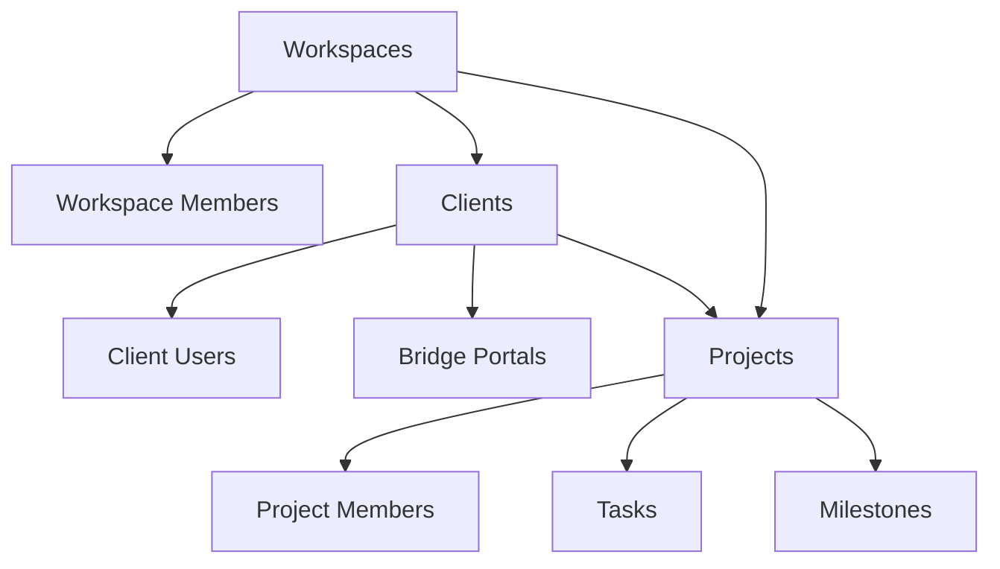

# 🛡️ Database Safety & Multi-Tenant Architecture

**Context:** You are working with a multi-tenant SaaS database with Row Level Security (RLS).
**CRITICAL:** One mistake here can expose client data across tenants. Follow these rules exactly.

---

## 1. 🚨 HARD CONSTRAINTS (Non-Negotiable)

### Security Rules (Never Violate)
```sql
-- ❌ NEVER disable RLS on tenant-scoped tables
ALTER TABLE workspaces DISABLE ROW LEVEL SECURITY;  -- FORBIDDEN

-- ❌ NEVER query without tenant context
SELECT * FROM clients;  -- DANGEROUS: Could expose all clients

-- ✅ ALWAYS include tenant scoping
SELECT * FROM clients
WHERE workspace_id IN (
  SELECT workspace_id FROM workspace_members WHERE user_id = auth.uid()
);
```

### Migration Rules
```sql
-- ❌ NEVER add foreign keys without considering cascades
ALTER TABLE projects ADD COLUMN workspace_id uuid REFERENCES workspaces(id);
-- Missing: What happens when workspace is deleted?

-- ✅ ALWAYS specify cascade behavior
ALTER TABLE projects
  ADD COLUMN workspace_id uuid
  REFERENCES workspaces(id) ON DELETE CASCADE;  -- Explicit behavior
```

---

## 2. 🏗️ Multi-Tenant Architecture Overview

### Tenant Hierarchy


### Core Entities & Relationships
```typescript
// Primary tenant boundary
workspaces {
  id: uuid (PK)
  owner_id: uuid -> auth.users.id
  slug: text (unique)
  // ... other fields
}

// Tenant membership
workspace_members {
  workspace_id: uuid -> workspaces.id ON DELETE CASCADE
  user_id: uuid -> auth.users.id ON DELETE CASCADE
  role: 'owner' | 'admin' | 'member' | 'viewer'
}

// Workspace's customers
clients {
  workspace_id: uuid -> workspaces.id ON DELETE CASCADE  // Tenant scoped
  slug: text (unique within workspace)
  // ... other fields
}

// Projects belong to both workspace AND client
projects {
  workspace_id: uuid -> workspaces.id ON DELETE CASCADE   // Tenant scoped
  client_id: uuid -> clients.id ON DELETE CASCADE   // Customer scoped
  // ... other fields
}
```

---

## 3. 🔐 Row Level Security (RLS) Patterns

### Workspace Member Access Pattern
**Most common pattern in the system:**
```sql
-- Pattern: "Workspace members can access their workspace's data"
CREATE POLICY "policy_name" ON table_name
FOR operation USING (
  workspace_id IN (
    SELECT workspace_id FROM workspace_members
    WHERE user_id = auth.uid()
  )
);
```

### Client User Access Pattern
```sql
-- Pattern: "Client users can access their own data"
CREATE POLICY "client_users_view_own_data" ON projects
FOR SELECT USING (
  client_id IN (
    SELECT client_id FROM client_users
    WHERE user_id = auth.uid()
  )
);
```

### Role-Based Access Pattern
```sql
-- Pattern: "Only admins and owners can modify"
CREATE POLICY "admins_can_manage" ON workspace_members
FOR ALL USING (
  workspace_id IN (
    SELECT workspace_id FROM workspace_members
    WHERE user_id = auth.uid()
    AND role IN ('owner', 'admin')
  )
);
```

---

## 4. 📋 Safe Migration Patterns

### Adding Tenant-Scoped Tables
```sql
-- ✅ Safe pattern for new tenant-scoped table
CREATE TABLE new_tenant_table (
  id uuid PRIMARY KEY DEFAULT gen_random_uuid(),
  workspace_id uuid NOT NULL REFERENCES workspaces(id) ON DELETE CASCADE,
  -- ... other columns
  created_at timestamptz DEFAULT now(),
  updated_at timestamptz DEFAULT now()
);

-- Add indexes immediately
CREATE INDEX new_tenant_table_workspace_id_idx ON new_tenant_table(workspace_id);

-- Enable RLS
ALTER TABLE new_tenant_table ENABLE ROW LEVEL SECURITY;

-- Add policies (use existing patterns)
CREATE POLICY "workspace_members_can_view" ON new_tenant_table
FOR SELECT USING (
  workspace_id IN (
    SELECT workspace_id FROM workspace_members WHERE user_id = auth.uid()
  )
);

CREATE POLICY "workspace_members_can_manage" ON new_tenant_table
FOR ALL USING (
  workspace_id IN (
    SELECT workspace_id FROM workspace_members
    WHERE user_id = auth.uid() AND role IN ('owner', 'admin', 'member')
  )
);
```

### Adding Non-Tenant Tables (Rare)
```sql
-- ⚠️ Only for truly global data (system settings, etc.)
CREATE TABLE global_settings (
  id uuid PRIMARY KEY DEFAULT gen_random_uuid(),
  key text NOT NULL UNIQUE,
  value jsonb,
  created_at timestamptz DEFAULT now()
);

-- Still enable RLS for safety
ALTER TABLE global_settings ENABLE ROW LEVEL SECURITY;

### June 2026 security baseline (do not regress)

Shipped in `migrations/20260610120000_security_remediation_batch.sql`. Full narrative: `docs/architecture/security-model.md`.

```sql
-- ❌ NEVER re-grant credit or audit RPCs to anon/authenticated
GRANT EXECUTE ON FUNCTION public.add_purchased_credits(uuid, integer) TO authenticated;

-- ❌ NEVER expose waitlist export view to PostgREST clients
GRANT SELECT ON public.waitlist_leads_sheet TO authenticated;

-- ❌ NEVER restore anon write on marketing pipeline tables
CREATE POLICY "Allow insert from anon" ON public.pipeline_runs ...;
```

**Locked to `service_role`:** `add_purchased_credits`, `deduct_ai_credits`, `reset_monthly_ai_credits`, `log_agent_operation`.

**Views:** `waitlist_leads_sheet` — `security_invoker`, SELECT `service_role` only.

**RLS:** `gmail_sync_logs` INSERT service role; `pipeline_runs` / `youtube_video_stats` service role when present; `client_intakes` public INSERT with field validation.

**Storage:** Public read on `user-assets`/`bridge-branding` is folder-scoped — do not widen to full-bucket SELECT.

-- Admin-only access
CREATE POLICY "admin_only" ON global_settings
FOR ALL USING (
  auth.uid() IN (
    SELECT user_id FROM workspace_members
    WHERE role = 'owner' AND workspace_id = 'system-admin-workspace-id'
  )
);
```

### Adding Columns Safely
```sql
-- ✅ Safe column addition
ALTER TABLE existing_table
ADD COLUMN new_column text;

-- ✅ Safe column with constraints
ALTER TABLE existing_table
ADD COLUMN status text DEFAULT 'active'
CHECK (status IN ('active', 'inactive', 'archived'));

-- ❌ DANGEROUS: Adding non-nullable columns to large tables
ALTER TABLE projects ADD COLUMN required_field text NOT NULL;
-- Can cause downtime! Use DEFAULT first, then remove it.

-- ✅ Safe approach for non-nullable columns
ALTER TABLE projects ADD COLUMN required_field text DEFAULT 'temp';
-- Deploy, update all rows, then:
ALTER TABLE projects ALTER COLUMN required_field DROP DEFAULT;
```

---

## 5. 🔍 Testing RLS Policies

### Pre-Migration Testing
```sql
-- Create test workspace and users
INSERT INTO auth.users (id, email) VALUES
  ('11111111-1111-1111-1111-111111111111', 'workspace1@example.com'),
  ('22222222-2222-2222-2222-222222222222', 'workspace2@example.com');

INSERT INTO workspaces (id, owner_id, name, slug) VALUES
  ('aaaaaaaa-aaaa-aaaa-aaaa-aaaaaaaaaaaa', '11111111-1111-1111-1111-111111111111', 'Workspace 1', 'workspace-1'),
  ('bbbbbbbb-bbbb-bbbb-bbbb-bbbbbbbbbbbb', '22222222-2222-2222-2222-222222222222', 'Workspace 2', 'workspace-2');

INSERT INTO workspace_members (workspace_id, user_id, role, email) VALUES
  ('aaaaaaaa-aaaa-aaaa-aaaa-aaaaaaaaaaaa', '11111111-1111-1111-1111-111111111111', 'owner', 'workspace1@example.com'),
  ('bbbbbbbb-bbbb-bbbb-bbbb-bbbbbbbbbbbb', '22222222-2222-2222-2222-222222222222', 'owner', 'workspace2@example.com');

-- Test isolation: User 1 should NOT see Workspace 2's data
SET session.user_id = '11111111-1111-1111-1111-111111111111';
SELECT * FROM workspaces;  -- Should only return Workspace 1

SET session.user_id = '22222222-2222-2222-2222-222222222222';
SELECT * FROM workspaces;  -- Should only return Workspace 2
```

### RLS Testing Queries
```sql
-- Test that users can only see their workspace's clients
SELECT
  c.name as client_name,
  s.name as workspace_name
FROM clients c
JOIN workspaces s ON c.workspace_id = s.id;

-- Should return results based on auth.uid()'s workspace membership only
```

---

## 6. 🔧 Safe Data Access Patterns

### Using Server-Side Supabase Client
```typescript
// ✅ Always use server client for RLS enforcement
import { createClient } from "@/app/_lib/supabase/server"

export async function getWorkspaceClients(workspaceId: string) {
  const supabase = await createClient()

  // RLS automatically filters to current user's accessible workspaces
  const { data, error } = await supabase
    .from('clients')
    .select('*')
    .eq('workspace_id', workspaceId)  // Additional safety check

  if (error) throw error
  return data
}
```

### DANGEROUS: Bypassing RLS
```typescript
// ❌ NEVER use admin client for regular operations
import { createAdminClient } from "@/app/_lib/supabase/admin"

export async function dangerousOperation() {
  const supabase = createAdminClient()  // ❌ Bypasses RLS!

  // This could return ALL clients across ALL workspaces
  const { data } = await supabase.from('clients').select('*')
  return data
}

// ✅ Only use admin client for system operations
export async function systemMaintenance() {
  // Only in system admin context, not user-facing operations
  const supabase = createAdminClient()
  // ... system-level operations only
}
```

---

## 7. 📊 Common Tables & Their RLS Patterns

### Workspaces Table
```sql
-- Users can only see workspaces they're members of
CREATE POLICY "workspace_members_view_workspace" ON workspaces
FOR SELECT USING (
  id IN (
    SELECT workspace_id FROM workspace_members WHERE user_id = auth.uid()
  )
);

-- Only owners can update workspace settings
CREATE POLICY "owners_update_workspace" ON workspaces
FOR UPDATE USING (owner_id = auth.uid());
```

### Clients Table
```sql
-- Workspace members can view clients in their workspace
CREATE POLICY "workspace_members_view_clients" ON clients
FOR SELECT USING (
  workspace_id IN (
    SELECT workspace_id FROM workspace_members WHERE user_id = auth.uid()
  )
);

-- Workspace members can manage clients
CREATE POLICY "workspace_members_manage_clients" ON clients
FOR ALL USING (
  workspace_id IN (
    SELECT workspace_id FROM workspace_members
    WHERE user_id = auth.uid() AND role IN ('owner', 'admin', 'member')
  )
);
```

### Projects Table (Dual Scoping)
```sql
-- Workspace members can view projects in their workspace
CREATE POLICY "workspace_members_view_projects" ON projects
FOR SELECT USING (
  workspace_id IN (
    SELECT workspace_id FROM workspace_members WHERE user_id = auth.uid()
  )
);

-- Client users can view their own projects
CREATE POLICY "client_users_view_projects" ON projects
FOR SELECT USING (
  client_id IN (
    SELECT client_id FROM client_users WHERE user_id = auth.uid()
  )
);
```

---

## 8. 🚨 Emergency Procedures

### If RLS is Accidentally Disabled
```sql
-- Immediately re-enable RLS
ALTER TABLE table_name ENABLE ROW LEVEL SECURITY;

-- Check all tables
SELECT
  schemaname,
  tablename,
  rowsecurity,
  hasrls
FROM pg_tables
WHERE schemaname = 'public'
AND hasrls = false;  -- Tables without RLS

-- Should return empty if all tenant-scoped tables have RLS
```

### If Bad Migration is Deployed
```sql
-- Quick rollback strategy
BEGIN;

-- Revert the problematic changes
-- (Have rollback SQL ready before deploying)

-- Test RLS still works
SET session.user_id = 'test-user-id';
SELECT count(*) FROM sensitive_table;  -- Should be scoped

COMMIT;  -- Only if tests pass
```

---

## 9. 💡 Performance Considerations

### RLS Policy Performance
```sql
-- ❌ Slow: Nested subqueries in policies
CREATE POLICY "slow_policy" ON projects USING (
  EXISTS (
    SELECT 1 FROM workspace_members sm
    JOIN workspaces s ON s.id = sm.workspace_id
    WHERE sm.user_id = auth.uid()
    AND s.id = projects.workspace_id
  )
);

-- ✅ Fast: Use IN with subquery (PostgreSQL optimizes this)
CREATE POLICY "fast_policy" ON projects USING (
  workspace_id IN (
    SELECT workspace_id FROM workspace_members
    WHERE user_id = auth.uid()
  )
);
```

### Index Requirements
```sql
-- ✅ Always index tenant boundary columns
CREATE INDEX table_name_workspace_id_idx ON table_name(workspace_id);
CREATE INDEX table_name_client_id_idx ON table_name(client_id);

-- ✅ Index user lookup columns
CREATE INDEX workspace_members_user_id_idx ON workspace_members(user_id);
CREATE INDEX client_users_user_id_idx ON client_users(user_id);
```

---

## 10. ✅ Pre-Deploy Checklist

Before any migration that touches tenant data:

- [ ] **RLS Enabled:** All new tables have `ENABLE ROW LEVEL SECURITY`
- [ ] **Policies Created:** At least SELECT policy exists for new tables
- [ ] **Foreign Keys:** All tenant references have `ON DELETE CASCADE`
- [ ] **Indexes Added:** Tenant boundary columns are indexed
- [ ] **Test Data:** Created test workspaces/users to verify isolation
- [ ] **Rollback Plan:** Written rollback SQL and tested it
- [ ] **Performance:** Checked that policies use efficient patterns

**Remember:** In multi-tenant systems, security bugs are data breaches. When in doubt, ask for a security review.

---

## 11. 🤖 Database Keeper Agent Integration

The `database-keeper` agent provides AI-assisted database operations with strict security controls. It's designed to help Ralph and other agentic workflows explore the schema, audit RLS, and draft migrations safely.

### Tiered Access Model

| Tier | Operations | Description |
|------|------------|-------------|
| **1 (Default)** | Read-Only | Schema exploration, RLS auditing, query analysis |
| **2 (Explicit)** | Draft-Only | Migration authoring - drafts SQL for human review |
| **3 (Never)** | Production Write | Human-only - no agent access |

### Commands

```bash
# Tier 1: Read-only exploration
/database explore "How are client documents stored?"
/database analyze "SELECT * FROM projects WHERE workspace_id = $1"
/database audit
/database audit --table intelligence_events

# Tier 2: Migration drafting (human executes)
/database migration "Add notifications table for clients"
```

### When to Use

**Do use database-keeper for:**
- Schema exploration before feature development
- RLS policy audits
- Query performance analysis
- Migration template generation
- Pre-implementation research (Ralph Phase 0)

**Do NOT use for:**
- Direct production data modifications
- Bypassing RLS for debugging
- Emergency data fixes (use human DBA)
- Any destructive operations

### Audit Logging

All agent operations are logged to `agent_audit_log`:

```sql
-- View recent agent operations
SELECT
  agent_id,
  operation_type,
  operation_tier,
  target_tables,
  result_status,
  created_at
FROM agent_audit_log
WHERE agent_id = 'database-keeper'
ORDER BY created_at DESC
LIMIT 20;

-- Find failed/denied operations
SELECT *
FROM agent_audit_log
WHERE result_status != 'success'
ORDER BY created_at DESC;
```

### Migration Workflow with Agent

1. **Ralph or user requests schema change**
2. **`/database explore`** to analyze existing patterns
3. **`/database migration`** to draft SQL (staged in `.claude/ralph/migrations/`)
4. **Human reviews** the generated migration
5. **Human executes** `pnpm dlx supabase db push`
6. **Agent logs** outcome to audit table

### Security Invariants

The database-keeper agent MUST:
- [ ] Never execute DDL without human approval
- [ ] Always include tenant scoping in example queries
- [ ] Log all operations to `agent_audit_log`
- [ ] Refuse Tier 2 operations unless explicitly requested
- [ ] Never access production database directly
- [ ] Follow all patterns from this CLAUDE.md

### Integration with Ralph

When Ralph is building a feature that requires database changes:

```
Ralph → calls /database explore "relevant patterns"
      ↓
database-keeper → returns schema analysis + patterns
      ↓
Ralph → drafts migration following patterns
      ↓
Ralph → calls /database migration --validate
      ↓
database-keeper → validates against rules, returns issues
      ↓
Human → reviews and approves
      ↓
Human → pnpm dlx supabase db push
```

This ensures Ralph can build database-backed features while maintaining human oversight over all schema changes.

---

## 12. 🤝 Related Agents

### payment-keeper Agent

The `payment-keeper` agent follows the same tiered permission model for Stripe payment operations:

- **Tier 1:** Read-only (audit, monitor, analyze)
- **Tier 2:** Draft-only (refund proposals, Radar rule recommendations)
- **Tier 3:** Human-only (actual refunds, payouts, cancellations)

**See:** `.claude/agents/payment-keeper.md` and `/payment` command.

**Key Difference:** While `database-keeper` protects data integrity, `payment-keeper` protects financial operations. Both use the same "observe → draft → human-execute" pattern.